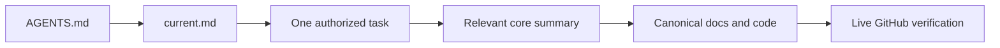

# 🧭 AI context system

**Purpose:** concise, reviewable, evidence-based continuity for parallel Tio Money agents. Not a chat archive, autonomous permission system or substitute for live repository inspection.

| Read | Use |
|---|---|
| [`../AGENTS.md`](../AGENTS.md) | Mandatory operating, permission and financial contract |
| [`current.md`](current.md) | Compact **multi-task** index; not a single-agent lock or live GitHub truth |
| [`core/`](core/README.md) | Small routing summaries linked to authoritative `docs/` |
| [`tasks/`](tasks/README.md) | Per-task scope, verified session history and handoff |
| [`agents/`](agents/README.md) | Identity and provenance rules |
| [`archive/`](archive/README.md) | Verified completed history, never speculative work |
| [Decision register](../docs/DECISIONS.md) | Approved owner decisions / unresolved proposals |

## One-task context path

### Concurrency

- Every task owns a separate task file and a single bounded branch/PR scope.
- `current.md` indexes multiple tasks; it **does not grant exclusive locks**, assign unknown work or prove merge status.
- Before edits, compare live branches, PRs and changed paths; coordinate any overlapping files, especially this index.
- Record only known agent identity, tests and commit SHAs; use `UNKNOWN_NOT_VERIFIED` for unknown historical information.
- Keep credentials, OTPs, personal finance data, raw logs and chat transcripts out of Git.
- On handoff, record last verified state and an exact next action, then let the next agent revalidate.

**Scope:** Governance documentation only. App implementation remains separately authorized and review-gated.
