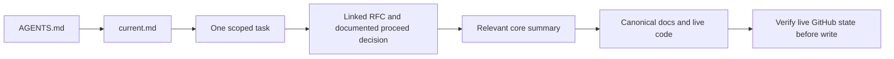

# 🧭 AI context system

**Purpose:** concise, reviewable, evidence-based continuity for parallel Tio Money agents. Not a chat archive, autonomous permission system or substitute for live repository inspection.

| Read | Use |
|---|---|
| [`../AGENTS.md`](../AGENTS.md) | Mandatory operating, permission and financial contract |
| [`current.md`](current.md) | Compact **multi-task** index; not a single-agent lock or live GitHub truth |
| [`core/`](core/README.md) | Small routing summaries linked to authoritative `docs/` |
| [`discussions/`](discussions/README.md) | Mandatory pre-implementation RFC, alternatives, threats and recorded proceed decision; owner signoff optional |
| [`tasks/`](tasks/README.md) | Task state gates, scoped work, verified history and handoff |
| [`agents/`](agents/README.md) | Identity and provenance rules |
| [`archive/`](archive/README.md) | Verified completed history, never speculative work |
| [GitHub governance](../.github/README.md) | Issue/RFC forms, PR evidence, read-only CI, independent review and manual post-merge guide |
| [Decision register](../docs/DECISIONS.md) | Approved owner decisions / unresolved proposals |

## One-task context path

### Concurrency

- Every substantial task must have a durable [discussion/RFC](discussions/README.md) and **documented decision to proceed** before `IN_PROGRESS`. Owner implementation signoff is optional except for separately restricted operations. **Independent review is optional by default** (recommended for finance/security/privacy/auth/migrations/platform); record its status and preserve blocking findings and GitHub-required reviews. **Action-specific owner merge permission** is mandatory for every PR, and an agent may merge only after verification of that permission and required GitHub protections.
- Every task owns a separate task file and a single bounded branch/PR scope.
- `current.md` indexes multiple tasks; it **does not grant exclusive locks**, assign unknown work or prove merge status.
- Before edits, compare live branches, PRs and changed paths; coordinate any overlapping files, especially this index.
- Record only known agent identity, tests and commit SHAs; use `UNKNOWN_NOT_VERIFIED` for unknown historical information. **No Git `Co-authored-by:` trailers for any agent or contributor; identities belong in task records.**
- Keep credentials, OTPs, personal finance data, raw logs and chat transcripts out of Git.
- On handoff, record last verified state, discussion/approval, reviewed SHA and an exact next action, then let the next agent revalidate.
- For safe nested task creation and archival, use the [stdlib link helper](../scripts/ai_context.py) with dry-run and fixture tests; it **does not verify** GitHub approvals.

**Scope:** These documents define governance, not a blanket grant for restricted actions, financial semantics, deployment or merge. [Owner decisions TM-DEC-002/003](../docs/DECISIONS.md) govern optional independent review and expressly authorized agent merge. **No permission to merge PR #2 was granted** by updating these documents.
