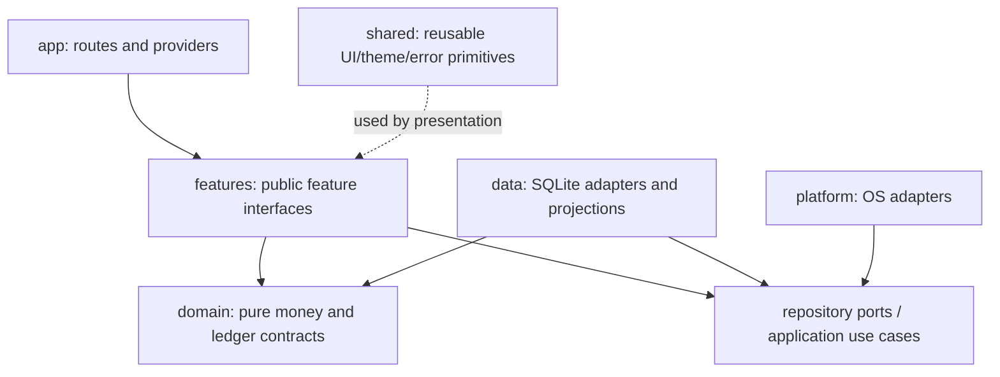

# 🧩 Feature isolation and dependency contracts

**Status:** Proposed logical boundaries for a separately authorized implementation task. [Technical architecture](../../docs/05-TECH-ARCHITECTURE.md) is canonical. [Phase 0 PR #1](https://github.com/im-tnyx/Tio-Money/pull/1) contains a **parallel, unmerged scaffold**; reconcile its real folders and public interfaces before applying these names as physical paths.

## Logical shape (not files to create in this PR)

```text
src/
├── app/                # Expo Router route composition, no business logic
├── features/
│   ├── onboarding/
│   ├── dashboard/
│   ├── transactions/
│   ├── accounts/
│   ├── categories/
│   ├── reports/
│   ├── imports/
│   └── settings/
├── domain/
│   ├── money/          # Validated safe-integer paise
│   ├── ledger/         # Single canonical journal / projections contract
│   └── contracts/
├── data/
│   ├── sqlite/         # Repositories, migrations and transactional writes
│   └── projections/    # Ledger-derived read models
├── platform/
│   ├── file-import/
│   ├── sms/            # Disabled in Expo Go; separate native gate
│   └── security/
└── shared/
    ├── ui/
    ├── theme/
    ├── i18n/
    ├── errors/
    └── utils/
```

The observed Phase 0 PR currently has `src/features/common/`, `src/shared/bootstrap/`, `src/platform/sms/`, `src/domain/ledger/` and `src/data/sqlite/`. No new modules are authorized here; avoid speculative empty directories.

## Direction of dependency



| Module | Owns | May depend on | Must not do |
|---|---|---|---|
| `app/` | Navigation and root providers | Feature public APIs, shared shell | Business calculations or SQL |
| `features/<name>/` | Feature UI, controller, use cases, tests, public `index.ts` | Domain/ports/shared | Deep-import siblings, duplicate ledger engines |
| `domain/` | Pure money types, balanced journal and rules | Domain-local pure contracts | Import React, Expo, SQLite, navigation or OS modules |
| `data/` | Persistent repository adapters, SQL, canonical projections | Domain/ports | Import visual components or store authoritative balance snapshots |
| `platform/` | Native/file/SMS/security adapters behind capabilities | Ports and OS APIs as authorized | Leak native permissions into Expo Go or bypass review |
| `shared/` | Non-business design primitives, formatting, errors | Pure cross-cutting modules | Hide transaction business rules in generic helpers |

### Allowed and forbidden examples

- **Allowed:** `features/transactions` submits `CreateLedgerEvent` through a domain/application port; `features/accounts` and `features/reports` consume the **same** journal-derived projection.
- **Forbidden:** Transactions imports `features/accounts/screens/account-editor.tsx`; Reports computes a second running ledger; a screen calls `db.runAsync()`; UI directly mutates `currentBalance`; a shared formatting helper branches on a transfer fee.
- Cross-feature calls require a deliberately exported public API, not `../../other-feature/private/*`. Avoid circular dependencies and feature-specific state inside global stores.
- No feature may change another feature's internals during a scoped task without explicit review/coordination.
- Financial rules (asset/liability, postings, reversals, paise, fees) are **shared domain invariants**, not each feature's property.

### Enforceability proposal — **not implemented here**

In a **separately approved** code task, add ESLint `no-restricted-imports` / import-boundaries configuration for private `features/*/` paths, `src/domain` forbidden platform imports and UI forbidden `data/sqlite` paths. Test rules with deliberate violating fixtures; avoid blanket patterns that block legitimate type-only/public port imports. Phase 0 PR already proposes lint boundaries; review its actual config before changing anything.
