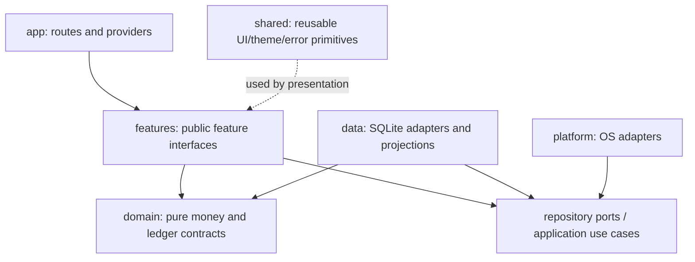

# 🧩 Feature isolation and dependency contracts

**Status (2026-11-21):** Proposed logical boundaries for separately authorized Stage 1 implementation. [Technical architecture](../../docs/architecture/TECH-ARCHITECTURE.md) is canonical; [Phase 0 PR #1](https://github.com/im-tnyx/Tio-Money/pull/1) is **MERGED**, not a parallel draft. Source inspection at current main confirms four routes (`index`, `transactions`, `reports`, `accounts`) export `BlankScreen` while `more.tsx` exports `MoreRoute` (`useMoreViewModel` controller + dumb `MoreScreen` presentation); layout/providers own boot/navigation wiring outside feature screens. The owner now mandates [strict dumb-screen boundaries](../../docs/architecture/DUMB-SCREEN-BOUNDARIES.md) (TM-DEC-011); paths in the example below are still a future proposal, not new files.

## Logical shape (not files to create in this PR)

```text
src/
├── app/                # Expo Router route composition, no business logic
├── features/
│   ├── onboarding/
│   ├── dashboard/
│   ├── transactions/
│   ├── accounts/
│   ├── categories/
│   ├── reports/
│   ├── imports/
│   └── settings/
├── domain/
│   ├── money/          # Validated currency-specific integer minor units (INR paise)
│   ├── ledger/         # Single canonical journal / projections contract
│   └── contracts/
├── data/
│   ├── sqlite/         # Repositories, migrations and transactional writes
│   └── projections/    # Ledger-derived read models
├── platform/
│   ├── file-import/
│   ├── sms/            # Disabled in Expo Go; separate native gate
│   └── security/
└── shared/
    ├── ui/
    ├── theme/
    ├── i18n/
    ├── errors/
    └── utils/
```

Verified merged Phase 0 source includes `src/features/common/`, `src/shared/bootstrap/`, `src/platform/sms/`, `src/domain/ledger/` and `src/data/sqlite/`. This docs task does **not** create new modules; avoid speculative empty directories.

## Mandatory screen/container/controller split (owner TM-DEC-011)

Every screen is **props-to-JSX only**. Do not allow workflow hooks, navigation functions, SQL/repository, network/FX, domain services, balance/fee calculation, platform permission or side effects in screens, even through an imported shared UI helper. `app/` routes perform static composition, `features/<name>/controllers` / hooks own navigation+view state, use cases execute approved workflows, pure `domain/ledger` owns financial rules, and data adapters own SQL. An immutable typed ViewModel and callback interface is the **only runtime interaction boundary** across feature screens. See [12 — Dumb-Screen Contract](../../docs/architecture/DUMB-SCREEN-BOUNDARIES.md) with negative-fixture acceptance `TM-PRES-001–006`; rules need a distinct code task to become **enforced CI**, not merely docs.

## Direction of dependency



| Module | Owns | May depend on | Must not do |
|---|---|---|---|
| `app/` | Navigation and root providers | Feature public APIs, shared shell | Business calculations or SQL |
| `features/<name>/` | Feature UI, controller, use cases, tests, public `index.ts` | Domain/ports/shared | Deep-import siblings, duplicate ledger engines |
| `domain/` | Pure money types, balanced journal and rules | Domain-local pure contracts | Import React, Expo, SQLite, navigation or OS modules |
| `data/` | Persistent repository adapters, SQL, canonical projections | Domain/ports | Import visual components or store authoritative balance snapshots |
| `platform/` | Native/file/SMS/security adapters behind capabilities | Ports and OS APIs as authorized | Leak native permissions into Expo Go or bypass review |
| `shared/` | Non-business design primitives, formatting, errors | Pure cross-cutting modules | Hide transaction business rules in generic helpers |

### Allowed and forbidden examples

- **Allowed:** `features/transactions` submits `CreateLedgerEvent` through a domain/application port; `features/accounts` and `features/reports` consume the **same** journal-derived projection.
- **Forbidden:** Transactions imports `features/accounts/screens/account-editor.tsx`; Reports computes a second running ledger; a screen calls `db.runAsync()`; UI directly mutates `currentBalance`; a shared formatting helper branches on a transfer fee.
- Cross-feature calls require a deliberately exported public API, not `../../other-feature/private/*`. Avoid circular dependencies and feature-specific state inside global stores.
- No feature may change another feature's internals during a scoped task without explicit review/coordination.
- Financial rules (asset/liability, postings, reversals, paise, fees) are **shared domain invariants**, not each feature's property.

## Feature-level contract (apply to future authorized implementation)

Each independently owned feature must document: **task/owner**, public API surface (and explicitly private implementation paths), user intents and feature-specific application use cases, relevant domain/repository contracts, permitted upstream/downstream dependencies, feature-local test ownership, and linked task/RFC history. Put only durable API/ownership notes in the feature README or canonical architecture; **do not create empty directories now**.

| Feature / boundary | Public contract direction | Private implementation and test owner |
|---|---|---|
| Onboarding | Produces account/setup commands through validated domain ports | Setup screens and first-run UX tests; never writes ledger directly in components |
| Transactions | Exposes create/revise/reverse event use cases to route composition | Editor/controllers and submission tests; posts through **single** shared ledger |
| Accounts | Exposes account commands and ledger-derived account projections | Account UI/tests; no mutable balance calculations |
| Categories | Exposes stable category IDs and classification contracts | Category editing/testing; labels not stored as financial IDs |
| Dashboard / Reports | Consume read-only ledger projections, not raw SQL in UI | Rendering, period/filter and reconciliation tests |
| Imports | Produces **unposted** review candidates until user confirmation | Parser/dedupe tests and platform permission boundaries |
| Settings | Exposes implemented user preferences only, no fake cloud/SMS capabilities | Settings, privacy and accessibility UI tests |

**Allowed:** an Accounts view consumes `LedgerReadModel` exported by an approved contract; Transactions calls a ledger use case; Reports consumes that **same** ledger posting projection. **Forbidden:** Dashboard deep-imports Transactions editor internals, Reports runs its own fee math or SQL, shared UI contains money business rules, or features mutate another feature's scoped files without coordination. Route composition must not become an application service locator full of business logic.

For every proposed boundary change, the mandatory [RFC](../discussions/README.md) records owner/ports/import direction, alternatives, dependency-cycle risk and negative tests. Any new contract affecting financial math needs a separately approved domain decision.

### Enforceability proposal — **not implemented here**

In a **separately approved** code task, add architecture boundary tests and ESLint `no-restricted-imports` / import-boundaries configuration for private `features/*/` paths, `src/domain` forbidden platform imports and UI forbidden `data/sqlite` paths. Test rules with deliberate violating fixtures; avoid blanket patterns that block legitimate type-only/public port imports. Phase 0 PR already proposes lint boundaries; review its actual config before changing anything.
