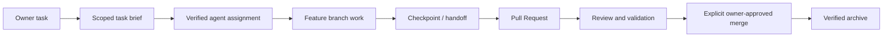

# 🔄 Task, branch, review and handoff workflow

**Canonical:** [AGENTS](../../AGENTS.md) · [task guide](../tasks/README.md) · [template](../tasks/TEMPLATE.md) · [current index](../current.md).

1. Verify repository, latest base SHA, branch, PR, checked ownership and current instructions.
2. Record stable task ID, current agent/model if exposed, prior verified agent (else `UNKNOWN_NOT_VERIFIED`), UTC times, scope and approval reference.
3. Work only in assigned branch. Never push to `main`, edit parallel branches or overwrite shared docs without coordination.
4. Checkpoint exact changed files, test commands/results, inspected HEAD, decisions, failures, next action and prohibited changes.
5. PR creation/review is a gate; a green job, agent comment or PR author is **not** a merge approval.
6. Obtain separate owner merge approval. After merge, verify GitHub state, final SHA and remaining risks; only then archive and reconcile `current.md`.
7. If task stops midflight, retain it as Active/Blocked/Review; a stopped session is **not** completion.

`current.md` is a **multi-task index**, not an exclusive lock. One task owns its own durable record; concurrent agents must coordinate overlapping files and reread live refs on each write. Never claim identity or passing tests from commit author metadata.
