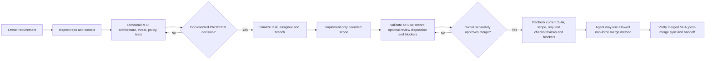

# 🔄 Discussion-first task, review and agent handoff workflow

**Canonical:** [Root agent contract](../../AGENTS.md) · [RFC guide](../discussions/README.md) · [Task state machine](../tasks/README.md) · [Task template](../tasks/TEMPLATE.md) · [Current multi-task index](../current.md) · [GitHub review and CI](../../.github/README.md).

1. Read `AGENTS.md`, `.ai/current.md`, assigned task and **linked durable RFC/decisions**; inspect live repo/branch/PR and actual source. No blanket task creation or code writes merely because a plan exists.
2. Record product purpose, error paths, module ownership, dependency directions, applicable security/OS policy, alternatives/trade-offs, testable acceptance, rollback and outstanding decisions in GitHub Issue/Discussion/existing PR. Use [discussion template](../discussions/TEMPLATE.md).
3. No `IN_PROGRESS` until the durable RFC contains a documented decision to **PROCEED** with date, source, scope and conditions, and confirmed agent/feature ownership, branch, non-goals and tests. **Owner implementation signoff is optional**, but unresolved material restricted-operation risks block progress. New scope/risk returns to discussion; routine bounded subtasks may continue.
4. Work only on the verified, scoped feature branch after the documented proceed decision. No direct `main` commits, editing concurrent PR branches, unapproved schema/permissions/security changes or force-push. Merge and auto-merge remain forbidden without **separate action-specific owner authorization**.
5. Record exact commands/results, tested SHA, review disposition `PERFORMED / SKIPPED / UNAVAILABLE / DEFERRED` and rationale. **Independent review is optional by default**, strongly recommended for ledger, migration, security/privacy, authentication and sensitive platform work. If performed, record reviewer, type/verdict and reviewed SHA. Never fabricate passing review; preserve known blocking findings and comply with actual GitHub-required reviewers/checks. Material changes invalidate stale review/authorization.
6. Require **distinct express owner merge authorization naming repository, specific PR, permission to merge and conditions**. An agent may perform a **non-force merge only after** authenticating the instruction, re-fetching base `main` and HEAD, confirming configured checks/protections and no unresolved blocking findings, and verifying authorized scope is unchanged. Renew permission for material changes or unclear conditions; **separate explicit permission** to enable auto-merge. After confirmed GitHub merge/merge SHA, use the [post-merge procedure](../../.github/POST-MERGE-SYNC.md), then update provenance/index and archive only after verified terminal status.
7. Before PR/merge review, inspect the actual commit message range and **reject every `Co-authored-by:` trailer** (Claude, Codex, Cursor, ChatGPT or any contributor). Use `python3 scripts/ai_context.py check-commits --base <base> --head <head>` in a real local Git checkout. Never spoof commit author; agent/model attribution belongs **only** in task provenance. A [read-only governance workflow](../../.github/workflows/ai-governance-checks.yml) is proposed on PR #2, but it is **not** a trusted required branch-protection check or proof of merge authorization until explicitly configured and independently verified.
8. Append handoff checkpoints; current/previous verified working agents, Git commit author, PR author, reviewer and owner remain distinct. Do not overwrite old records or infer model from commit metadata.

No template checkbox or Python helper verifies the owner's identity, reviews or GitHub status by itself. Concurrency requires live source verification on every shared-file write. Product/language/financial contracts remain under their canonical owner documents.
