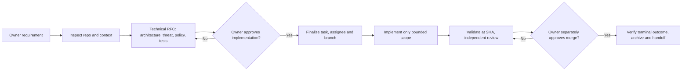

# 🔄 Discussion-first task, review and agent handoff workflow

**Canonical:** [Root agent contract](../../AGENTS.md) · [RFC guide](../discussions/README.md) · [Task state machine](../tasks/README.md) · [Task template](../tasks/TEMPLATE.md) · [Current multi-task index](../current.md).

1. Read `AGENTS.md`, `.ai/current.md`, assigned task and **linked durable RFC/decisions**; inspect live repo/branch/PR and actual source. No blanket task creation or code writes merely because a plan exists.
2. Record product purpose, error paths, module ownership, dependency directions, applicable security/OS policy, alternatives/trade-offs, testable acceptance, rollback and outstanding decisions in GitHub Issue/Discussion/existing PR. Use [discussion template](../discussions/TEMPLATE.md).
3. No `IN_PROGRESS` until an explicit owner `APPROVED_FOR_IMPLEMENTATION` is recorded with decision source, date, scope and conditions, and **confirmed** feature owner, branch, non-goals and tests. New scope or material risks renew discussion; routine approved subtasks can continue.
4. Work only on the approved isolated feature branch. No direct `main` commits, editing concurrent PR branches, unapproved schema/permissions/security changes, force-push or automatic merge.
5. Record exact commands/results, tested SHA, independent reviewer, review type/verdict/severity and outstanding threads. `COMMENTED` is not formal approval; reviewer outage/quota failure is `INCONCLUSIVE`, not code failure or review pass. Re-review after material changes.
6. Require **distinct express owner merge permission** before merge. After verified terminal outcome, move to archive only with [link repair](../archive/README.md), provenance/risks and `.ai/current.md` index reconciliation.
7. Append handoff checkpoints; current/previous verified working agents, Git commit author, PR author, reviewer and owner remain distinct. Do not overwrite old records or infer model from commit metadata.

No template checkbox or Python helper verifies the owner's identity, reviews or GitHub status by itself. Concurrency requires live source verification on every shared-file write. Product/language/financial contracts remain under their canonical owner documents.
