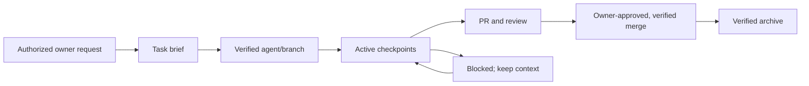

# 📋 Task records and durable checkpoints

Use **one Markdown task file per independently scoped owner request**. Suggested path: `.ai/tasks/<area>/<stable-task-id-or-slug>.md`. Never fabricate completed historical tasks, sessions or agents.

## Lifecycle

- **Planned:** brief recorded; no work claimed. **Active:** bounded work ongoing. **Blocked:** next action needs external resolution. **Review:** PR open or acceptance pending. **Completed:** independently verified terminal state, never merely "agent stopped."
- Copy [TEMPLATE.md](TEMPLATE.md) into a scoped task. Use [`current.md`](../current.md) to link it, along with branch, PR, owner, status and last verified checkpoint.
- Each session appends a short checkpoint with verified agent/model, previous verified agent, checked HEAD/base, UTC timestamps, actual changed files, tests and exact next safe action.
- Agents may be replaced. Write what was requested, completed, failed, unfinished, changed, tested, blocked, prohibited and where to resume.
- Do **not** assume a merge from stale context. Check actual PR and resulting target-branch SHA before [archiving](../archive/README.md).
- Do **not** overwrite another agent's record; coordinate same-task ownership and shared-index edits before writing. GitHub PR history is not equivalent to agent identity.
- No full transcripts, secrets, credentials, unredacted financial data or enormous diffs.

[Root contract](../../AGENTS.md) · [Agent identity](../agents/README.md) · [Workflow](../core/workflow-rules.md)
