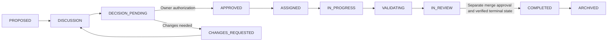

# 📋 Task lifecycle and durable checkpoints

[Agent contract](../../AGENTS.md) · [Discussion/RFC gate](../discussions/README.md) · [Task template](TEMPLATE.md) · [Current task index](../current.md)

> **No implementation task enters `IN_PROGRESS` without a reviewable discussion and an explicit, bounded owner `APPROVED_FOR_IMPLEMENTATION` decision.** A PR, roadmap, task note, bot review or chat summary alone is not approval. The owner must separately approve **merging**.

Each substantial task has exactly one stable task ID and one scoped task file under `.ai/tasks/<area>/<slug>.md`, plus links to its durable GitHub Issue/Discussion/existing PR RFC and canonical decisions. Do not fabricate sessions, past approval or agent identity.

## Lifecycle and evidence gates

| Transition | Minimum verified evidence |
|---|---|
| `PROPOSED → DISCUSSION` | Stable task ID, bounded problem, intended user/product impact and actual repository state |
| `DISCUSSION → DECISION_PENDING` | Persistent RFC URL covering functional architecture, threat/policy review, alternatives, failure paths, test acceptance and open questions |
| `DECISION_PENDING → APPROVED` | Owner explicitly records `APPROVED_FOR_IMPLEMENTATION` with source, UTC/date, scope, exclusions, risk/conditions; *not* merge approval |
| `APPROVED → ASSIGNED` | Verified current agent/ownership, linked RFC and approval, working branch/base HEAD, conflicts resolved |
| `ASSIGNED → IN_PROGRESS` | Reverified approval, scope/owner/branch and discussion, settled blocking decisions, tests defined |
| `IN_PROGRESS → VALIDATING` | Implementation diff and checked SHA, commands + actual results, known limitations |
| `VALIDATING → IN_REVIEW` | PR URL + current inspected SHA, independent review requested, severity and remaining findings recorded |
| `IN_REVIEW → COMPLETED` | Actual reviewed SHA, applicable checks and findings addressed (or documented owner-approved deferral); separately authorized merge when required, verified terminal GitHub state and residual risks |
| `COMPLETED → ARCHIVED` | Verified terminal outcome, retained agent/checkpoint/PR history, repaired inbound and outbound links, index reconciled |

**Allowed exceptional transitions:** `PROPOSED → CANCELLED`; `DISCUSSION → DEFERRED/CANCELLED`; `DECISION_PENDING → CHANGES_REQUESTED/DEFERRED/BLOCKED/CANCELLED`; `CHANGES_REQUESTED → DISCUSSION/CANCELLED`; `APPROVED → DISCUSSION/CANCELLED`; `ASSIGNED → BLOCKED/DISCUSSION/CANCELLED`; `IN_PROGRESS → BLOCKED/DISCUSSION/CANCELLED`; `VALIDATING → IN_PROGRESS/BLOCKED`; `IN_REVIEW → IN_PROGRESS/BLOCKED`; `BLOCKED → DISCUSSION/DECISION_PENDING/ASSIGNED/IN_PROGRESS/IN_REVIEW/CANCELLED`; `DEFERRED → DISCUSSION/CANCELLED`. No work may resume from `BLOCKED` without rechecking the prior approval, risk, ownership and branch gates. `CANCELLED` and `ARCHIVED` are terminal.

Return to **DISCUSSION** if a new feature, meaningful scope expansion, financial/accounting semantic change, material security/policy risk or architecture direction change appears. Routine subtasks under an already approved *bounded* scope need not solicit the same approval again.

**Decision vocabulary** (distinct from lifecycle): `APPROVED_FOR_IMPLEMENTATION`, `CHANGES_REQUESTED`, `DEFERRED`, `REJECTED`, `BLOCKED_PENDING_DECISION`. A rejected task remains non-implementable/cancelled as appropriate; never treat a negative decision as a transition to `APPROVED`.

## Create, hand off and archive safely

1. Inspect actual repository PR/branch state, then copy the [template](TEMPLATE.md) to a scoped folder with **recalculated relative links**. The original template's links are relative to `.ai/tasks/`; copying verbatim to `.ai/tasks/<area>/` breaks them.
2. Prefer the approved stdlib helper (default **dry-run**): `python3 scripts/ai_context.py create-task --scope governance --slug my-task`; after inspection add `--apply`. It rebases links and validates local targets before writing. Use `--repo-root PATH` when not in repository root. Manually fill fields and index the task.
3. Before archival, verify terminal PR/owner status; inspect the dry run: `python3 scripts/ai_context.py archive-task --task .ai/tasks/governance/my-task.md --year 2026`. After independent verification, `--apply --verified-terminal` rewrites outgoing links in the moved task and incoming links from indexed docs/registry/decisions. The flag is only an **operator assertion**, **not** a GitHub approval check.
4. Review the diff, validate local links (`python3 scripts/ai_context.py check-links`, optional `--anchors` for conventional heading IDs), update status/text in the task index and agent registry without overwriting historical checkpoints, and record tested SHA and final disposition. The helper does not edit status text or create owner authorizations.
5. **Manual fallback:** calculate link paths from the destination folder; update every incoming reference using repository-wide search; validate link destinations and anchors; then review a diff. Use fixtures to prove path changes before applying to real tasks.

No chat transcripts, secrets, OTPs, personal finance data, fabricated CI results or gigantic code dumps in task records. `.ai/current.md` is a **multi-task index**, never an exclusive agent lock. Multiple agents must coordinate shared-file writes and reread live refs first.
