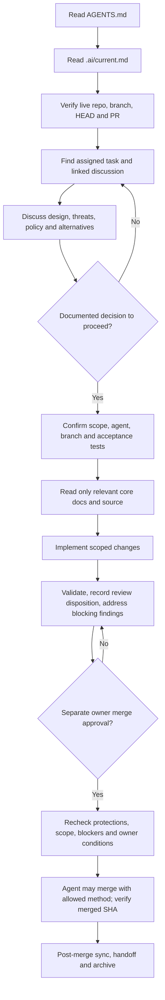

# 🤖 Tio Money — Agent Operating Contract

> **Start here.** This governs contributors and AI agents working in `im-tnyx/Tio-Money`. It is a **working protocol, not blanket authorization** to implement features, merge, deploy, or alter security controls.

| Contract | Reference |
|---|---|
| Repository | [Tio Money](https://github.com/im-tnyx/Tio-Money) · Android and iPhone, React Native / Expo / TypeScript |
| Product source | [PRD](docs/01-PRD.md), [flows](docs/02-USER-FLOWS.md), [screen spec](docs/03-SCREEN-SPEC.md) |
| Technical source | [ledger design](docs/04-DATABASE-DESIGN.md), [architecture](docs/05-TECH-ARCHITECTURE.md), [tests](docs/06-IMPLEMENTATION-TEST-PLAN.md) |
| Owner decisions | [Decision register](docs/DECISIONS.md); approved decisions override older conflicting drafts |
| Live progress | [Current task index](.ai/current.md) — **snapshot only, never proof of live GitHub state** |
| Detailed rules | [.ai/core/README.md](.ai/core/README.md) · [task protocol](.ai/tasks/README.md) |
| GitHub governance | [Issue Forms, PR template and CI](.github/README.md) · [independent review guide](.github/REVIEW_GUIDE.md) · [manual post-merge sync](.github/POST-MERGE-SYNC.md) |
| Reference stage, 2026-11-18 | `main` was documentation-only at governance kickoff; [Phase 0 PR #1](https://github.com/im-tnyx/Tio-Money/pull/1) is parallel draft work; recheck both before acting |

## 1. Mandatory startup and execution sequence

1. Read this file, then `.ai/current.md`; select **one assigned task**, not the entire archive.
2. Inspect live GitHub refs, PR status, changed files, checks and authorizations. With a local checkout additionally inspect `git status --short --branch` and `git rev-parse HEAD`. Connector-only access **does not prove** a clean local worktree.
3. Locate **one task** and its persistent [discussion/RFC](.ai/discussions/README.md); verify file ownership and current agent. Unknown means **unassigned**, not permission to start.
4. Before implementation, discuss purpose and UX, end-to-end data/failure behavior, module/API ownership, architecture dependencies, realistic privacy/security/platform risks, alternatives, rollback and testable acceptance criteria. Store a durable GitHub Issue/Discussion or existing PR record, not only a chat.
5. Require a **documented decision to proceed** after the RFC, with source, date, agreed scope, exclusions and any risk conditions. **Owner implementation approval is optional** for ordinary scoped tasks; when provided, record it precisely. An unresolved material policy, financial, privacy or security decision must be escalated and blocked rather than assumed safe. A discussion by itself is not a decision to proceed.
6. After the documented proceed decision (owner signoff if provided), finalize scoped task, non-goals, assigned agent and verified branch. Read only relevant [core summaries](.ai/core/README.md), canonical source documents and actual code; implement **only** the authorized slice. A material new risk or scope expansion returns to discussion.
7. Run proportionate validation; report exact commands, inspected SHA, results and skipped tests. **Independent review is optional by default**, but strongly recommended for ledger, migration, security, privacy, authentication and sensitive platform work. Record **PERFORMED, SKIPPED, UNAVAILABLE or DEFERRED** with source/reason and actual review evidence when applicable. Never fabricate a review result. Known blocking findings and actual GitHub-required reviewers/checks remain binding.
8. Update task record and compact index with observed HEAD, review finding severity, exact changed paths, results and safe handoff. Re-review after material fixes.
9. Require a **separate, explicit, action-specific owner authorization** naming the **repository, PR number, permission to merge and any conditions**. An agent **MAY perform the merge only after this authorization**, not before. Re-fetch current PR/HEAD/base `main`, check actual required GitHub protections and CI, remaining blocking findings and authorized scope; material changes or unclear/failed conditions require renewed owner authorization. Use only a permitted non-force method, verify GitHub merged state and resulting SHA, then follow [post-merge sync](.github/POST-MERGE-SYNC.md) and update handoff/archive. **Auto-merge requires separate explicit permission.** This instruction is NOT authorization to merge PR #2.

Context budget: **`AGENTS.md → .ai/current.md → one assigned task → discussion / approved decision → relevant core files → actual source`**. Summaries route to authoritative specifications; they do not override the owner's decisions.

## 2. Mandatory discussion and independent owner decisions

**Every substantial feature, UI change, schema/migration, dependency installation, security-sensitive action or deployment requires a technical discussion BEFORE implementation.** The [discussion contract](.ai/discussions/README.md) covers product purpose, end-to-end flow/failure states, data boundaries, cross-feature dependencies, security and applicable store policy, alternatives, trade-offs, acceptance criteria, rollback and unresolved decisions. The conversation is durable in a GitHub Issue/Discussion (if enabled), existing PR for active work, or linked RFC; never rely solely on transient chat memory.

**Decision states:** `PROCEED` (recorded technical decision, **not owner approval**), optional owner `APPROVED_FOR_IMPLEMENTATION`, `CHANGES_REQUESTED`, `DEFERRED`, `REJECTED`, or `BLOCKED_PENDING_DECISION`. Record **who decided what, where, when, exact scope/behavior and conditions**; identify agent-transcribed chat instructions separately from an owner-posted decision. **The RFC and explicit proceed decision are mandatory; owner implementation approval is optional.** Material unsettled product/security/privacy policy decisions block until settled by the proper authority; new scope/risk reopens discussion.

**Separate gates:** a documented technical decision permits bounded implementation where no restricted-operation authorization is required; optional owner implementation signoff is **not** merge permission. **Independent review is optional by default**, with stronger recommendation for finance, migrations, security, privacy, authentication and sensitive platforms. Record the review disposition accurately; never bypass known blocking findings or actual GitHub required checks/reviews. Every merge requires owner authorization **specific to `im-tnyx/Tio-Money` (or the actual repository), the PR number, explicit merge action and attached conditions**. An agent may carry it out **only after** validating identity, current HEAD/base, protected-branch conditions and scope. An unavailable review is not a passing review; a bot `COMMENTED` is not GitHub `APPROVED`.

[Task state machine](.ai/tasks/README.md) · [Handoff template](.ai/tasks/TEMPLATE.md) · [Discussion template](.ai/discussions/TEMPLATE.md)

## 3. Strict Git commit attribution — no co-authors

**Mandatory rule: Never add a `Co-authored-by:` trailer to a commit message.** This is a zero-exceptions policy for agent-assisted commits: **Claude (including Opus), Codex, Cursor, ChatGPT or any other AI agent must never appear as a co-author**. To prevent ambiguity or bypass, **all** `Co-authored-by:` trailers are forbidden regardless of name, email, casing or contributor type. Do not replace the forbidden trailer with misleading alternative credit lines, fake authorship, false approval markers or spoofed Git identities.

- Keep the real Git commit author/committer metadata intact; do not invent an agent signature or change the authenticated user's identity.
- Attribute AI work, model (if actually known), reviewer and handoff **only in the task/agent provenance record**, not commit author/co-author trailers.
- Before submitting a PR or merge review, inspect commit messages. Use `python3 scripts/ai_context.py check-commits --base <base> --head <head>` in a full local Git checkout; this scans commit messages and rejects forbidden trailers. Include its exact observed result and checked range in the task. Also inspect GitHub's actual commits where local Git is unavailable.
- A standalone script/Markdown rule is **not** a GitHub-enforced gate until a separately authorized CI/ruleset is configured. Never claim it automatically blocks merges today.

## 4. Authority and conflict resolution

| Question | Source of truth |
|---|---|
| What exists now? | Live repository files, actual commits/branches/PRs and observed tests/device evidence |
| What must the product do? | Explicit current owner decisions, then accepted PRD and approved architecture decisions |
| What is proposed? | Draft specs and future-state examples; not implementation approval |
| Who may edit what? | Bounded owner authorization, assigned task, and verified branch/file ownership |
| Can it merge or deploy? | **Separate express, action-specific owner permission** identifying repo, PR, permitted action and conditions; agent execution permitted only after safeguards |

Resolve contradictions by recording both references in [DECISIONS](docs/DECISIONS.md) or the task and requesting an owner decision where necessary. Never silently choose a feature-changing interpretation. A new explicit owner decision controls over superseded text; amend affected docs in a scoped PR. Tool/platform security requirements still apply.

**Current owner decision:** Initial app UI, accessibility copy and validation text are **English only**; no MVP language selector. Retain localization-ready typed resources and separate number/date formatting. Hindi and other languages are future scope. See [TM-DEC-001](docs/DECISIONS.md#tm-dec-001--english-only-initial-app).

## 5. Permission and branch safety

**Allowed within a verified scoped task after mandatory discussion and documented proceed decision:** read/review, bounded documentation or ordinary implementation, feature branch, tests, review PR and task checkpoints. **Owner pre-implementation signoff is optional**, but specifically restricted operations still require any applicable separate authority. No implicit right to merge.

**Never permitted without separate explicit owner authorization:** merge, enable auto-merge, production deployment/publishing, modification of protected repository settings, force-push, branch deletion and irreversible/high-impact actions. **Owner-authorized agent merge is allowed** following [the safety preflight](.github/POST-MERGE-SYNC.md#authorized-agent-merge-preflight-before-any-merge); without a specific owner instruction, it is strictly forbidden. Schema/accounting, Auth/Supabase, cloud finance-data movement, native SMS permissions, privacy/security-sensitive scope changes and third-party costs require the documented RFC and all applicable product/security/restricted-operation approvals; do not mistake optional *general implementation signoff* for bypassing these risk gates.

- Start from a verified base (normally latest `main`). Confirm the target branch does not contain unknown work before reuse.
- Never commit directly to `main`; if branch creation fails, **stop** rather than falling back.
- Keep unrelated branches untouched. A docs PR cannot be treated as consent to modify the Phase 0 app branch or merge PR #1.
- Before **each** shared-file write or PR update, recheck live HEAD, relevant PR and parallel ownership. Resolve conflicts rather than overwriting other agents' notes.
- PRs remain reviewable; independent review is optional unless actual GitHub settings require it. Owner merge authorization is **always** required even if CI passes. Resolve or properly disposition known blocking findings; never override configured required checks/reviews.

## 6. Application engineering boundaries

Tio Money is an **offline-first finance tracker**, not a live bank integration. Design authority: [architecture](docs/05-TECH-ARCHITECTURE.md), [ledger](docs/04-DATABASE-DESIGN.md), [feature boundaries](.ai/core/feature-boundaries.md).

- Use strict TypeScript; feature-oriented React Native / Expo Router architecture. `src/app/` owns route composition, not business logic.
- Feature modules own their UI, commands/use cases, tests and public contracts. No deep cross-feature imports, circular dependencies or unrelated refactors.
- UI must not execute SQL or calculate financial balances/fees. Domain must not import Expo, React Native, navigation or SQLite. Repository adapters own bound SQL, migrations and atomic persistence.
- One canonical shared **ledger domain** serves Accounts, Transactions and Reports; do not invent feature-local ledgers or editable balance caches.
- No monolithic global feature store and no hardcoded business values buried in presentation components.
- Prefer reusable semantic theme tokens, accessible system-font UI, centralized English strings, scale-safe layouts, correct keyboard/safe-area behavior and original (not copied) design.
- Proposed `src/` layout is in [feature boundaries](.ai/core/feature-boundaries.md); reconcile with the **actual** Phase 0 scaffold before declaring a path final. Suggest lint enforcement in a separate approved code task.

## 7. Financial and privacy invariants

- Exactly **one central `+` action** opens a unified **Income | Expense | Transfer** editor; never three Home shortcut cards.
- Internal transfer principal is **neither income nor expense**; actual optional transfer fees are expenses. A fee and its transfer post atomically.
- Cash, bank and funded wallet are **assets**; credit cards are **liabilities**. Net worth, balances, reports and history derive from **one balanced journal**.
- Amounts use safe-integer **paise**; no floating-point accumulation. Corrections and import confirmation follow the canonical ledger contract.
- Import candidates are unposted until user review and deduplication. No bank credentials, OTP storage or unrelated message retention.
- No automatic Android SMS inbox access in Expo Go; no automatic third-party iOS SMS inbox access. Android native SMS is conditional and separately policy-gated.
- Least privilege, redaction, secure input validation and explicit approval of future sync/encryption are mandatory. Never claim local SQLite is encrypted or data backed up without proof.

## 8. Validation, provenance, ownership and handoff

- For code: typecheck, lint, relevant unit/integration tests, transaction invariants, platform/build checks and real device evidence when applicable. For docs: links (including copied/moved task links), Mermaid syntax where practical, consistency, privacy and changed-file scope.
- Log **exact commands, observed results, environment, tested commit SHA, review disposition (`PERFORMED / SKIPPED / UNAVAILABLE / DEFERRED`), method/verdict when performed, open findings and omitted checks**. Independent review is **optional** unless configured branch protection/review requirements make it mandatory; particularly recommend it for ledger, migrations, security, privacy, authentication and sensitive platform work. A green CI or failed/quota-limited external review does not prove independent verification.
- Record a stable task ID; agent/tool and actual model (or `UNKNOWN_NOT_VERIFIED`); current and previous *verified* agents; UTC checkpoints; branch; base and observed HEAD; scope; changed paths; blockers; decision references; PR; next safe step.
- **Never infer the model or working agent from Git commit/PR author.** Commit author, PR author, reviewer and owner are separate roles.
- A task is not complete just because an agent stopped. Archive only after verified terminal state (for merge work, verify merge and resulting SHA). Open PR tasks remain active or under review.
- The next agent must **reverify** all mutable refs and observed tests. An accurate handoff improves continuity but cannot promise perfect persistent memory.

**Proceed from:** [.ai/current.md](.ai/current.md) → [mandatory discussion and proceed decision](.ai/discussions/README.md) → [task template](.ai/tasks/TEMPLATE.md) → [workflow rules](.ai/core/workflow-rules.md).
