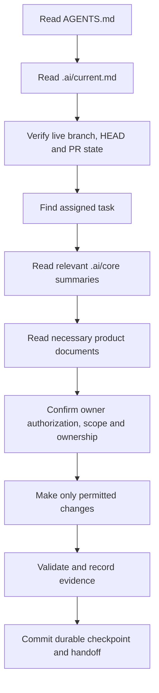

# 🤖 Tio Money — Agent Operating Contract

> **Start here.** This governs contributors and AI agents working in `im-tnyx/Tio-Money`. It is a **working protocol, not blanket authorization** to implement features, merge, deploy, or alter security controls.

| Contract | Reference |
|---|---|
| Repository | [Tio Money](https://github.com/im-tnyx/Tio-Money) · Android and iPhone, React Native / Expo / TypeScript |
| Product source | [PRD](docs/01-PRD.md), [flows](docs/02-USER-FLOWS.md), [screen spec](docs/03-SCREEN-SPEC.md) |
| Technical source | [ledger design](docs/04-DATABASE-DESIGN.md), [architecture](docs/05-TECH-ARCHITECTURE.md), [tests](docs/06-IMPLEMENTATION-TEST-PLAN.md) |
| Owner decisions | [Decision register](docs/DECISIONS.md); approved decisions override older conflicting drafts |
| Live progress | [Current task index](.ai/current.md) — **snapshot only, never proof of live GitHub state** |
| Detailed rules | [.ai/core/README.md](.ai/core/README.md) · [task protocol](.ai/tasks/README.md) |
| Reference stage, 2026-11-18 | `main` was documentation-only at governance kickoff; [Phase 0 PR #1](https://github.com/im-tnyx/Tio-Money/pull/1) is parallel draft work; recheck both before acting |

## 1. Mandatory startup and execution sequence

1. Read this file, then `.ai/current.md`; select **one assigned task**, not the entire archive.
2. Inspect live GitHub refs, PR status, changed files, checks and authorizations. With a local checkout additionally inspect `git status --short --branch` and `git rev-parse HEAD`. Connector-only access **does not prove** a clean local worktree.
3. Verify which task and agent own the affected files. Unknown means **unassigned**, not an invitation to take ownership.
4. Read the task, only relevant [core summaries](.ai/core/README.md), then the necessary canonical source documents and actual runtime code. Confirm the latest approved product decisions.
5. State intended change, non-goals and owner approval source before changing anything; no permission may be inferred from a plan, PR or task file.
6. Implement only the authorized slice on its assigned feature branch; never alter another agent's branch as a shortcut.
7. Run proportionate validation; distinguish commands actually executed from planned or skipped checks.
8. Update the task record and compact current index with evidence, risks, tested SHA, files, next action and handoff; open a PR for owner review.
9. **Never auto-merge.** Owner approval, review completion and technical validation are distinct gates.

Context budget: **`AGENTS.md → .ai/current.md → one task → relevant core files → relevant source files`**. Summaries are routing notes, not competing source-of-truth documents.

## 2. Authority and conflict resolution

| Question | Source of truth |
|---|---|
| What exists now? | Live repository files, actual commits/branches/PRs and observed tests/device evidence |
| What must the product do? | Explicit current owner decisions, then accepted PRD and approved architecture decisions |
| What is proposed? | Draft specs and future-state examples; not implementation approval |
| Who may edit what? | Bounded owner authorization, assigned task, and verified branch/file ownership |
| Can it merge or deploy? | **Separate express owner approval** for the specific PR/release |

Resolve contradictions by recording both references in [DECISIONS](docs/DECISIONS.md) or the task and requesting an owner decision where necessary. Never silently choose a feature-changing interpretation. A new explicit owner decision controls over superseded text; amend affected docs in a scoped PR. Tool/platform security requirements still apply.

**Current owner decision:** Initial app UI, accessibility copy and validation text are **English only**; no MVP language selector. Retain localization-ready typed resources and separate number/date formatting. Hindi and other languages are future scope. See [TM-DEC-001](docs/DECISIONS.md#tm-dec-001--english-only-initial-app).

## 3. Permission and branch safety

**Allowed only within a verified, specifically assigned task:** read/review; change approved documentation; implement explicitly authorized feature code; create a feature branch; add tests; create review PR; maintain task checkpoints.

**Forbidden without new, explicit owner approval:** merge/enable auto-merge, deploy/publish, change database schema or accounting semantics, add SMS permissions or a native SMS reader, introduce Auth/Supabase/cloud/analytics, upload personal finance data, relax security/checks, change repository protection/rules, force-push, delete a branch, rewrite another agent's history, or expand beyond the authorized scope.

- Start from a verified base (normally latest `main`). Confirm the target branch does not contain unknown work before reuse.
- Never commit directly to `main`; if branch creation fails, **stop** rather than falling back.
- Keep unrelated branches untouched. A docs PR cannot be treated as consent to modify the Phase 0 app branch or merge PR #1.
- Before **each** shared-file write or PR update, recheck live HEAD, relevant PR and parallel ownership. Resolve conflicts rather than overwriting other agents' notes.
- PRs remain reviewable; separate owner approval is required for merge even if CI passes.

## 4. Application engineering boundaries

Tio Money is an **offline-first finance tracker**, not a live bank integration. Design authority: [architecture](docs/05-TECH-ARCHITECTURE.md), [ledger](docs/04-DATABASE-DESIGN.md), [feature boundaries](.ai/core/feature-boundaries.md).

- Use strict TypeScript; feature-oriented React Native / Expo Router architecture. `src/app/` owns route composition, not business logic.
- Feature modules own their UI, commands/use cases, tests and public contracts. No deep cross-feature imports, circular dependencies or unrelated refactors.
- UI must not execute SQL or calculate financial balances/fees. Domain must not import Expo, React Native, navigation or SQLite. Repository adapters own bound SQL, migrations and atomic persistence.
- One canonical shared **ledger domain** serves Accounts, Transactions and Reports; do not invent feature-local ledgers or editable balance caches.
- No monolithic global feature store and no hardcoded business values buried in presentation components.
- Prefer reusable semantic theme tokens, accessible system-font UI, centralized English strings, scale-safe layouts, correct keyboard/safe-area behavior and original (not copied) design.
- Proposed `src/` layout is in [feature boundaries](.ai/core/feature-boundaries.md); reconcile with the **actual** Phase 0 scaffold before declaring a path final. Suggest lint enforcement in a separate approved code task.

## 5. Financial and privacy invariants

- Exactly **one central `+` action** opens a unified **Income | Expense | Transfer** editor; never three Home shortcut cards.
- Internal transfer principal is **neither income nor expense**; actual optional transfer fees are expenses. A fee and its transfer post atomically.
- Cash, bank and funded wallet are **assets**; credit cards are **liabilities**. Net worth, balances, reports and history derive from **one balanced journal**.
- Amounts use safe-integer **paise**; no floating-point accumulation. Corrections and import confirmation follow the canonical ledger contract.
- Import candidates are unposted until user review and deduplication. No bank credentials, OTP storage or unrelated message retention.
- No automatic Android SMS inbox access in Expo Go; no automatic third-party iOS SMS inbox access. Android native SMS is conditional and separately policy-gated.
- Least privilege, redaction, secure input validation and explicit approval of future sync/encryption are mandatory. Never claim local SQLite is encrypted or data backed up without proof.

## 6. Validation, provenance, ownership and handoff

- For code: typecheck, lint, relevant unit/integration tests, transaction invariants, platform/build checks and real device evidence when applicable. For docs: links, Mermaid syntax where practical, consistency, privacy and changed-file scope.
- Log **exact commands, observed results, environment, tested commit SHA and omitted checks**. Green CI is not equivalent to real-device financial QA.
- Record a stable task ID; agent/tool and actual model (or `UNKNOWN_NOT_VERIFIED`); current and previous *verified* agents; UTC checkpoints; branch; base and observed HEAD; scope; changed paths; blockers; decision references; PR; next safe step.
- **Never infer the model or working agent from Git commit/PR author.** Commit author, PR author, reviewer and owner are separate roles.
- A task is not complete just because an agent stopped. Archive only after verified terminal state (for merge work, verify merge and resulting SHA). Open PR tasks remain active or under review.
- The next agent must **reverify** all mutable refs and observed tests. An accurate handoff improves continuity but cannot promise perfect persistent memory.

**Proceed from:** [.ai/current.md](.ai/current.md) → [task template](.ai/tasks/TEMPLATE.md) → [workflow rules](.ai/core/workflow-rules.md).
