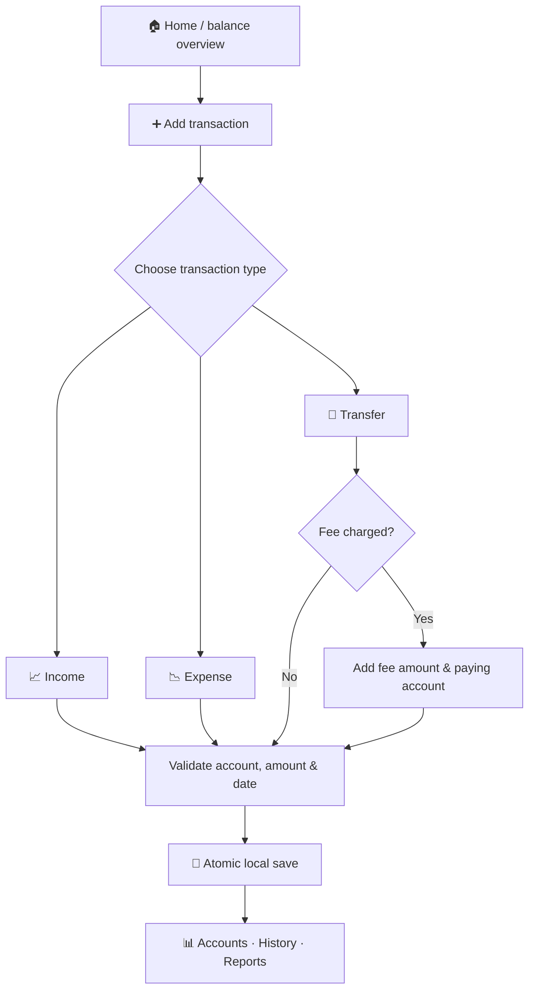
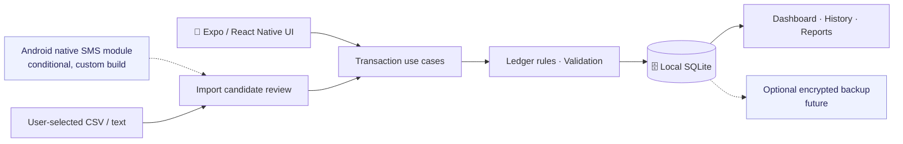

<div align="center">

# 💸 TIO MONEY

### Every rupee. One clear picture.

**A thoughtfully designed, offline-first money tracker for Android & iPhone.**  
Track income, expenses, transfers, optional transfer fees and account balances — without losing control of your data.


**[🤖 Agent Rules](AGENTS.md)** · **[📌 Owner Decisions](docs/DECISIONS.md)** · **[📚 Docs Hub](docs/00-INDEX.md)** · **[🎯 PRD](docs/01-PRD.md)** · **[🧭 Flows](docs/02-USER-FLOWS.md)** · **[🎨 Screen Design](docs/03-SCREEN-SPEC.md)** · **[🗄 Ledger](docs/04-DATABASE-DESIGN.md)** · **[🏗 Architecture](docs/05-TECH-ARCHITECTURE.md)** · **[🧪 Implementation & Tests](docs/06-IMPLEMENTATION-TEST-PLAN.md)** · **[✍️ Style](docs/90-DOCS-STYLE-GUIDE.md)**

</div>

---

> [!IMPORTANT]
> **Current source snapshot · 2026-11-21 (`main` `57e564af8f526f9de69eaaf61f2fbc0c72731188`):** Five bottom destinations (**Home · Trans. · Stats. · Account · More**) remain; **Home/Trans./Stats./Account** are blank finance screens, while **More → Appearance** has a working System/Light/Dark preference sheet. The floating `+` above More remains **disabled**. There is no financial transaction editor, onboarding, ledger posting, banking integration, cloud backup, Supabase signup or SMS inbox access. Current bottom tokens use **selected weight 300 / inactive 200**, **0dp** icon-label gap and a **160ms Reduced Motion-aware** scene crossfade. Owner-reported device smoke is not independent iPhone or finance/SQLite acceptance. The owner reports the latest UI looks correct on a physical device and the previously observed `ExpoSQLite` error no longer appears; exact device/platform and real on-device SQLite migration/restart tests remain unrecorded. This is an owner-reported smoke result, not full two-platform QA.

## ✨ A calm place for your money

| 🧾 **Know where it went** | 🔄 **Move money without fake spending** | 🔒 **Keep control** |
| :--- | :--- | :--- |
| Log every income or expense, categorize it, and discover daily or monthly patterns. | Transfer between your accounts without inflating income or expense. Any **real transfer fee** counts as expense. | Core entries are local-first. No banking password or OTP is needed for manual tracking. |
| **Manual tracking · P0** | **Transfers + optional fees · P0** | **Offline SQLite · P0** |

## 📱 The core interaction

The owner-provided screenshots are **references for fields and interaction**, **not a UI to copy**. Tio Money will have its **own** visual language and screen design.

- **Current Phase 0 baseline (updated):** five bottom tabs (**Home · Trans. · Stats. · Account · More**); four finance routes remain blank and **More → Appearance** is implemented. The sole floating `+` **icon is disabled**, aligned above More; tapping it does nothing. No financial editor, top bar or additional root destination. See [TM-DEC-005](docs/DECISIONS.md#tm-dec-005--phase-0-empty-navigation-shell-and-disabled-fab).
- **Future product design (not implemented now):** after a new scoped implementation decision, `+` may open an Income / Expense / Transfer editor.
- **Fees** appear only when needed on a transfer and are accounted for separately as an expense.
- **Future product design only:** Save and Save & Add Another are not available in this Phase 0 shell.

> **Future flow concept, not a screen or action implemented in the current Phase 0 shell.**



### Example: ₹5,000 sent, ₹50 transfer fee

| SBI account | HDFC account | Expense report |
| :--- | :--- | :--- |
| **−₹5,050** | **+₹5,000** | **₹50** bank charges |

**Only the ₹50 fee is spending.** The ₹5,000 principal is an internal transfer. Credit-card liability flows have separate ledger rules — see the [PRD](docs/01-PRD.md#5-accounting-rules-and-examples).

## 🧩 Feature map and honest delivery status

| Capability | Priority | Status | Where defined |
| :--- | :---: | :--- | :--- |
| One `+` / three transaction tabs | P0 | 📐 Drafted | [PRD](docs/01-PRD.md) |
| Account balances + manual entries | P0 | 📐 Drafted | [PRD](docs/01-PRD.md) |
| Transfer fees counted as expense | P0 | 📐 Drafted | [User flows](docs/02-USER-FLOWS.md) |
| Transaction history + reports | P0 | 📐 Drafted | [PRD](docs/01-PRD.md) |
| Manual SMS text / CSV import | P1 | 🗓 Planned | [User flows](docs/02-USER-FLOWS.md) |
| Android native SMS import | Conditional | 🔬 Policy review required | [PRD](docs/01-PRD.md#47-sms--import-review-p1-platform-dependent) |
| Cash, Bank, Wallet, Credit Card, Investment & Loan | Stage 1 | 📐 Specified, not implemented | [Account groups](docs/08-ACCOUNT-GROUPS-SPEC.md) |
| Encrypted Google Drive / iCloud-compatible backup & restore | Stage 2 | 🗓 Future; security ADR pending | [Backup and sync](docs/09-BACKUP-SYNC-SPEC.md) |
| Optional Supabase sync + opt-in app sign-in | Stage 3 | 🗓 Future; security/identity ADR pending | [Backup and sync](docs/09-BACKUP-SYNC-SPEC.md) |

> [!NOTE]
> **Expo Go supports the core React Native experience**, not custom native SMS inbox-reading modules. Android automatic SMS import would require a custom development build **and** eligibility under Google Play's restricted SMS permission policy. A normal third-party iOS app cannot continuously read the user's SMS inbox. The product always offers user-initiated import alternatives.

## 🏗 Proposed architecture — boundaries, not a shipped stack



**Financial invariant:** balance, history and reports must derive from the **same transaction ledger**. Asset-to-asset transfers preserve total assets, card repayments preserve net worth (before fees), and real charges reduce net worth.

## 📚 Explore the documentation

[📋 Documentation readiness & unresolved decisions](docs/13-DOCUMENTATION-READINESS.md) distinguishes existing contracts, implementation blockers and future-only stages. No financial feature is implied shipped by a documentation update.

| Start here | Interaction & product | Collaboration standards |
| :--- | :--- | :--- |
| [📚 Documentation hub](docs/00-INDEX.md) | [🎯 Product requirements](docs/01-PRD.md) | [✍️ Documentation style guide](docs/90-DOCS-STYLE-GUIDE.md) |
| [💡 Product promises](#-a-calm-place-for-your-money) | [🧭 User flows and edge cases](docs/02-USER-FLOWS.md) | [📋 Status & approval rules](docs/90-DOCS-STYLE-GUIDE.md) |
| [🧩 Feature map](#-feature-map-and-honest-delivery-status) | [🎨 Screen design specification](docs/03-SCREEN-SPEC.md) | [🧪 Implementation & Test Plan](docs/06-IMPLEMENTATION-TEST-PLAN.md) |
| [🏗 Architecture overview](#-proposed-architecture--boundaries-not-a-shipped-stack) | [🗄 Database & ledger](docs/04-DATABASE-DESIGN.md) · [Technical architecture](docs/05-TECH-ARCHITECTURE.md) | [Phase gates & financial QA](docs/06-IMPLEMENTATION-TEST-PLAN.md#5-financial-acceptance-test-catalogue) |

## 🛠 Phase 0 · Developer setup (merged scaffold; finance work pending)

The code in this branch is an **Expo SDK 58 / React Native 0.88.1 / React 19.3** scaffold. It renders five bottom destinations **Home · Trans. · Stats. · Account · More**, with **four blank finance screen bodies**, an implemented **More → Appearance** settings sheet, and a **disabled floating `+` icon above More**. After the native **splash**, the app goes **directly to Home's blank canvas and the five-tab bottom bar**, with the disabled floating `+` above More. No intermediate loading screen is shown during successful SQLite initialization. There is **no Add editor, account/transaction settings flow or onboarding screen** and no top app toolbar; the **More Appearance** setting is already implemented. A database-startup failure may show a minimal retry/error recovery view rather than silently corrupting data. The SQLite settings-only initialization, strict TypeScript, theme, tests and governance remain under the hood. No financial data can be saved.

**Requirements:** Node.js **`^22.13.0 || ^24.3.0 || >=26.0.0`** (the repo pins a known-compatible **22.16.0** in `.nvmrc`), npm, Expo Go supporting SDK 58 on an Android/iPhone device, and a reachable npm registry. Node 23, 25 and Node 24.0–24.2 are not supported by the locked Expo/React Native engines.

```bash
nvm use                   # uses the known-compatible .nvmrc Node 22.16.0
npm ci                    # reproducible install from committed package-lock.json
npx expo install --check  # confirm managed Expo SDK compatibility
npm run check             # strict TypeScript, ESLint, Prettier, unit tests
npm run expo:config       # inspect the public Expo configuration
npx expo start --clear    # scan QR code in Expo Go
```

For iPhone use Expo Go from the App Store; for Android use the Expo Go app and its QR scanner. **Do not assume Expo Go compatibility solely from package versions**: test an actual device and record the SDK, OS and result. Owner reports a physical-device UI smoke pass without the prior `ExpoSQLite` error; device identity/OS/SDK and the full Android + iPhone acceptance matrix still need to be documented. If SDK 58 Expo Go is not available on a particular store/device, do not downgrade packages ad hoc; check the [Expo SDK 58 release notes](https://expo.dev/changelog/sdk-58) and obtain an appropriate compatible client.

**Language:** Initial UI, validation and accessibility text are **English only**, with no MVP language selector per [TM-DEC-001](docs/DECISIONS.md#tm-dec-001--english-only-initial-app). Stable message keys remain ready for future translations. **Environment / privacy:** P0 has no backend and requires **no secrets**. `.env.example` explains `EXPO_PUBLIC_*` flags; those flags are public in app bundles, so never put banking credentials, API keys or encryption secrets there. The default `app.json` declares **no SMS permissions**. Automatic Android SMS requires a separately approved custom native build; automatic iPhone inbox access is not offered.

**Architecture boundaries:** [Document 05](docs/05-TECH-ARCHITECTURE.md) · [Phase 0–7 plan](docs/06-IMPLEMENTATION-TEST-PLAN.md) · [Foundation notes](docs/07-PHASE-0-FOUNDATION-NOTES.md) · [Core Theme ownership](src/shared/theme/README.md). The current UI automatically follows system **light/dark** via typed semantic palettes; **all reusable fixed UI dimensions, 24dp Google Material Symbols Outlined SVG icon display sizes, tab/FAB geometry, typography and spacing are centrally owned design tokens**, with shared icon-size roles available to future top bars/buttons/sheets/cards/fields. Four finance route screens remain **blank/presentation-only**; **More → Appearance** uses a controller/view-model and presentation-only screen. Routing, splash lifecycle and safe-area behavior remain outside finance/business screens. Future feature-screen specifications remain proposals, not implemented routes. SQLite bootstrap currently migrates only a local settings table; balances, financial event posting and encryption are **not** built. Keep local database files out of Git.

> [!NOTE]
> **Historical PR #1 pre-merge audit checkpoint (superseded):** PR #1 later **MERGED** (verify [PR #1](https://github.com/im-tnyx/Tio-Money/pull/1)); the following evidence and open-gate comments describe **only the original 2026-11-20 pre-merge snapshot**, not present GitHub status. **Historical source evidence (2026-11-20):** On branch `feat/phase-0-expo-foundation`, source HEAD `c90d1c00462de5e4a5b007a87dade6641a106f40` passed [Phase 0 App CI #44600432345](https://github.com/im-tnyx/Tio-Money/actions/runs/44600432345) (npm/Expo checks, strict TypeScript, lint, Prettier, unit tests, Android/iOS Metro) and [governance CI #44600432365](https://github.com/im-tnyx/Tio-Money/actions/runs/44600432365) (Python tests, links and commit attribution). **Owner reports testing current UI on a physical device and no longer encountering the previous `ExpoSQLite` error.** Record as **OWNER_REPORTED_DEVICE_SMOKE_PASS**; device platform/model/OS/client version and full cold-restart evidence were **not provided**. On-device SQLite PRAGMA checks, migration persistence, both-platform signoff, accessibility/contrast matrix and formal M0 acceptance remain **NOT_VERIFIED**. This is not a new CI or independent device-test claim. **Historical visual tokens at that checked commit (superseded):** five Google Material Symbols Outlined SVG tab icons (`home`, `book_2`, `bar_chart_4_bars`, `account_balance`, `more_horiz`) at weight **200** and size **24dp**; floating disabled Google `add` icon at weight **400**, size **24dp**; circular FAB **50dp**; nav baseline **50dp plus actual OS bottom inset** (1dp border + 1dp top padding + 48dp tab hit row); icon/label gap **1dp**; FAB-to-navigation vertical clearance **16dp**. FAB remains over the More tab, not at a fixed right-edge inset. **Historical merge gate at that snapshot:** PR #1 was **OPEN / NOT MERGED** then; it has since merged. Latest self-audit confirms the original Copilot Node-range finding fixed in `package.json` and lockfile (both `^22.13.0 || ^24.3.0 || >=26.0.0`), but its GitHub thread is **outdated/unresolved**; do not treat the Copilot `COMMENTED` review as approval. Independent latest-head review **DEFERRED** under the optional policy. `main` reports `protected:false`, but protection and rulesets endpoints returned **403**, so enforcement cannot be exhaustively inventoried. Recheck live GitHub-required gates. A fresh explicit owner authorization naming `im-tnyx/Tio-Money` PR #1 and permission to merge is needed because the old “go merge” preceded material UI changes. Draft PR #7 is independent and remains untouched.

## 🚀 How the product is developed


**No feature is marked shipped until code, tests and actual device behavior prove it.** The source of truth is the [documentation hub](docs/00-INDEX.md), not badges alone.

---

<div align="center">

**Tio Money** · Designed for clarity, correctness & privacy  
<sub>Phase 0 scaffold merged · Stage 1 finance requirements and decisions pending · November 2026</sub>

</div>
