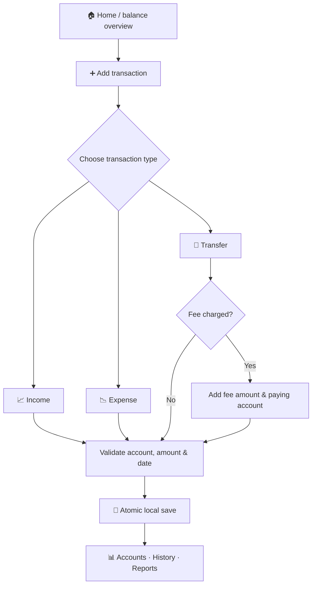
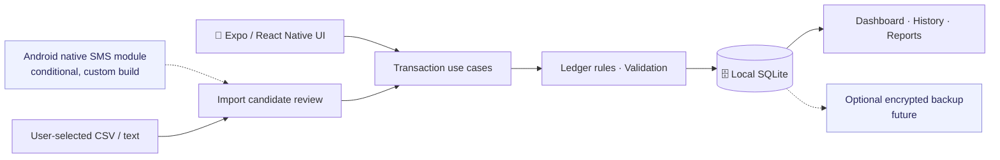
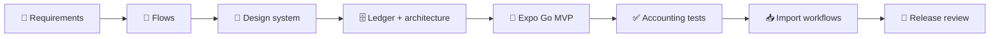

# 💸 TIO MONEY

### Every rupee. One clear picture.

**A thoughtfully designed, offline-first money tracker for Android & iPhone.**  
Track income, expenses, transfers, optional transfer fees and account balances — without losing control of your data.

**[📚 Documentation Hub](docs/00-INDEX.md)** · **[🎯 Product Requirements](docs/01-PRD.md)** · **[🧭 User Flows](docs/02-USER-FLOWS.md)** · **[✍️ Documentation Style](docs/90-DOCS-STYLE-GUIDE.md)**

---

> [!IMPORTANT]
> **Current state · 2026-11-18:** This is a **documentation-stage project**, not a completed or published app. The product requirements and flows are working drafts. No functional Expo UI, SQLite implementation, SMS reader or store release has been delivered in this repository. Labels such as *planned*, *draft* and *implemented* must reflect evidence — not aspiration.

## ✨ A calm place for your money

| 🧾 **Know where it went** | 🔄 **Move money without fake spending** | 🔒 **Keep control** |
| :--- | :--- | :--- |
| Log every income or expense, categorize it, and discover daily or monthly patterns. | Transfer between your accounts without inflating income or expense. Any **real transfer fee** counts as expense. | Core entries are local-first. No banking password or OTP is needed for manual tracking. |
| **Manual tracking · P0** | **Transfers + optional fees · P0** | **Offline SQLite · P0** |

## 📱 The core interaction

The owner-provided screenshots are **references for fields and interaction**, **not a UI to copy**. Tio Money will have its **own** visual language and screen design.

- **One primary `+` action on Home** — no separate Income / Expense / Transfer shortcut tiles.
- `+` opens one transaction form with the tabs **Income | Expense | Transfer**.
- **Fees** appear only when needed on a transfer and are accounted for separately as an expense.
- **Save** stores the transaction and returns; **Save & Add Another** supports faster repeated entry.

### Example: ₹5,000 sent, ₹50 transfer fee

| SBI account | HDFC account | Expense report |
| :--- | :--- | :--- |
| **−₹5,050** | **+₹5,000** | **₹50** bank charges |

**Only the ₹50 fee is spending.** The ₹5,000 principal is an internal transfer. Credit-card liability flows have separate ledger rules — see the [PRD](docs/01-PRD.md#5-accounting-rules-and-examples).

## 🧩 Feature map and honest delivery status

| Capability | Priority | Status | Where defined |
| :--- | :---: | :--- | :--- |
| One `+` / three transaction tabs | P0 | 📐 Drafted | [PRD](docs/01-PRD.md) |
| Account balances + manual entries | P0 | 📐 Drafted | [PRD](docs/01-PRD.md) |
| Transfer fees counted as expense | P0 | 📐 Drafted | [User flows](docs/02-USER-FLOWS.md) |
| Transaction history + reports | P0 | 📐 Drafted | [PRD](docs/01-PRD.md) |
| Manual SMS text / CSV import | P1 | 🗓 Planned | [User flows](docs/02-USER-FLOWS.md) |
| Android native SMS import | Conditional | 🔬 Policy review required | [PRD](docs/01-PRD.md#47-sms--import-review-p1-platform-dependent) |
| Optional secure backup / sync | Later | 🗓 Planned | [PRD](docs/01-PRD.md) |

> [!NOTE]
> **Expo Go supports the core React Native experience**, not custom native SMS inbox-reading modules. Android automatic SMS import would require a custom development build **and** eligibility under Google Play's restricted SMS permission policy. A normal third-party iOS app cannot continuously read the user's SMS inbox. The product always offers user-initiated import alternatives.

## 🏗 Proposed architecture — boundaries, not a shipped stack

**Financial invariant:** balance, history and reports must derive from the **same transaction ledger**. Asset-to-asset transfers preserve total assets, card repayments preserve net worth (before fees), and real charges reduce net worth.

## 📚 Explore the documentation

| Start here | Interaction & product | Collaboration standards |
| :--- | :--- | :--- |
| [📚 Documentation hub](docs/00-INDEX.md) | [🎯 Product requirements](docs/01-PRD.md) | [✍️ Documentation style guide](docs/90-DOCS-STYLE-GUIDE.md) |
| [💡 Product promises](#-a-calm-place-for-your-money) | [🧭 User flows and edge cases](docs/02-USER-FLOWS.md) | [📋 Status & approval rules](docs/90-DOCS-STYLE-GUIDE.md#6-status-and-approval-truth) |
| [🧩 Feature map](#-feature-map-and-honest-delivery-status) | **Next:** Screen & design spec | **Next:** Implementation / test plan |
| [🏗 Architecture overview](#-proposed-architecture--boundaries-not-a-shipped-stack) | **Next:** Data model + technical architecture | **Next:** ADR / decision log |

## 🚀 How the product is developed

**No feature is marked shipped until code, tests and actual device behavior prove it.** The source of truth is the [documentation hub](docs/00-INDEX.md), not badges alone.

---

**Tio Money** · Designed for clarity, correctness & privacy  
Documentation phase · 18 November 2026 · Original product design, not a reference-app clone

