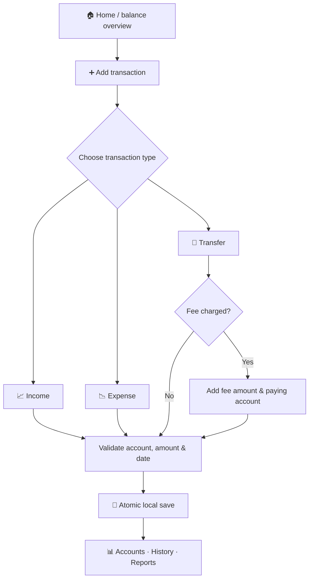
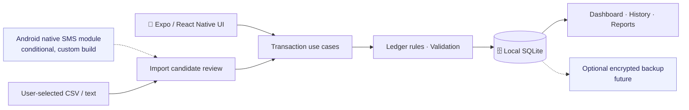
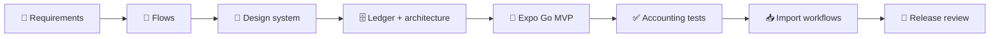

<div align="center">

# 💸 TIO MONEY

### Every rupee. One clear picture.

**A thoughtfully designed, offline-first money tracker for Android & iPhone.**  
Track income, expenses, transfers, optional transfer fees and account balances — without losing control of your data.


**[🤖 Agent Rules](AGENTS.md)** · **[📌 Owner Decisions](docs/DECISIONS.md)** · **[📚 Docs Hub](docs/00-INDEX.md)** · **[🎯 PRD](docs/01-PRD.md)** · **[🧭 Flows](docs/02-USER-FLOWS.md)** · **[🎨 Screen Design](docs/03-SCREEN-SPEC.md)** · **[🗄 Ledger](docs/04-DATABASE-DESIGN.md)** · **[🏗 Architecture](docs/05-TECH-ARCHITECTURE.md)** · **[🧪 Implementation & Tests](docs/06-IMPLEMENTATION-TEST-PLAN.md)** · **[✍️ Style](docs/90-DOCS-STYLE-GUIDE.md)**

</div>

---

> [!IMPORTANT]
> **Current state · 2026-11-18:** A **Phase 0 Expo Router scaffold is under review** on its feature branch. The theme/components, placeholder navigation and SQLite initialization source exist, but **financial accounts, journal tables, transaction saving, reports, imports, SMS reading and store release are not implemented**. Dependency install, Expo Go behavior and physical-device verification must be recorded separately; source presence is not a passing test.

## ✨ A calm place for your money

| 🧾 **Know where it went** | 🔄 **Move money without fake spending** | 🔒 **Keep control** |
| :--- | :--- | :--- |
| Log every income or expense, categorize it, and discover daily or monthly patterns. | Transfer between your accounts without inflating income or expense. Any **real transfer fee** counts as expense. | Core entries are local-first. No banking password or OTP is needed for manual tracking. |
| **Manual tracking · P0** | **Transfers + optional fees · P0** | **Offline SQLite · P0** |

## 📱 The core interaction

The owner-provided screenshots are **references for fields and interaction**, **not a UI to copy**. Tio Money will have its **own** visual language and screen design.

- **One floating `+` action above the five-destination bottom bar, aligned over **More** on the right** — no separate Income / Expense / Transfer shortcut tiles or Add content tab. See [TM-DEC-004](docs/DECISIONS.md#tm-dec-004--five-destinations-and-floating-add).
- `+` opens one transaction form with the tabs **Income | Expense | Transfer**.
- **Fees** appear only when needed on a transfer and are accounted for separately as an expense.
- **Save** stores the transaction and returns; **Save & Add Another** supports faster repeated entry.



### Example: ₹5,000 sent, ₹50 transfer fee

| SBI account | HDFC account | Expense report |
| :--- | :--- | :--- |
| **−₹5,050** | **+₹5,000** | **₹50** bank charges |

**Only the ₹50 fee is spending.** The ₹5,000 principal is an internal transfer. Credit-card liability flows have separate ledger rules — see the [PRD](docs/01-PRD.md#5-accounting-rules-and-examples).

## 🧩 Feature map and honest delivery status

| Capability | Priority | Status | Where defined |
| :--- | :---: | :--- | :--- |
| One `+` / three transaction tabs | P0 | 📐 Drafted | [PRD](docs/01-PRD.md) |
| Account balances + manual entries | P0 | 📐 Drafted | [PRD](docs/01-PRD.md) |
| Transfer fees counted as expense | P0 | 📐 Drafted | [User flows](docs/02-USER-FLOWS.md) |
| Transaction history + reports | P0 | 📐 Drafted | [PRD](docs/01-PRD.md) |
| Manual SMS text / CSV import | P1 | 🗓 Planned | [User flows](docs/02-USER-FLOWS.md) |
| Android native SMS import | Conditional | 🔬 Policy review required | [PRD](docs/01-PRD.md#47-sms--import-review-p1-platform-dependent) |
| Optional secure backup / sync | Later | 🗓 Planned | [PRD](docs/01-PRD.md) |

> [!NOTE]
> **Expo Go supports the core React Native experience**, not custom native SMS inbox-reading modules. Android automatic SMS import would require a custom development build **and** eligibility under Google Play's restricted SMS permission policy. A normal third-party iOS app cannot continuously read the user's SMS inbox. The product always offers user-initiated import alternatives.

## 🏗 Proposed architecture — boundaries, not a shipped stack



**Financial invariant:** balance, history and reports must derive from the **same transaction ledger**. Asset-to-asset transfers preserve total assets, card repayments preserve net worth (before fees), and real charges reduce net worth.

## 📚 Explore the documentation

| Start here | Interaction & product | Collaboration standards |
| :--- | :--- | :--- |
| [📚 Documentation hub](docs/00-INDEX.md) | [🎯 Product requirements](docs/01-PRD.md) | [✍️ Documentation style guide](docs/90-DOCS-STYLE-GUIDE.md) |
| [💡 Product promises](#-a-calm-place-for-your-money) | [🧭 User flows and edge cases](docs/02-USER-FLOWS.md) | [📋 Status & approval rules](docs/90-DOCS-STYLE-GUIDE.md) |
| [🧩 Feature map](#-feature-map-and-honest-delivery-status) | [🎨 Screen design specification](docs/03-SCREEN-SPEC.md) | [🧪 Implementation & Test Plan](docs/06-IMPLEMENTATION-TEST-PLAN.md) |
| [🏗 Architecture overview](#-proposed-architecture--boundaries-not-a-shipped-stack) | [🗄 Database & ledger](docs/04-DATABASE-DESIGN.md) · [Technical architecture](docs/05-TECH-ARCHITECTURE.md) | [Phase gates & financial QA](docs/06-IMPLEMENTATION-TEST-PLAN.md#5-financial-acceptance-test-catalogue) |

## 🛠 Phase 0 · Developer setup (scaffold under review)

The code in this branch is an **Expo SDK 58 / React Native 0.88.1 / React 19.3** project scaffold. Its **Home · Trans. · Stats. · Account · More** destinations and independent **floating `+` FAB** open a unified preview with **Income | Expense | Transfer** tabs. **Save is disabled**; financial data and genuine account setup are scheduled for later phases.

**Requirements:** Node.js **`^22.13.0 || ^24.3.0 || >=26.0.0`** (the repo pins a known-compatible **22.16.0** in `.nvmrc`), npm, Expo Go supporting SDK 58 on an Android/iPhone device, and a reachable npm registry. Node 23, 25 and Node 24.0–24.2 are not supported by the locked Expo/React Native engines.

```bash
nvm use                   # uses the known-compatible .nvmrc Node 22.16.0
npm ci                    # reproducible install from committed package-lock.json
npx expo install --check  # confirm managed Expo SDK compatibility
npm run check             # strict TypeScript, ESLint, Prettier, unit tests
npm run expo:config       # inspect the public Expo configuration
npx expo start --clear    # scan QR code in Expo Go
```

For iPhone use Expo Go from the App Store; for Android use the Expo Go app and its QR scanner. **Do not assume Expo Go compatibility solely from package versions**: test an actual device and record the SDK, OS and result. This environment has not established a physical-device pass. If SDK 58 Expo Go is not available on a particular store/device, do not downgrade packages ad hoc; check the [Expo SDK 58 release notes](https://expo.dev/changelog/sdk-58) and obtain an appropriate compatible client.

**Language:** Initial UI, validation and accessibility text are **English only**, with no MVP language selector per [TM-DEC-001](docs/DECISIONS.md#tm-dec-001--english-only-initial-app). Stable message keys remain ready for future translations. **Environment / privacy:** P0 has no backend and requires **no secrets**. `.env.example` explains `EXPO_PUBLIC_*` flags; those flags are public in app bundles, so never put banking credentials, API keys or encryption secrets there. The default `app.json` declares **no SMS permissions**. Automatic Android SMS requires a separately approved custom native build; automatic iPhone inbox access is not offered.

**Architecture boundaries:** [Document 05](docs/05-TECH-ARCHITECTURE.md) · [Phase 0–7 plan](docs/06-IMPLEMENTATION-TEST-PLAN.md) · [Foundation decisions](docs/07-PHASE-0-FOUNDATION-NOTES.md). The SQLite bootstrap currently migrates only a local settings table; balances, financial event posting and encryption are **not** built. Keep local database files out of Git.

> [!NOTE]
> The dependency lockfile is committed and the previous PR-head CI was green, but fresh integration CI and Android/iPhone Expo Go device QA require recorded evidence. **Phase 0 is not complete** until those gates are verified.

## 🚀 How the product is developed



**No feature is marked shipped until code, tests and actual device behavior prove it.** The source of truth is the [documentation hub](docs/00-INDEX.md), not badges alone.

---

<div align="center">

**Tio Money** · Designed for clarity, correctness & privacy  
<sub>Phase 0 scaffold in draft review · November 2026 · Original product design</sub>

</div>
