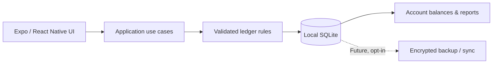

<div align="center">

# 💸 TIO MONEY

### Every rupee. One clear picture.

**A thoughtfully designed, offline-first personal money tracker for Android & iPhone.**

Understand your accounts, income, expenses and transfers — with clarity and control over your data.


[✨ Product](#-why-tio-money) · [📱 Experience](#-the-experience) · [🧱 Delivery](#-delivery-roadmap) · [🛠 Get started](#-get-started) · [📚 Documentation](docs/00-INDEX.md)

</div>

---

## ✨ Why Tio Money?

Tio Money is designed to make everyday money tracking understandable without requiring a bank login. The long-term goal is to give people a reliable picture of what they own, owe, earn and spend. **Local-first accounting** is the guiding design principle: optional remote features must not be silently introduced into the core ledger.

| 🧾 **See where money goes** | 🔄 **Transfer without double counting** | 🔒 **Stay in control** |
| :--- | :--- | :--- |
| Track income and expenses with accounts, categories and reporting. | Moving money between your own accounts is not new income or spending; real transfer fees are expenses. | Core finance records are designed for local SQLite storage; cloud backup and sync are future opt-in stages. |
| **Stage 1 finance goal** | **Canonical accounting rule** | **Offline-first product rule** |

## 📱 The experience

The product direction is a calm interface for **Home · Transactions · Statistics · Accounts · More**, with reusable themes, accessible controls and focused editing flows.

- **Accounts:** cash, bank, wallet, credit card, investments and loans have different financial meanings.
- **Transactions:** income, expense and transfer use one coherent ledger; transfer fees are recorded separately.
- **Currencies:** a main currency and optional secondary display currency are specified; cross-currency ledger posting has separate decision gates.
- **Privacy:** no banking password or OTP is required for manual tracking; automatic SMS inbox access is **not** a feature of ordinary Expo Go builds.

These describe the **intended product**, not a claim that every screen or transaction workflow is currently shipped. The owner-approved design and implementation boundaries are documented in the [product specifications](docs/product/PRD.md) and [screen design](docs/design/SCREEN-SPEC.md).

### A transfer example

| From SBI | To HDFC | Real spending |
| :--- | :--- | :--- |
| **−₹5,050** | **+₹5,000** | **₹50** transfer fee |

Only the fee is an expense. For credit cards, liabilities and mixed currencies, see the [ledger contract](docs/architecture/DATABASE-DESIGN.md) and [finance decisions](docs/governance/STAGE-1-FINANCE-ADRS.md).

## 🧱 Delivery roadmap

| Stage | Focus | Status |
| :--- | :--- | :--- |
| Foundation | Expo / React Native / TypeScript scaffold, navigation, theming and settings foundation | **Implemented foundation**; exact feature/device acceptance varies |
| Stage 1 | Local SQLite money ledger, accounts, transactions and reports | **Specified / in development**; do not assume finance posting is shipped |
| Stage 2 | Optional encrypted backup and restore | **Planned**; security design/approval pending |
| Stage 3 | Optional Supabase sync and user sign-in | **Planned**, opt-in only; security and identity gates pending |

**Truth in delivery:** a proposal or UI preview is not a verified financial feature. Current code, tests and device evidence—not badges—determine what is actually implemented. See [readiness and open gates](docs/governance/DOCUMENTATION-READINESS.md).

## 🏗 Technical approach



The canonical ledger must drive balances and reports consistently. UI screens are presentation-only and keep business calculations out of rendering: [architecture](docs/architecture/TECH-ARCHITECTURE.md) · [screen boundaries](docs/architecture/DUMB-SCREEN-BOUNDARIES.md).

## 🛠 Get started

**Prerequisites:** Node.js compatible with `^22.13.0 || ^24.3.0 || >=26.0.0`, npm and an Expo client compatible with this repository's installed SDK. The repository provides `.nvmrc` for a known-compatible Node version.

```bash
nvm use
npm ci
npx expo install --check
npm run check
npx expo start --clear
```

Verify Expo Go and platform behavior on actual devices; dependency compatibility alone does not prove Android and iOS device acceptance. Never put secrets in `EXPO_PUBLIC_*` variables. No banking credentials or SMS permissions are needed for the current local-first foundation.

## 📚 Documentation

Explore the [**Documentation Hub**](docs/00-INDEX.md) for organized **Product**, **Design**, **Architecture**, **Engineering**, **Security**, **Governance** and **Historical Records**.

[Product requirements](docs/product/PRD.md) · [User flows](docs/product/USER-FLOWS.md) · [Account groups](docs/product/ACCOUNT-GROUPS-SPEC.md) · [Currency](docs/product/CURRENCY-SPEC.md) · [Decisions](docs/governance/DECISIONS.md) · [Agent rules](AGENTS.md)

---

<div align="center">

**Tio Money** · Designed for clarity, correctness & privacy.

</div>
