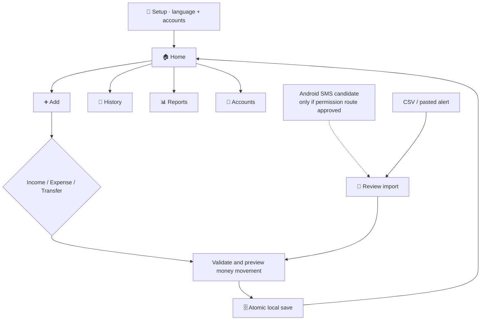
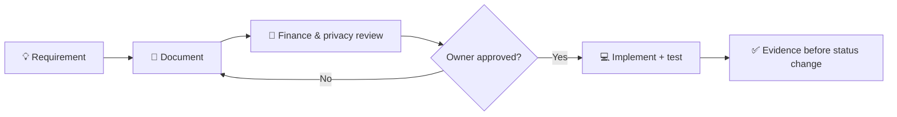

<div align="center">

# 📚 Tio Money · Documentation Hub

### One elegant map for product decisions, screen behavior, accounting accuracy and engineering delivery.


[🏠 Project Home](../README.md) · [🎯 PRD](01-PRD.md) · [🧭 User Flows](02-USER-FLOWS.md) · [🎨 Screen Design](03-SCREEN-SPEC.md) · [✍️ Style Guide](90-DOCS-STYLE-GUIDE.md)

</div>

---

> [!IMPORTANT]
> **Planning stage.** Documents capture product intent and testable proposals. They do not imply working code, native SMS permissions, launched products or approved production security. The PRD is a **draft** until reviewed.

## 🧭 Find the answer you need

| **You want to…** | **Read this first** | **You'll get** |
| :--- | :--- | :--- |
| Understand the product and MVP scope | [🎯 01 — Product Requirements](01-PRD.md) | Goals, screen contracts, scope, and acceptance criteria |
| Understand the exact `+` transaction experience | [🧭 02 — User Flows](02-USER-FLOWS.md) | Journey diagrams, fields, fee behavior, edge cases |
| Create new documentation consistent with the product | [✍️ 90 — Style & Quality Guide](90-DOCS-STYLE-GUIDE.md) | Page anatomy, diagrams, status labeling, quality checklist |
| Design original app screens | [🎨 03 — Screen Design Specification](03-SCREEN-SPEC.md) | Original visual direction, tokens, 10 screen contracts, acceptance tests |
| Design the financial data model | [🗄 04 — Database & Financial Ledger](04-DATABASE-DESIGN.md) | Double-entry postings, assets/liabilities, transfer fees, reconciliation |
| Build the Expo project | **05 — Technical Architecture** · next | Modules, Expo Go boundaries, integration decisions |
| Evaluate readiness for release | **06 — Implementation & Test Plan** · next | Test cases, milestones, permission and release gates |

## 💎 Product rules that must survive every design revision

| Rule | Why it matters |
| :--- | :--- |
| **One `+` action** | Home stays focused; transaction types appear inside one editor |
| **Transfer principal ≠ expense** | Moving money between your own accounts must not inflate spending |
| **Transfer fee = expense** | Real bank/card/wallet charges belong in the spending report |
| **Credit card ≠ ordinary cash account** | Outstanding liabilities must be modeled explicitly |
| **One local ledger** | Dashboard, account balances and reports cannot disagree |
| **Reference ≠ copy** | Provided screens are inspiration for fields/flow, not a UI to clone |
| **Expo Go ≠ native SMS access** | Android native integration requires a separate custom-build and policy path |

## 🗺 Product flow at a glance



## 📌 Documentation progress

| Artifact | Stage | Next action |
| :--- | :--- | :--- |
| Product requirements | 📝 Initial draft | Owner review, versioned decisions |
| Detailed flows | 📝 Initial draft | Confirm Save & Add Another and fee exceptions |
| Documentation design language | 📝 Initial standard | Apply to new and existing pages |
| [Screen specification](03-SCREEN-SPEC.md) | 📝 Initial draft | Review navigation, visual palette, fee disclosure |
| [Data model / ledger](04-DATABASE-DESIGN.md) | 📝 Initial draft | Review journal schema, reversal policy, credit-card postings |
| Architecture | ⚪ Not started | Confirm Expo package + native boundaries |
| Test/release plan | ⚪ Not started | Map every accounting rule to automated tests |

## 🧱 Information architecture

```text
Tio-Money/
├─ README.md
└─ docs/
   ├─ 00-INDEX.md                 ← You are here
   ├─ 01-PRD.md                   ← Product contract
   ├─ 02-USER-FLOWS.md            ← Interaction & edge cases
   ├─ 03-SCREEN-SPEC.md           ← Screen design draft
   ├─ 04-DATABASE-DESIGN.md       ← Ledger draft
   ├─ 05-TECH-ARCHITECTURE.md     ← Next
   ├─ 06-IMPLEMENTATION-TEST-PLAN.md ← Next
   └─ 90-DOCS-STYLE-GUIDE.md      ← Documentation contract
```

Only **05–06** are future placeholder paths; the other listed documents exist on the branch.

## 🔄 Review gate



**Next:** review the [screen design specification](03-SCREEN-SPEC.md), then plan the financial ledger and database. New files should follow the [documentation quality standard](90-DOCS-STYLE-GUIDE.md).

---

[← Project Home](../README.md) · [Product Requirements →](01-PRD.md)
