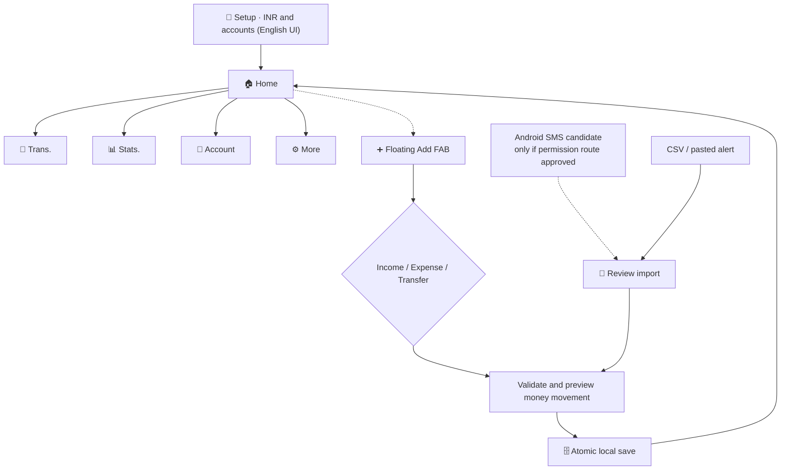
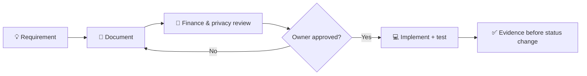

<div align="center">

# 📚 Tio Money · Documentation Hub

### One elegant map for product decisions, screen behavior, accounting accuracy and engineering delivery.


[🏠 Project Home](../README.md) · [🎯 PRD](01-PRD.md) · [🧭 User Flows](02-USER-FLOWS.md) · [🎨 Screen Design](03-SCREEN-SPEC.md) · [🏗 Architecture](05-TECH-ARCHITECTURE.md) · [🧪 Implementation & Tests](06-IMPLEMENTATION-TEST-PLAN.md) · [🧱 Phase 0 Notes](07-PHASE-0-FOUNDATION-NOTES.md) · [✍️ Style Guide](90-DOCS-STYLE-GUIDE.md)

</div>

---

> [!IMPORTANT]
> **Phase 0 code review stage.** The feature branch now contains an Expo Router UI shell and SQLite bootstrap **source**, not a working finance tracker. Native SMS, posted money, backups and production security are not implemented. The committed dependency lockfile and GitHub Actions checks are tracked in the Phase 0 notes; Android/iPhone Expo Go and real-device SQLite tests remain unverified. Product documents remain drafts.

## 🧭 Find the answer you need

| **You want to…** | **Read this first** | **You'll get** |
| :--- | :--- | :--- |
| Review confirmed owner decisions | [📌 Decision register](DECISIONS.md) | English-only initial app; approvals versus pending proposals |
| Understand the product and MVP scope | [🎯 01 — Product Requirements](01-PRD.md) | Goals, screen contracts, scope, and acceptance criteria |
| Understand the exact `+` transaction experience | [🧭 02 — User Flows](02-USER-FLOWS.md) | Journey diagrams, fields, fee behavior, edge cases |
| Create new documentation consistent with the product | [✍️ 90 — Style & Quality Guide](90-DOCS-STYLE-GUIDE.md) | Page anatomy, diagrams, status labeling, quality checklist |
| Design original app screens | [🎨 03 — Screen Design Specification](03-SCREEN-SPEC.md) | Original visual direction, tokens, 10 screen contracts, acceptance tests |
| Design the financial data model | [🗄 04 — Database & Financial Ledger](04-DATABASE-DESIGN.md) | Double-entry postings, assets/liabilities, transfer fees, reconciliation |
| Build the Expo project | [🏗 05 — Technical Architecture](05-TECH-ARCHITECTURE.md) · [🧱 Phase 0 Foundation Notes](07-PHASE-0-FOUNDATION-NOTES.md) | Modules, Expo Go boundaries, scaffold choices, remaining validation |
| Evaluate readiness for release | [🧪 06 — Implementation & Test Plan](06-IMPLEMENTATION-TEST-PLAN.md) | Phases 0–7, financial test cases, permissions, release gates and owner decisions |

## 💎 Product rules that must survive every design revision

| Rule | Why it matters |
| :--- | :--- |
| **One floating `+` action** | Five bottom destinations stay distinct; FAB opens one Income / Expense / Transfer editor ([TM-DEC-004](DECISIONS.md#tm-dec-004--five-destinations-and-floating-add)) |
| **Transfer principal ≠ expense** | Moving money between your own accounts must not inflate spending |
| **Transfer fee = expense** | Real bank/card/wallet charges belong in the spending report |
| **Credit card ≠ ordinary cash account** | Outstanding liabilities must be modeled explicitly |
| **One local ledger** | Dashboard, account balances and reports cannot disagree |
| **Reference ≠ copy** | Provided screens are inspiration for fields/flow, not a UI to clone |
| **Expo Go ≠ native SMS access** | Android native integration requires a separate custom-build and policy path |

## 🗺 Product flow at a glance



## 📌 Documentation progress

| Artifact | Stage | Next action |
| :--- | :--- | :--- |
| Product requirements | 📝 Initial draft | Owner review, versioned decisions |
| Detailed flows | 📝 Initial draft | Confirm Save & Add Another and fee exceptions |
| Documentation design language | 📝 Initial standard | Apply to new and existing pages |
| [Screen specification](03-SCREEN-SPEC.md) | 📝 Initial draft | Review navigation, visual palette, fee disclosure |
| [Data model / ledger](04-DATABASE-DESIGN.md) | 📝 Initial draft | Review journal schema, reversal policy, credit-card postings |
| [Technical architecture](05-TECH-ARCHITECTURE.md) | 📝 Initial draft | Review SQLite transaction strategy, Expo SDK and platform gates |
| [Implementation & test plan](06-IMPLEMENTATION-TEST-PLAN.md) | 📝 Initial draft | Owner review of milestone gates, finance test matrix and unresolved ADRs |
| [Phase 0 foundation notes](07-PHASE-0-FOUNDATION-NOTES.md) | 🧱 Scaffold source under review | Lockfile committed; review CI evidence and complete Expo Go/device verification |

## 🧱 Information architecture

```text
Tio-Money/
├─ README.md
└─ docs/
   ├─ 00-INDEX.md                 ← You are here
   ├─ 01-PRD.md                   ← Product contract
   ├─ 02-USER-FLOWS.md            ← Interaction & edge cases
   ├─ 03-SCREEN-SPEC.md           ← Screen design draft
   ├─ 04-DATABASE-DESIGN.md       ← Ledger draft
   ├─ 05-TECH-ARCHITECTURE.md     ← Architecture draft
   ├─ 06-IMPLEMENTATION-TEST-PLAN.md ← Phase-gated delivery & QA draft
   ├─ 07-PHASE-0-FOUNDATION-NOTES.md ← Scaffold choices & pending verification
   └─ 90-DOCS-STYLE-GUIDE.md      ← Documentation contract
```

All listed documentation files now exist. **06** is a planning draft, not evidence of implemented application features or passing tests.

## 🔄 Review gate



**Confirmed owner product decisions:** initial app copy, accessibility text and validation are **English only**, with no MVP language selector. See [TM-DEC-001](DECISIONS.md#tm-dec-001--english-only-initial-app). The Phase 0 navigation is [five destinations + floating FAB (TM-DEC-004)](DECISIONS.md#tm-dec-004--five-destinations-and-floating-add). Neither decision authorizes a PR merge.

**Next:** review the [technical architecture](05-TECH-ARCHITECTURE.md) and the [Implementation & Test Plan](06-IMPLEMENTATION-TEST-PLAN.md), then resolve owner decisions before coding. New files should follow the [documentation quality standard](90-DOCS-STYLE-GUIDE.md).

---

[← Project Home](../README.md) · [Product Requirements →](01-PRD.md)
