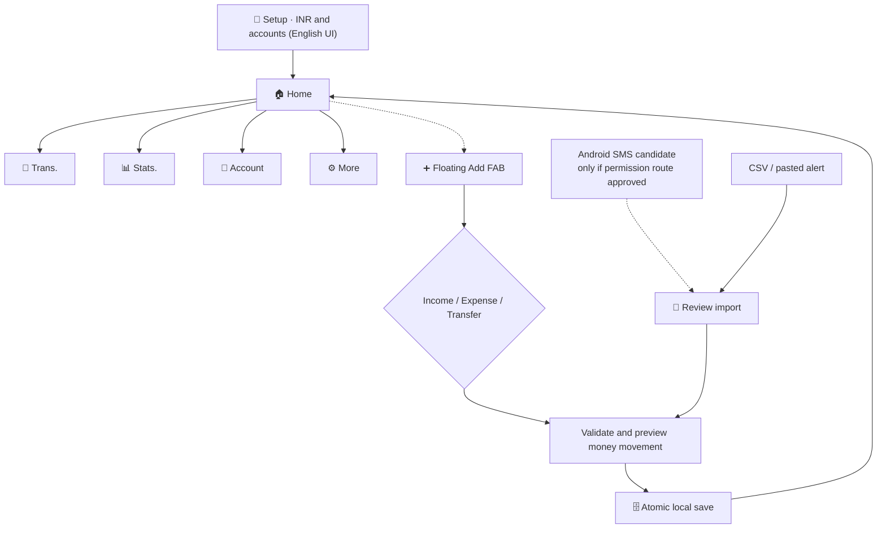
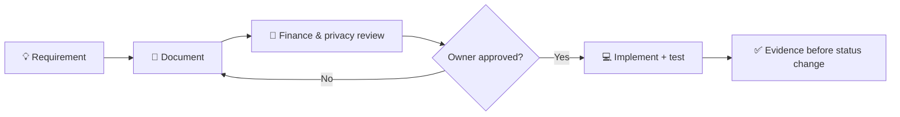

<div align="center">

# 📚 Tio Money · Documentation Hub

### One elegant map for product decisions, screen behavior, accounting accuracy and engineering delivery.


[🏠 Project Home](../README.md) · [🎯 PRD](01-PRD.md) · [🧭 User Flows](02-USER-FLOWS.md) · [🎨 Screen Design](03-SCREEN-SPEC.md) · [🏗 Architecture](05-TECH-ARCHITECTURE.md) · [🧪 Implementation & Tests](06-IMPLEMENTATION-TEST-PLAN.md) · [🧱 Phase 0 Notes](07-PHASE-0-FOUNDATION-NOTES.md) · [✍️ Style Guide](90-DOCS-STYLE-GUIDE.md)

</div>

---

> [!IMPORTANT]
> **Historical Phase 0 source snapshot (pre-merge PR #1, dated 2026-11-20; PR #1 later MERGED):** Five blank selectable screens and one disabled Google SVG Add over More; no top bar/editor/Settings/onboarding/finance posting/SMS. **Historical pre-merge visual tokens (superseded by later owner-approved UI):** five Google Material Symbols Outlined SVG tab icons (`home`, `book_2`, `bar_chart_4_bars`, `account_balance`, `more_horiz`) at weight **200** and size **24dp**; floating disabled Google `add` icon at weight **400**, size **24dp**; circular FAB **50dp**; nav baseline **50dp plus actual OS bottom inset** (1dp border + 1dp top padding + 48dp tab hit row); icon/label gap **1dp**; FAB-to-navigation vertical clearance **16dp**. FAB remains over the More tab, not at a fixed right-edge inset. **Historical pre-merge source evidence (2026-11-20):** On branch `feat/phase-0-expo-foundation`, source HEAD `c90d1c00462de5e4a5b007a87dade6641a106f40` passed [Phase 0 App CI #44600432345](https://github.com/im-tnyx/Tio-Money/actions/runs/44600432345) (npm/Expo checks, strict TypeScript, lint, Prettier, unit tests, Android/iOS Metro) and [governance CI #44600432365](https://github.com/im-tnyx/Tio-Money/actions/runs/44600432365) (Python tests, links and commit attribution). **Owner reports testing current UI on a physical device and no longer encountering the previous `ExpoSQLite` error.** Record as **OWNER_REPORTED_DEVICE_SMOKE_PASS**; device platform/model/OS/client version and full cold-restart evidence were **not provided**. On-device SQLite PRAGMA checks, migration persistence, both-platform signoff, accessibility/contrast matrix and formal M0 acceptance remain **NOT_VERIFIED**. This is not a new CI or independent device-test claim. See [Phase 0 Foundation Notes](07-PHASE-0-FOUNDATION-NOTES.md). Owner device smoke is reported, but full two-platform/SQLite QA and PR-specific merge permission are still pending. Future screen specs remain proposals.

## 🧭 New owner product direction · 2026-11-20

> [!IMPORTANT]
> **Stage 1:** complete **local SQLite** finance app (Cash, Bank, Wallet, Credit Card, Investment, Loan, full transaction/reporting system and conditional Main/Sub Currency with online **exchange-rate lookup only**). **Stage 2:** optional encrypted Google Drive/iCloud Drive backup and restore. **Stage 3:** optional Supabase synchronization with signup/signin **only after opt-in**. This is **future specification**, not current Phase 0 implementation. See [TM-DEC-006–009](DECISIONS.md#tm-dec-006--local-first-delivery-order-and-backup-boundary) and [RFC #13](https://github.com/im-tnyx/Tio-Money/issues/13).

| New product specification | Responsible contract |
| :--- | :--- |
| [08 · Account Groups](08-ACCOUNT-GROUPS-SPEC.md) | Dynamic Cash/Bank/Wallet/Card/Investment/Loan setup, account links and financial boundaries |
| [10 · Currency & Exchange Rates](10-CURRENCY-SPEC.md) | Main + optional distinct Sub Currency, refresh-on-use, stale offline fallback, unresolved ledger ADRs |
| [09 · Future Backup, Restore & Sync](09-BACKUP-SYNC-SPEC.md) | Stage 2 encrypted user-directed backup, Stage 3 optional Supabase/Auth; **design only, not implemented** |
| [11 · Stage 1 Finance ADR Register](11-STAGE-1-FINANCE-ADRS.md) | Canonical TM-ADR-011–023 decisions, accepted invariants versus blocked accounting/policy prerequisites and test vectors |
| [12 · Dumb-Screen Boundaries](12-DUMB-SCREEN-BOUNDARIES.md) | Owner-mandated strictly presentation-only screens, typed controller/domain/repository separation and future CI negative tests |
| [13 · Documentation Readiness & Gaps](13-DOCUMENTATION-READINESS.md) | Current code versus future requirements, pending owner/ADR gates, evidence and docs PR checklist |

**GitHub state reverified 2026-11-21:** [PR #14](https://github.com/im-tnyx/Tio-Money/pull/14) (merge `582893d0915622623f8c6b3fb9da0f1bbb0a4a60`), [PR #16](https://github.com/im-tnyx/Tio-Money/pull/16) (merge `6187b7a7e4c59949547c21655accf50dec8d0dfd`) and [PR #22](https://github.com/im-tnyx/Tio-Money/pull/22) (merge `f4332eb338ca75e27a5b35ff57511f522a4bb96a`) are **MERGED into main**. Earlier Draft/unmerged task checkpoints are historical. Current Phase 0 has **four blank finance tabs (Home/Trans./Stats./Account), implemented More → Appearance**, and a disabled floating Add; financial features, future backups and Supabase Auth **are not implemented**. The five-blank shell described for PR #1 is historical. Owner-reported Android smoke is not iPhone/SQLite end-to-end QA.

### Protected bottom tabs · owner clarification (2026-11-20)

**Current bottom-navigation baseline (2026-11-21):** Preserve the five labels/order and existing Material Symbols SVG roles, 24dp icons, **selected 300 / inactive 200**, **0dp icon-label gap**, 50dp bar baseline + OS inset, a separate **disabled 50dp Add** above More with 16dp clearance, and **160ms Reduced Motion-aware tab-content crossfade**. Later owner-approved refinements supersede earlier TM-DEC-010 numeric values; this documentation PR does not change UI. See [source tokens](../src/shared/theme/component-tokens.ts) and [TM-DEC-010](DECISIONS.md#tm-dec-010--bottom-navigation-ui-freeze).

## 🧭 Find the answer you need

| **You want to…** | **Read this first** | **You'll get** |
| :--- | :--- | :--- |
| Review confirmed owner decisions | [📌 Decision register](DECISIONS.md) | English-only initial app; approvals versus pending proposals |
| Define the new account-group system | [08 — Account Groups](08-ACCOUNT-GROUPS-SPEC.md) | Six group forms, payment options, card/loan/investment rules and open ADRs |
| Define currency behavior | [10 — Currency & FX](10-CURRENCY-SPEC.md) | Main/Sub Currency selection, refresh-on-use and offline fallback |
| Plan recovery and optional cloud | [09 — Backup, Restore & Sync](09-BACKUP-SYNC-SPEC.md) | Stage 2 encryption/restore and Stage 3 optional consent/auth/tenant isolation |
| Understand the product and MVP scope | [🎯 01 — Product Requirements](01-PRD.md) | Goals, screen contracts, scope, and acceptance criteria |
| Understand the exact `+` transaction experience | [🧭 02 — User Flows](02-USER-FLOWS.md) | Journey diagrams, fields, fee behavior, edge cases |
| Create new documentation consistent with the product | [✍️ 90 — Style & Quality Guide](90-DOCS-STYLE-GUIDE.md) | Page anatomy, diagrams, status labeling, quality checklist |
| Understand current shell vs future finance screens | [🎨 03 — Screen Design Specification](03-SCREEN-SPEC.md) · [Core Theme ownership](../src/shared/theme/README.md) | Four blank finance tabs + **More → Appearance**, disabled Add and centralized tokens distinguished from future finance screens |
| Design the financial data model | [🗄 04 — Database & Financial Ledger](04-DATABASE-DESIGN.md) | Double-entry postings, assets/liabilities, transfer fees, reconciliation |
| Review actual Phase 0 structure and future boundaries | [🏗 05 — Technical Architecture](05-TECH-ARCHITECTURE.md) · [🧱 Phase 0 Foundation Notes](07-PHASE-0-FOUNDATION-NOTES.md) | Typed central theme, navigation/boot controllers, four blank finance routes + More Appearance, Expo Go limits and remaining real-device QA |
| Evaluate readiness for release | [🧪 06 — Implementation & Test Plan](06-IMPLEMENTATION-TEST-PLAN.md) | Phases 0–7, financial test cases, permissions, release gates and owner decisions |

**Live UI read-back (2026-11-21, `main` `118830c94a7af78dd2c29fdf6d3f7ab561cf4c1a`):** Five tab destinations remain **Home · Trans. · Stats. · Account · More**. The first **four finance screens are blank**; **More implements persistent System/Light/Dark Appearance** with controller `useMoreViewModel` and a presentation-only `MoreScreen`. Source tokens now use **selected icon weight 300, inactive 200, 0dp icon-label gap, 160ms reduced-motion-aware content crossfade**, a separate disabled 50dp Add above More with 16dp clearance and unchanged five-destination bar. Prior five-blank, selected-200 and 1dp text is historical and superseded by later owner refinements. [Current More details](MORE-APPEARANCE.md) · [navigation source tokens](../src/shared/theme/component-tokens.ts).

**New mandatory architecture gate:** all future **screens are strictly dumb/presentation-only** (owner TM-DEC-011): typed ViewModels and callbacks only, with no workflow state/navigation/SQL/business calculation, FX or permissions in screens. Read [12 — Screen Boundary](12-DUMB-SCREEN-BOUNDARIES.md). The [11 — Finance ADR Register](11-STAGE-1-FINANCE-ADRS.md) is the *single decision/status map* for the finance implementation gate; unanswered owner/provider/interest/valuation/cross-currency policies remain **BLOCKED**.

## 💎 Product rules that must survive every design revision

| Rule | Why it matters |
| :--- | :--- |
| **Disabled floating `+` (current)** | Five root destinations, four blank finance bodies and **More → Appearance** active; the right-aligned Add remains disabled with no finance editor ([TM-DEC-005 historical baseline](DECISIONS.md#tm-dec-005--phase-0-empty-navigation-shell-and-disabled-fab)) |
| **Transfer principal ≠ expense** | Moving money between your own accounts must not inflate spending |
| **Transfer fee = expense** | Real bank/card/wallet charges belong in the spending report |
| **Credit card ≠ ordinary cash account** | Outstanding liabilities must be modeled explicitly |
| **One local ledger** | Dashboard, account balances and reports cannot disagree |
| **Reference ≠ copy** | Provided screens are inspiration for fields/flow, not a UI to clone |
| **Expo Go ≠ native SMS access** | Android native integration requires a separate custom-build and policy path |

**Documentation gap follow-up (2026-11-21):** [readiness register](13-DOCUMENTATION-READINESS.md) records the **remaining decisions and implementation gates** without treating proposed Stage 1 accounting, encrypted backup, or Supabase integration as approved/shipped. It also marks the stale pre-merge README checkpoint as historical.

## 🗺 Future product flow at a glance

> **Planning diagram only.** Add/editor, Save, import and financial reports remain **future**; current source shows four blank finance tabs, implemented **More → Appearance**, and disabled Add.



## 📌 Documentation progress

| Artifact | Stage | Next action |
| :--- | :--- | :--- |
| Product requirements | 📝 Initial draft + 2026-11-20 owner-direction overlay | Reconcile future stage scope across flows/DB/architecture/test plan |
| Detailed flows | 📝 Initial draft | Confirm Save & Add Another and fee exceptions |
| Documentation design language | 📝 Initial standard | Apply to new and existing pages |
| [Account groups](08-ACCOUNT-GROUPS-SPEC.md) | 📝 New draft | Review loan/valuation/card billing ADRs before implementation |
| [Currency & FX](10-CURRENCY-SPEC.md) | 📝 New draft | Approve multi-currency ledger and FX provider ADRs before implementation |
| [Backup, restore & future sync](09-BACKUP-SYNC-SPEC.md) | 📝 Stage 2–3 future design draft | Crypto/key/restore and tenant sync threat models remain future blockers |
| [Screen specification](03-SCREEN-SPEC.md) | 📝 Current shell documented + future feature draft | Review future palette, fee disclosure and new feature approvals separately from already-decided five-tab navigation |
| [Data model / ledger](04-DATABASE-DESIGN.md) | 📝 Initial draft | Review journal schema, reversal policy, credit-card postings |
| [Technical architecture](05-TECH-ARCHITECTURE.md) | 🧱 Current Phase 0 and future proposal separated | Verify remaining SQLite/device acceptance, future ledger architecture and platform gates |
| [Implementation & test plan](06-IMPLEMENTATION-TEST-PLAN.md) | 📝 Older submilestones + Stage 1–3 owner direction | Review stage gates, frozen bottom-nav tests, finance/backup/sync acceptance and unresolved ADRs |
| [Phase 0 foundation notes](07-PHASE-0-FOUNDATION-NOTES.md) | 🧱 Historical Phase 0 scaffold, now merged | Preserve historical QA/CI evidence; verify remaining two-platform/device SQLite tests separately from new finance work |

## 🧱 Information architecture

```text
Tio-Money/
├─ README.md
└─ docs/
   ├─ 00-INDEX.md                 ← You are here
   ├─ 01-PRD.md                   ← Product contract
   ├─ 02-USER-FLOWS.md            ← Interaction & edge cases
   ├─ 03-SCREEN-SPEC.md           ← Screen design draft
   ├─ 04-DATABASE-DESIGN.md       ← Ledger draft
   ├─ 05-TECH-ARCHITECTURE.md     ← Architecture draft
   ├─ 06-IMPLEMENTATION-TEST-PLAN.md ← Phase-gated delivery & QA draft
   ├─ 07-PHASE-0-FOUNDATION-NOTES.md ← Scaffold choices & pending verification
   ├─ 08-ACCOUNT-GROUPS-SPEC.md    ← Six group contracts
   ├─ 09-BACKUP-SYNC-SPEC.md       ← Future encrypted backup and optional sync
   ├─ 10-CURRENCY-SPEC.md          ← Main/Sub Currency, FX refresh
   └─ 90-DOCS-STYLE-GUIDE.md      ← Documentation contract
```

All listed documentation files now exist. **06** is a planning draft, not evidence of implemented application features or passing tests.

## 🔄 Review gate



**Confirmed owner decisions:** English-only current copy and strict [TM-DEC-011 dumb screens](DECISIONS.md#tm-dec-011--strict-dumb-screen-presentation-only-rule). [TM-DEC-005](DECISIONS.md#tm-dec-005--phase-0-empty-navigation-shell-and-disabled-fab) five-blank shell is **historical** where More Appearance has been implemented; the four finance bodies remain blank, the five tabs and disabled Add persist. Later 300/200 icons, 0dp gap and 160ms crossfade are current owner-approved source, not changes introduced by PR #24.

**Next:** review the [technical architecture](05-TECH-ARCHITECTURE.md) and the [Implementation & Test Plan](06-IMPLEMENTATION-TEST-PLAN.md), then resolve owner decisions before coding. New files should follow the [documentation quality standard](90-DOCS-STYLE-GUIDE.md).

---

[← Project Home](../README.md) · [Product Requirements →](01-PRD.md)
