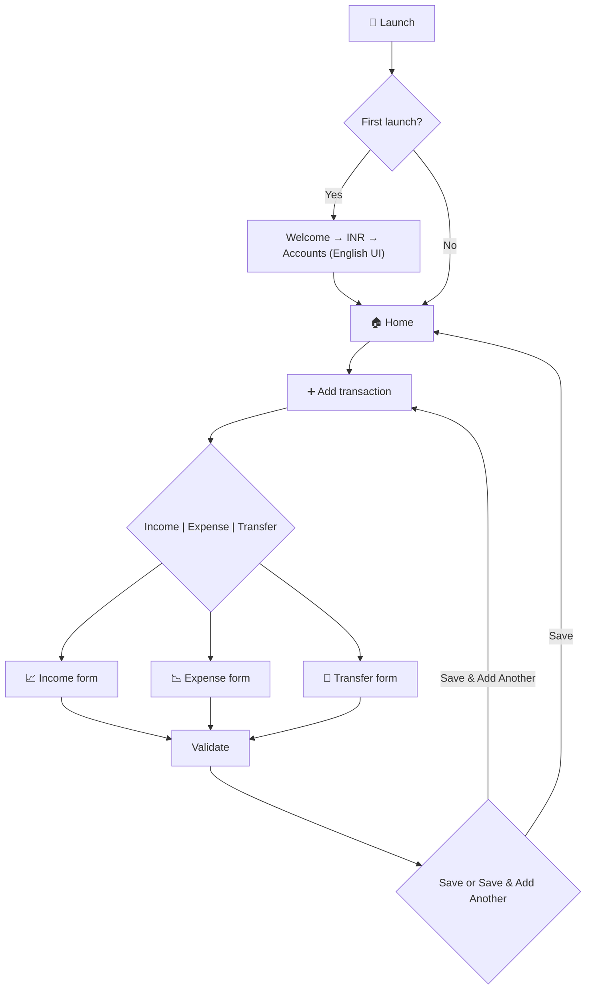
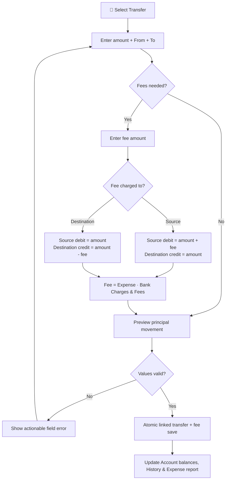
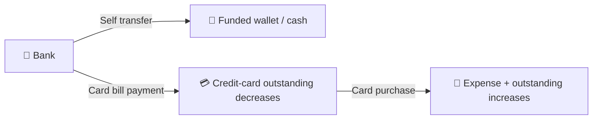
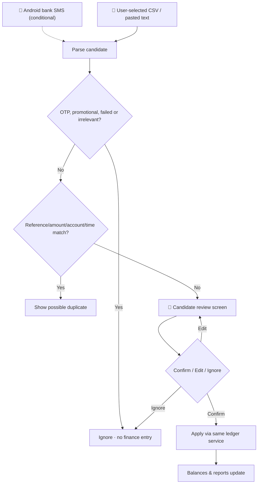

# 🧭 02 · User Journeys & Transaction Flows

### From a single `+` tap to a trustworthy financial record.

[🏠 Home](../README.md) · [📚 Docs Hub](00-INDEX.md) · [🎯 Requirements](01-PRD.md) · [✍️ Standards](90-DOCS-STYLE-GUIDE.md)

---

> [!NOTE]
> **Design intent, not a pixel-perfect clone.** The supplied Income/Expense/Transfer screenshots are references for tabs, fields and the optional Fees action. The final Tio Money visual system will be original.

## 01 · The navigation promise

**Initial onboarding is English-only:** no language picker in the MVP; future locales remain a separate enhancement ([TM-DEC-001](DECISIONS.md#tm-dec-001--english-only-initial-app)).

**Home stays clean:** one `+` (Add) control opens one unified transaction editor. The Home screen does **not** show three Income / Expense / Transfer shortcut tiles.

### Navigation skeleton

| Entry | Destination | Key behavior |
| :--- | :--- | :--- |
| Home `+` | Transaction editor | Last-used tab may be preserved only if owner approves |
| Income tab | Income fields | Category and receiving account required |
| Expense tab | Expense fields | Category and paying account required |
| Transfer tab | Transfer fields | From and To required; optional Fees |
| Save | Return to origin | Show success and freshly derived balances |
| Save & Add Another | Fresh editor | Never save duplicate when tapped twice |
| Back with changes | Confirm discard or keep editing | Never silently lose typed values |

## 02 · Three transaction types

| Field | 📈 Income | 📉 Expense | 🔄 Transfer |
| :--- | :---: | :---: | :---: |
| Date/time | ✓ | ✓ | ✓ |
| Positive amount | ✓ | ✓ | ✓ |
| Category | Income category | Expense category | — |
| Account | **To** | **From** | **From + To** |
| Optional Fees | — | — | ✓ |
| Optional note/description | ✓ | ✓ | ✓ |
| Save / Add Another | ✓ | ✓ | ✓ |

**Type rules:** Internal transfers never contribute principal to income or expense; money arriving from an external payer is not automatically assumed to be salary/income when it could be a refund or a transfer between owned accounts.

## 03 · Transfer fees — important money rule

Fees are **optional** and **collapsed by default**. The Fee action reveals an amount, account charged, and an expense-category preview.

### Worked example · Fee charged to source account

**Before:** SBI ₹10,000 · HDFC ₹500.  
**Action:** transfer ₹5,000 with ₹50 fee paid by SBI.

| Ledger impact | Amount | Classification |
| :--- | ---: | :--- |
| SBI change | **−₹5,050** | Source outflow |
| HDFC change | **+₹5,000** | Destination inflow |
| Transfer principal | ₹5,000 | Internal movement — **not income or expense** |
| Bank Charges & Fees | **₹50** | **Expense** |
| Combined assets | ₹10,500 → **₹10,450** | Only the fee reduces the total |

**Atomicity:** If writing the fee expense fails, the transfer must not be committed alone. If a linked transfer is edited/deleted, its fee must follow the edit/delete safely.

### Worked example · Fee deducted from destination

**Action:** source sends ₹5,000; recipient account receives ₹4,950; ₹50 is withheld as a fee.

| From account | To account | Expense |
| ---: | ---: | ---: |
| −₹5,000 | +₹4,950 | +₹50 |

**Validation:** Fee cannot be negative; destination-reduced fees cannot exceed the principal; identical From/To accounts are invalid. For credit-card transfers, show the correct liability change rather than treating the card as an ordinary asset account.

## 04 · Account flows: asset versus credit card

- **Bank → Cash:** bank goes down, cash goes up, combined assets stay unchanged.
- **Bank → Credit card repayment:** bank cash goes down, card outstanding also decreases. Net worth does not change before fees.
- **Card purchase:** creates expense and increases card debt.
- **Card cash advance:** creates asset inflow plus card liability, with any real charges booked to expenses.
- **UPI linked to bank:** do not double-count the same bank funds as a separate funded wallet.

## 05 · Transaction review and import flows

> [!IMPORTANT]
> **Platform boundary:** Reading incoming bank SMS requires an Android native module, not Expo Go, and distribution depends on restrictive Google Play permission policy. Third-party iOS apps cannot continuously read the SMS inbox. CSV and user-selected text import form the shared cross-platform alternative. Bank credentials/OTPs are not required.

### Import review quality contract

- Do not assume every credit alert equals income.
- Match manual entries and both legs of self-transfers before creating new entries.
- Reference IDs are not necessarily globally unique.
- Let the user correct category, account and date before confirmation.
- Retain only minimal import metadata; unrelated raw SMS and OTP must not be saved.

## 06 · Error, empty and recovery states

| Situation | Desired behavior |
| :--- | :--- |
| No accounts available | Offer **Add account**, then resume the unfinished transaction |
| Empty or zero amount | Inline validation; no write |
| Fee exceeds transferred amount (destination deducted) | Block save, explain why |
| From and To are the same | Explain that a transfer needs two distinct accounts |
| App closes mid-entry | Don't claim autosave; future draft recovery needs explicit implementation |
| Save fails halfway | Roll back all linked changes; clear error and retry |
| Duplicate save tap | Disable/reject duplicate submission while saving |
| Offline | Manual tracking works; cloud-dependent features say unavailable |
| SMS permission unavailable | Manual and CSV/text import still work |
| Imported debit later reversed | Link reversal/refund; don't double-count expenses |
| Credit card insufficient context | Ask for account class instead of silently using bank-account math |

## 07 · Acceptance walkthroughs for developers

- [ ] Tap the only `+` action; all three tabs appear inside one editor.
- [ ] A ₹500 cash expense reduces Cash ₹500 and adds exactly ₹500 to expenses.
- [ ] A ₹5,000 income adds ₹5,000 to the chosen receiving account.
- [ ] An internal ₹2,000 bank→cash transfer changes only account balances.
- [ ] A ₹5,000 bank→bank transfer with ₹50 source-side fee charges exactly ₹50 expense.
- [ ] Destination-side fee reduces destination receipt correctly.
- [ ] Fees and principal commit together or neither commits.
- [ ] Editing/deleting a linked transfer also updates/removes its fee safely.
- [ ] Credit card repayment changes bank and liability, not income/expenses.
- [ ] Same SMS/CSV transaction is not recorded twice.
- [ ] Core manual flows work in Expo Go without network access.

## 08 · Related specifications

- [🎯 Product Requirements](01-PRD.md) — normative product scope and business rules.
- [✍️ Documentation Style](90-DOCS-STYLE-GUIDE.md) — document quality and visual language.
- [🎨 Screen design specification](03-SCREEN-SPEC.md) — original visual patterns, accessibility and field-state definitions.
- **Next:** Database design — signed journal / accounting invariant and SQLite schema.

---

[← Documentation Hub](00-INDEX.md) · [Review PRD →](01-PRD.md)
