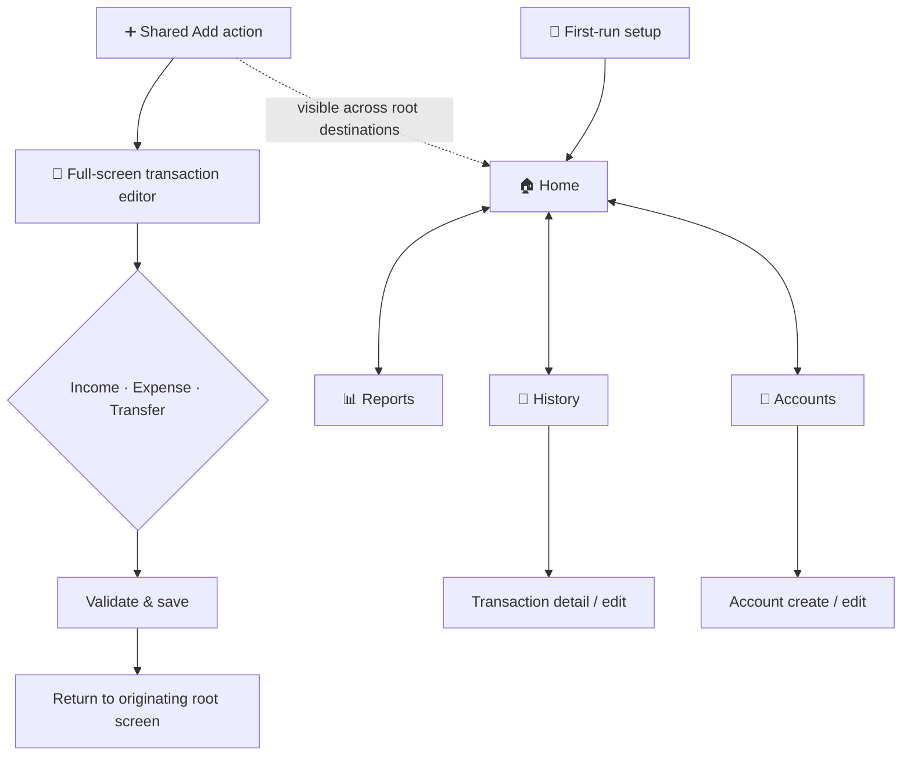
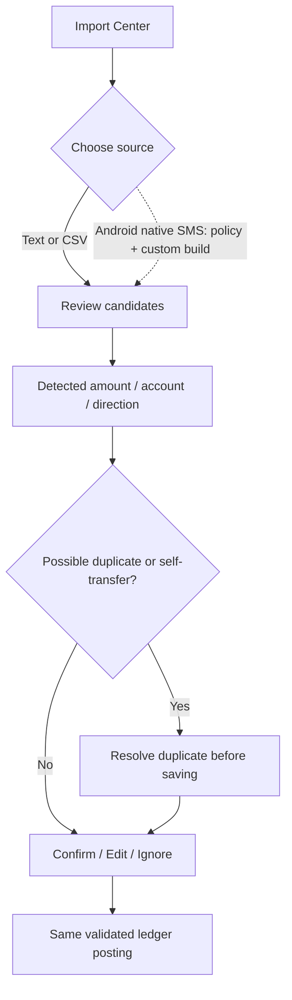

<div align="center">

# 🎨 03 · Screen Design Specification

### An original mobile experience for clear decisions, fast entry and trustworthy money math.


[🏠 Project](../README.md) · [📚 Docs Hub](00-INDEX.md) · [🎯 Product Requirements](01-PRD.md) · [🧭 User Flows](02-USER-FLOWS.md) · [✍️ Documentation Style](90-DOCS-STYLE-GUIDE.md)

</div>

---

> [!IMPORTANT]
> **Draft design contract — no UI has been built.** The owner-supplied screenshots communicate possible form fields and a three-tab interaction. They are **not** assets, colors, typography, component shapes or layouts to reproduce. This proposal defines **Tio Money's own design direction**. Final colors, placement and copy need review; no mockup here should be mistaken for a working screen.

## 01 · Executive design direction

**Personality:** calm · contemporary · trustworthy · precise · approachable. Finance tools must make **the movement of money** more obvious than decoration.

| Design promise | What the user experiences | Deliberately avoid |
| :--- | :--- | :--- |
| **Single entry point** | One recognizable **`+`** leads to a common Income / Expense / Transfer editor | Three action shortcuts on Home |
| **Numbers first** | Money totals, dates and account names are scannable | Loud decorative gradients behind essential numbers |
| **Math without surprises** | Every transfer previews what leaves, what arrives, and what is a fee expense | Treating transfer principal as spending |
| **One consistent language** | Same form structure, controls and messages across both OSs | Platform screenshots copied pixel for pixel |
| **Local-first trust** | Offline entry always visible; privacy/import controls are explicit | Pretending Expo Go can read SMS |
| **Accessible by design** | Scalable text, screen reader labels, generous tap targets and contrast | Red/green color as the only status signal |

### 1.1 Scope boundaries

| Phase | Screens / interactions | Status |
| :--- | :--- | :--- |
| **P0 · Core Expo Go** | Setup, Home, Add, History, Account management, Reports, Settings basics | **Specified here, not implemented** |
| **P1 · Cross-platform import** | Import source, candidate review, deduplication states | **Specified at flow level** |
| **Conditional Android native** | SMS permission rationale, review inbox, opt-out | **Requires policy eligibility + custom development build** |
| **P2 / later** | Budgets, recurring/instalments, secure backup/sync, advanced receipt management | **Future design only** |

## 02 · Navigation architecture

### 2.1 Proposal: five positions, one action

Use a shared bottom bar with **four navigable destinations** and a **central action**:

| Left | Left-center | Center | Right-center | Right |
| :---: | :---: | :---: | :---: | :---: |
| **Home** | **History** | **`+` Add** | **Reports** | **Accounts** |
| Root screen | Root screen | **Opens editor; not a root tab** | Root screen | Root screen |

- **Exactly one `+` control in the root shell.** The Home content itself must **not** add a second `+` or separate Income, Expense and Transfer shortcut cards.
- Tapping `+` pushes a **full-screen Add Transaction editor** with its own header and form.
- Root bottom bar is hidden on full-screen editor, detail pages, onboarding, keyboard-driven modal tasks and approval dialogs as appropriate.
- **Settings** opens from a shared, labeled top-bar action/profile menu (not an extra bottom-tab destination).
- Central `+` has a text/accessibility label (`Add transaction`) even if the compact visual uses only the symbol.
- This placement is an **initial design proposal**, not a previously approved owner choice. The confirmed requirement is **one primary `+` entry**, irrespective of final placement.



### 2.2 Header / route rules

| Level | Header | Back | Bottom bar |
| :--- | :--- | :--- | :--- |
| Root | Friendly page title + context action | No back button | Visible |
| Add editor | `Add transaction` + optional close | Confirm if dirty | Hidden |
| Detail / Edit | Contextual title + navigation | Returns to caller | Hidden |
| Sheet / selection | Single label + Close/Done | Dismiss to form without losing other fields | Hidden behind overlay |
| Setup | Step title + progress | Previous step where safe | Hidden |

**Safe-area contract:** iPhone home indicator, Android navigation areas, cutouts, status bar and keyboard must not cover amounts or primary actions.

## 03 · Tio Money visual language — proposed tokens

The design uses a **warm neutral canvas, deep ink, subtle violet brand signal and restrained semantic colors**. It should feel polished but never confuse colored accents with financial meaning. **These are candidate mobile UI tokens**, distinct from the purple badges used for the GitHub documentation.

### 3.1 Light & dark palette

| Semantic token | Light candidate | Dark candidate | Intended use |
| :--- | :--- | :--- | :--- |
| `surface.canvas` | `#F7F8FC` | `#0C1018` | Main background |
| `surface.card` | `#FFFFFF` | `#181F2B` | Summary and group surfaces |
| `surface.elevated` | `#F0F2F8` | `#242D3B` | Inputs, sheets, secondary surfaces |
| `text.primary` | `#172033` | `#F6F8FC` | Main amounts and titles |
| `text.secondary` | `#5B6578` | `#B6C0D0` | Descriptions and metadata |
| `border.subtle` | `#E1E6EE` | `#374254` | Row separators |
| `brand.primary` | `#6049CF` | `#A99BFF` | Primary action and focus |
| `money.income` | `#147D66` | `#5DE0B0` | Credits / positive |
| `money.expense` | `#BC4055` | `#FF8D9C` | Spending / negative |
| `money.transfer` | `#446A9C` | `#9AC6FF` | Internal movement |
| `state.warning` | `#93611E` | `#FFC77A` | Review needed; not for normal transfers |

**Contrast check required:** These are candidates, **not tested WCAG-compliant pairings**. Verify text-on-surface, selected/unselected tabs, disabled buttons, focus/error states and charts in both themes before approving a palette. Do not use a bright background with illegible white text.

### 3.2 Type, spacing and shape

| Element | Candidate rule | Why |
| :--- | :--- | :--- |
| Display balance | 32–36sp/pt, semibold, tabular numerals where available | Quick money scan |
| Screen title | 24–28sp/pt, semibold | Clear hierarchy |
| Section title | 16–18sp/pt, semibold | Stable rhythm |
| Body / field value | At least 16sp/pt in core forms | Readable and keyboard friendly |
| Caption | ~13–14sp/pt, responsive | Useful but subordinate |
| Grid | 4 / 8 / 12 / 16 / 24 / 32 | Predictable vertical rhythm |
| Content gutter | 16–20dp/pt | Consistent margins |
| Cards | 16–20 radius | Soft without clutter |
| Buttons | 12–16 radius; minimum 48dp Android / 44pt iOS touch target | Easy to use |
| Icons | One consistent outline family, ~20–24 | Familiar meanings |
| Motion | 160–220ms simple transitions; respect reduced motion | Calm feedback, not animation-heavy |

**Money format:** `₹12,500.00` where fractional precision is relevant; group Indian digits; avoid forcing decimals when a summary design intentionally rounds *display only*. Storage stays integer paise; never round before ledger calculation.

### 3.3 Color semantics and tone

- Income shows **`+` + label** as well as positive coloring.
- Expense shows **`−` + label** and does not make red the sole cue.
- Transfer shows a **two-way arrow**, `From → To`, and separate fee details.
- Neutral typography is used for total balance; net worth/credit-card outstanding are **named**, never shown as an unlabeled balance.
- App copy is friendly, short and precise. No guilt-oriented labels (e.g., “bad spending”).

## 04 · Design-system component contracts

| Component | Intent | Required states |
| :--- | :--- | :--- |
| `AppShell` | Shared root layout and safe areas | Loading, active root, modal overlay |
| `TopBar` | Title, back, contextual action | Root, nested, editor |
| `BottomNav` | Four destinations + one Add action | Active, keyboard, safe-area |
| `MoneyAmount` | INR formatting with accessible sign | Positive, negative, neutral, hidden/private |
| `SummaryCard` | Context + total + period | Loading, populated, empty |
| `TransactionRow` | Icon, merchant/category, account, amount, date | Income, expense, transfer, pending import |
| `TypeTabs` | Income / Expense / Transfer | Selected, unselected, accessibility announced |
| `FormField` | Visible label, helper, validation | Idle, focused, invalid, disabled |
| `AccountPicker` | Select owned account | Empty, selection, archived/missing |
| `CategoryPicker` | Choose compatible category | Empty, selected, custom |
| `FeeDisclosure` | Expand optional transfer charges | Collapsed by default; expanded; invalid |
| `MoneyMovementPreview` | Show debit, receipt and fee expense | Without fee, source fee, destination fee |
| `PrimaryCTA` | Save | Enabled, submitting, success, error |
| `SecondaryCTA` | Save & Add Another | Enabled, submitting, error |
| `EmptyState` | Explain absent data + one next step | No accounts, no transactions, no imports |
| `FeedbackBanner` | Nonblocking status | Success, warning, error |
| `ConfirmDialog` | Prevent destructive loss | Dirty form, delete, irreversible action |

**Architecture boundary:** presentational components render typed data and emit user intents; they do not calculate balances, parse SMS, or write SQLite. That work belongs to state/domain/data modules specified later.

## 05 · Screen inventory and specifications

### SCREEN 01 · First-run setup `TM-S01` · P0

**Purpose:** Give the user an immediately useful offline tracker.


- Welcome: short value proposition; **Get started**; no forced bank login/signup.
- Language: Hindi or English; currency defaults to INR.
- Account: Cash, Bank, funded Wallet or Credit Card (liability).
- Opening balance wording: **Available balance** for assets; **Amount owed** for credit card.
- Confirm screen summarizes what will be stored locally; distinguish future backup from current local storage.
- Validation: no blank account name; sensible number format; prevent creating an unusable first account.
- State: first launch, validation error, database setup failure, resumed setup.

### SCREEN 02 · Home dashboard `TM-S02` · P0

**Purpose:** At a glance — how much do I have, what did I spend, what changed recently?

```text
┌───────────────────────────────────┐
│ Tio Money                  Settings│
│ Good evening                       │
│                                   │
│  TOTAL ASSETS        NET WORTH      │
│  ₹24,500             ₹21,800        │
│  Credit card owed: ₹2,700           │
│                                   │
│ ┌──────────────┬─────────────────┐  │
│ │Income        │Expense          │  │
│ │+₹35,000      │−₹10,500         │  │
│ └──────────────┴─────────────────┘  │
│                                   │
│ Recent activity         See all   │
│  Grocery     · Cash       −₹650   │
│  Salary      · SBI      +₹30,000  │
│  Bank → Cash            ₹2,000    │
│                                   │
│ Home    History   [+]  Reports Accounts│
└───────────────────────────────────┘
```

*Layout illustration, not final screenshot; sample numbers are fictional.*

- Header with page identity, accessible Settings action.
- Primary summary distinguishes **Total Assets**, **Liabilities** and **Net Worth** rather than showing a misleading all-inclusive “balance”.
- Period switch (Today / Month) for income and expense summary; label period clearly.
- Latest 5 activities; transfer principal visually neutral; linked fees display under movement detail or as a clearly related fee line.
- **One shared Add `+` action**. No extra action card section.
- Empty: “No transactions yet” plus supporting copy pointing to `+` (not a second add button).
- Refresh of local figures is derived from canonical ledger, not a remote sync illusion.

### SCREEN 03 · Add transaction `TM-S03` · P0

**Purpose:** Save any standard money event in a small number of predictable steps.

```text
┌───────────────────────────────────┐
│ ←  Add transaction                 │
│ [ Income ] [ Expense ] [ Transfer ]│
│                                   │
│            ₹ 0.00                 │
│         Enter amount              │
│                                   │
│ Date & time     [ Today · 7:35 PM ]│
│ Category        [ Select          ]│
│ Account         [ Choose          ]│
│ Note            [ Optional        ]│
│ Description     [ Optional        ]│
│                                   │
│ [      Save      ] [ Save & Add  ] │
│                   [ Another     ]  │
└───────────────────────────────────┘
```

*Field arrangement is a unique proposed composition, not the row-for-row screenshot.*

**Common behavior**

- Exactly three tabs; switching changes available fields while retaining compatible values only when safe.
- Amount input has large formatting, rupee marker, decimal keyboard, accessible numeric error and **max two decimal places**.
- Date/time defaults to the user's local current time (not a hard-coded date from reference screenshots).
- Use direct labels; never substitute placeholders for field labels.
- The form scrolls while the footer CTA respects keyboard and safe area.
- **Save:** validate → one atomic write → success → return to origin.
- **Save & Add Another:** validate → write once → show success → reset input for next entry on the same transaction tab (proposed; awaiting owner decision on defaults).
- Rapid double tap must not submit twice; disable actions while saving.
- Discard changes: explicit Cancel/Keep editing dialog.

#### Tab A — Income `TM-S03-A`

| Field | Required | UI contract |
| :--- | :---: | :--- |
| Amount | Yes | Positive INR |
| Date/time | Yes | Editable default current |
| Category | Yes | Income-only list (salary, business, gift, other) |
| To account | Yes | Receives money; class-aware |
| Note / Description | No | Optional detail |

**Safe classification:** a credit from another owned account or refund must not automatically be classified as salary; user can choose the correct money event.

#### Tab B — Expense `TM-S03-B`

| Field | Required | UI contract |
| :--- | :---: | :--- |
| Amount | Yes | Positive INR |
| Date/time | Yes | Editable |
| Category | Yes | Expense-only list |
| From account | Yes | Pays bill; credit-card class supported |
| Note / Description | No | Optional detail |

If credit card is selected, the UI clarifies **“Adds to card outstanding”**, not “decreases cash balance”.

#### Tab C — Transfer `TM-S03-C`

```text
┌───────────────────────────────────┐
│ ←  Add transaction                 │
│ [ Income ] [ Expense ] [ TRANSFER ]│
│                                   │
│             ₹5,000                │
│ Date & time  [ Today · 7:35 PM ]   │
│ From         [ SBI Bank        ▾ ]│
│ To           [ HDFC Bank       ▾ ]│
│                     [ ⇅ Swap ]    │
│                                   │
│ [ + Add transfer fees ]            │
│                                   │
│ ┌──────── Movement preview ──────┐ │
│ │ SBI debit           ₹5,000     │ │
│ │ HDFC credit         ₹5,000     │ │
│ │ Expense from fee        ₹0     │ │
│ └───────────────────────────────┘ │
│ Note / Description  (optional)     │
│                                   │
│ [ Save ] [ Save & Add Another ]    │
└───────────────────────────────────┘
```

**When fees are added (the important special case):**

- `+ Add transfer fees` expands an **inline fee section**, not a separate transaction-type shortcut.
- User enters **Fee amount**, **Fee charged to** (source / destination) and sees `Bank Charges & Fees` as expense category (editable when accounting design allows).
- The live movement preview must update *before* Save, including separate values for source debit, destination credit, and expense reported.
- Fee amount `0` is equivalent to no fee; collapse section may remove fee input after clear confirmation if a nonzero amount was entered.
- Destination-deducted fee cannot exceed transfer amount.
- **From** and **To** must differ; the Swap control flips them but **must not silently reverse fee payer semantics** — show the new fee origin in the preview.
- For card-to-account / account-to-card transfers, use **Card outstanding** labels instead of fake asset debit/credit arithmetic.

| Example | Source change | Destination change | Expense |
| :--- | ---: | ---: | ---: |
| ₹5,000 transfer, no fee | −₹5,000 | +₹5,000 | ₹0 |
| ₹5,000, ₹50 fee at source | −₹5,050 | +₹5,000 | **₹50** |
| ₹5,000, ₹50 fee at destination | −₹5,000 | +₹4,950 | **₹50** |

**The ledger owns the truth:** The UI preview should be generated from the same domain calculation rules used for saving, never independently hard-coded. For asset-to-asset transfers, the total change is exactly the fee expense.

### SCREEN 04 · Transaction history `TM-S04` · P0

- Filter chips: **All / Income / Expense / Transfer**; date range, account, category and amount in a filter sheet.
- Group by actual local date; use clear merchant/category and account attribution.
- Sign and icon plus semantic color; transfers show `From → To` and no positive/negative income-style label.
- Linked transfer fee: e.g., `Transfer ₹5,000 · Fee ₹50` (one grouped list item if accounting detail permits), without concealing the fee from expense reporting.
- Empty filters: “No matching transactions. Clear filters.”
- Tap row opens details and actions, not instant edit.

### SCREEN 05 · Transaction detail / edit `TM-S05` · P0

- Header shows type, amount, date/time and origin (Manual / Import).
- Account route, category, notes, optional import reference; source-specific information redacted.
- For fee-bearing transfers, show principal + fee in one grouped detail panel and list the **expense classification** visibly.
- Edit reuses unified editor in edit mode; **no second fee must be created**.
- Delete requires confirmation and safely removes/soft-deletes linked fee with principal.
- Display reversal/refund relationship when present; account status and report consistency guaranteed after changes.
- State: deleted/restored, missing account label, failed edit rollback, stale reference.

### SCREEN 06 · Accounts `TM-S06` · P0

- List owned accounts by classes: **Cash / Bank / Funded Wallet / Credit Card**.
- Asset account card = current available balance; card liability card = **Outstanding**, never indistinct `Balance`.
- Add account is a labeled action within Accounts; it is **not** an Income/Expense/Transfer home shortcut.
- Add/edit form: name, type, opening amount, masked account identifier (optional), icon, archived status.
- Show all relevant account transactions in account detail.
- Do not double-count UPI handles linked to the same bank account as distinct funded wallets.
- If account is archived, preserve history and prevent new transactions unless restored.

### SCREEN 07 · Reports `TM-S07` · P0

- Period selector: Today, Week, Month, Custom.
- First row: **Income / Expense / Net** with a clear time context.
- Show category breakdown and trend chart; chart points must have accessible labels, currency units and readable alternatives.
- Distinguish **cashflow** from **profit/savings** and separate **asset / liability / net worth** trends when possible.
- Transfer principal excluded from income and expense bars; related fees included once in expense.
- Filters follow the same semantics as History.
- Empty report shows “No records for this period,” not zero bars suggesting data was verified.

### SCREEN 08 · Import center & review `TM-S08` · P1



- Tabs: Pending / Confirmed / Ignored. Do not announce unverified SMS parsing as success.
- Candidate card shows amount, debit/credit, timestamp, source, bank/account match, merchant and suggested category with confidence.
- Pending entry remains **not posted** to balances; only confirmed ledger records affect money.
- Show clear explanation on duplicates, failed/pending payments and reversals.
- A normal iOS app has **no automatic full inbox reading**; user-initiated pasted text and CSV/statement import only.
- Android inbox monitoring requires a native module, custom Expo development build and applicable Play policy approval; not available in Expo Go.
- Never display or retain OTP content, unrelated messages or unmasked account identifiers by default.

### SCREEN 09 · Settings, privacy, export `TM-S09` · P0 basic / P1 advanced

- Appearance: System / Light / Dark (proposed; subject to device QA).
- Language: Hindi / English; copy is centralized and layouts accommodate long Devanagari strings.
- Import settings: show platform-supported import methods; no misleading toggle to enable unavailable SMS reading.
- Export: user-initiated CSV with clear file destination/share intent.
- Data: privacy summary, export/delete options and an explanation that reinstall/device loss can erase local-only data without a completed backup.
- Lock/encrypted backup/sync controls appear **only after implemented**; don't expose nonfunctional switches.

### SCREEN 10 · Budget planning `TM-S10` · P2 only

- Monthly limits, category progress and approaching-limit alerts.
- Not part of the first Expo Go MVP. Reserve hooks in navigation without rendering fake functionality.

## 06 · Shared states & microcopy matrix

Every financial screen needs **loading, empty, validation error, persistence error, success and offline** representations where applicable. Offline is **normal** for local CRUD, not an error.

| Trigger | English copy proposal | Hindi copy proposal | Action |
| :--- | :--- | :--- | :--- |
| No accounts | “Add an account to start tracking.” | “ट्रैकिंग शुरू करने के लिए खाता जोड़ें।” | Open Account form |
| Missing amount | “Enter an amount greater than ₹0.” | “₹0 से अधिक राशि डालें।” | Focus amount |
| Same transfer account | “Choose two different accounts.” | “दो अलग खाते चुनें।” | Focus To account |
| Fee charged | “₹50 fee will be counted as an expense.” | “₹50 शुल्क खर्च में जोड़ा जाएगा।” | Preview before save |
| Save successful | “Transaction saved.” | “लेन-देन सेव हो गया।” | Return or reset |
| Save failed | “Couldn’t save. Nothing was recorded.” | “सेव नहीं हुआ। कोई एंट्री दर्ज नहीं हुई।” | Retry; preserve fields |
| No history | “Your transactions will appear here.” | “आपके लेन-देन यहाँ दिखेंगे।” | Point to Add |
| SMS unavailable | “Automatic SMS import isn’t supported here.” | “यहाँ अपने-आप SMS इम्पोर्ट उपलब्ध नहीं है।” | Show manual import |
| Possible duplicate | “This may already be recorded.” | “यह लेन-देन पहले से दर्ज हो सकता है।” | Review duplicate |

**Microcopy rule:** No deceptive “synced”, “securely backed up”, “SMS connected” or “verified balance” message unless the corresponding behavior actually exists.

## 07 · Accessibility, responsive & native behavior

- **Targets:** minimum 44 × 44pt (iOS) and 48 × 48dp (Android) interactive regions; focus indicators and screen reader labeling.
- **Text:** dynamic system font scaling and flexible wrapping; no truncating full amounts, charges or account names without a path to full detail.
- **Contrast:** verify proposed palette for both themes; color is supplemental to sign/icon/label.
- **Screen readers:** announce `Expense tab, selected`; `Fee amount, optional`; `SBI account, selected`; `Save transaction`; money movement preview in a useful spoken order.
- **Keyboard:** decimal keypad for amount; Next/Done focus management; the sticky save bar repositions/scrolls without covering content.
- **Inputs:** preserve editing cursor when adding Indian grouping separators; account picker/search support large lists.
- **Layout:** support small phones and large iPhones/Android devices; 320–430 logical width QA, content scrolling and safe areas.
- **Orientations:** portrait-first proposed; confirm whether locking portrait is desired rather than assuming OS support.
- **Motion:** respect reduced-motion; no celebratory animation for spending.
- **Privacy:** optionally hide balances in app switcher/when screen sharing (future security review); no banking secrets or OTP capture.

## 08 · UX acceptance criteria and screen QA

| Test ID | Scenario | Expected screen behavior |
| :--- | :--- | :--- |
| `TM-UX-001` | Open Home | Exactly **one** root `+`; no three transaction shortcut cards |
| `TM-UX-002` | Tap `+` | Editor shows **Income / Expense / Transfer** |
| `TM-UX-003` | Select Expense | Category + From account visible; no transfer fee fields |
| `TM-UX-004` | Select Transfer | From, To and optional collapsed Fees visible |
| `TM-UX-005` | Add ₹50 fee to ₹5,000 transfer | Preview shows exactly ₹50 as expense |
| `TM-UX-006` | Switch fee payer to destination | Preview shows source −₹5,000; destination +₹4,950 |
| `TM-UX-007` | Same From and To | Save blocked; inline explanation |
| `TM-UX-008` | Save & Add Another | Saves once and resets form (retain-tab proposal) |
| `TM-UX-009` | Edit/delete fee-bearing transfer | Fee remains linked; no orphan/duplicate |
| `TM-UX-010` | Credit-card repayment | Screen describes outstanding decrease; not expense |
| `TM-UX-011` | Import candidate pending | Dashboard totals unchanged until confirmed |
| `TM-UX-012` | iPhone import view | No promise of automatic SMS inbox access |
| `TM-UX-013` | Android in Expo Go | Core UI works; SMS inbox feature absent/disabled |
| `TM-UX-014` | Large text + screen reader | Labels and controls remain reachable and understandable |
| `TM-UX-015` | Device offline | Manual editor, history, accounts and reports remain usable |

## 09 · Reusable design files to implement later

Proposed React Native/Expo folder contracts (not created in this repository):

```text
src/
  app/                      # Expo Router shell and nested routes
  shared/
    theme/                  # light/dark semantic tokens
    ui/                     # AppShell, TopBar, BottomNav, fields, buttons, sheets
    i18n/                   # Hindi / English message keys
    formatting/             # INR, dates, account masking
  features/
    onboarding/             # setup flow
    dashboard/              # home read models
    accounts/               # account list & editor
    transactions/           # unified editor, history, details
    reports/                # charts and accessible summaries
    imports/                # P1; shared review candidates
  domain/
    ledger/                 # asset/liability and fee invariants
  data/
    sqlite/                 # Expo SQLite repositories & migrations
```

**Separation of concerns:** every screen receives typed view state and callbacks; it does not calculate fees directly or read the SMS inbox. The ledger remains the source for preview, save, balances and reports.

## 10 · Decisions requiring owner review

| Decision | Proposed default | Status |
| :--- | :--- | :--- |
| Position of the single `+` | Center of root bottom bar | **Proposed** |
| App color identity | Neutral surfaces + restrained violet brand | **Proposed** |
| Light/dark support | System default; user override | **Proposed** |
| Form entry style | Full-screen editor with large amount field | **Proposed** |
| Save & Add Another behavior | Stay on tab, clear new-entry fields | **Proposed** |
| Account picker behavior | Searchable sheet; preserves unfinished form | **Proposed** |
| Receipt photo in MVP | Deferred | **Aligned with P2** |
| Fees option | Collapsed by default, counts as expense | **Existing product rule** |

**Do not label any proposed styling as approved until reviewed.** The confirmed business rules come from the [PRD](01-PRD.md) and [user-flow document](02-USER-FLOWS.md).

## 11 · Handoff to the data & architecture documents

The [04 — Database Design & Financial Ledger](04-DATABASE-DESIGN.md) draft is now available and should encode the screen contract without duplicating accounting logic:

1. Asset accounts and credit-card liabilities use distinct posting semantics.
2. Transfer principal and fee expense are **linked and atomic**.
3. Transaction revision/deletion preserves history and report accuracy.
4. Import candidates are not balances until reviewed and confirmed.
5. `MoneyMovementPreview` and actual ledger save use the **same domain rule**.
6. Amounts are integer paise; local date presentation never changes the underlying instant.

---

[← Documentation Hub](00-INDEX.md) · [Database & Financial Ledger →](04-DATABASE-DESIGN.md) · [Product Requirements](01-PRD.md)
