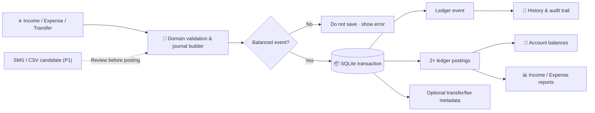
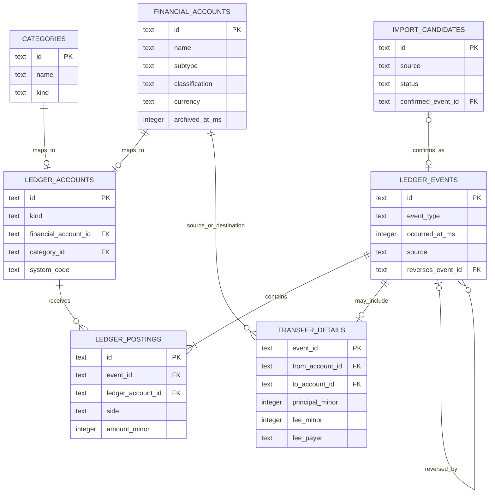
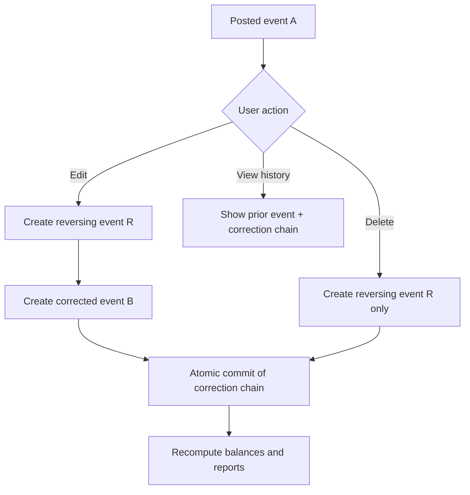
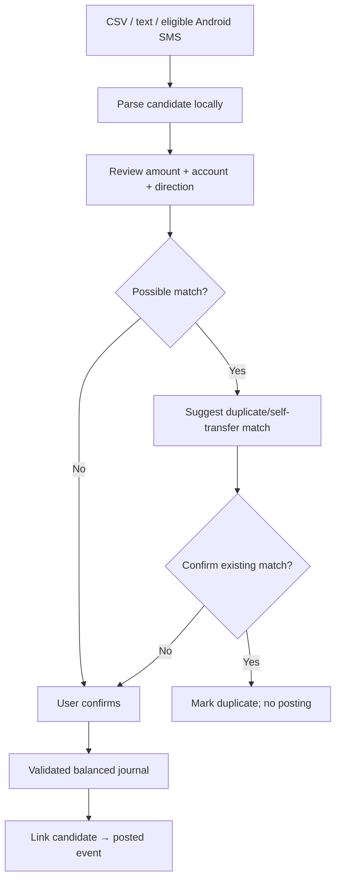

<div align="center">

# 🗄️ 04 · Database Design & Financial Ledger

### A precise source of truth for every rupee — assets, liabilities, income, expenses, transfers and fees.


[🏠 Project](../README.md) · [📚 Documentation Hub](00-INDEX.md) · [🎯 PRD](01-PRD.md) · [🧭 User Flows](02-USER-FLOWS.md) · [🎨 Screen Spec](03-SCREEN-SPEC.md)

</div>

---

> [!IMPORTANT]
> **Proposed architecture, not an implemented database.** This is the first detailed SQLite/ledger design. SQL is a starting contract for engineering review, **not a completed migration or proof of financial correctness**. No actual data, banking integration, balance synchronization, encryption or SMS inbox access has been implemented.

## 01 · Executive decision: use a balanced journal

**Recommendation: append-only, double-entry postings.** Do not make mutable balances on transaction rows the source of truth. A financial event contains two or more signed-effect postings to ledger accounts. **Total debits must equal total credits for each event.**

| Requirement | Ledger decision | Why |
| :--- | :--- | :--- |
| One Income / Expense / Transfer editor | One user-visible `ledger_event` with typed metadata | Matches the [single + flow](02-USER-FLOWS.md) |
| Accounts can be bank, cash, wallet or credit card | User accounts mapped to `ASSET` or `LIABILITY` ledger accounts | Avoid treating card debt as cash |
| Transfer principal is neither income nor expense | Post between tracked accounts only | Prevent fake salary/spending |
| Transfer fees are expenses | Fee expense account gets its **own posting** inside same balanced transfer event | Exact expense without an orphan charge |
| Editing/deleting must not break history | Append a reversal and, for edits, a replacement | Financial auditability and atomicity |
| Imported alerts need review | Import candidate ≠ posted event | Pending SMS never changes balances |
| Reports agree with balances | Derive all views from the same journal | No competing calculations |
| INR accuracy | Integer paise only | No float-rounding drift |

### Money rule in one picture



## 02 · Definitions and sign conventions

| Ledger kind | Increases on | Decreases on | Example |
| :--- | :--- | :--- | :--- |
| **ASSET** | Debit | Credit | SBI Bank, Cash, Funded Wallet |
| **LIABILITY** | Credit | Debit | Credit-card outstanding |
| **INCOME** | Credit | Debit | Salary, business income |
| **EXPENSE** | Debit | Credit | Food, transport, transfer fees |
| **EQUITY** | Credit | Debit | Opening balances / opening net worth |

**How to read the screen:** A positive asset balance means money the user has. A positive liability balance means **money owed**. `Net worth = assets − liabilities`. A credit-card expense increases outstanding debt, **not** a bank outflow.

> [!NOTE]
> Debit/credit here are **bookkeeping directions**, not necessarily the words “debited”/“credited” from a bank SMS. SMS text is parsed into a candidate first; the accounting engine later decides correct ledger postings.

### 2.1 Important invariants

- All stored monetary principal and fees are integer `amount_minor` values (₹1.00 = `100` paise); never use JS floats to accumulate ledger values.
- First MVP supports only `INR` events and accounts. No silent foreign-exchange conversions.
- Every posted event has **at least two postings**, with strictly positive amounts and exactly balanced debit/credit totals.
- An internal transfer between owned tracked accounts is **not** classified as income/expense; its fee **is an expense**.
- A credit-card purchase incurs expense and increases liability. A credit-card repayment reduces both asset and liability without becoming another expense.
- Reversals/refunds are distinct business events, never unexplained edits to balance snapshots.
- Reference SMS, UPI and CSV notifications may refer to the same actual event: **one posted entry**.
- Account balances, net worth, History and Reports must reconcile to the same posted entries.
- User accounts stay in the database after archiving so historical journals remain explainable.

## 03 · Data map

### 3.1 Logical entity relationships



### 3.2 What each table owns

| Entity | Responsibility | Source of truth for |
| :--- | :--- | :--- |
| `financial_accounts` | User-facing bank/cash/wallet/card name, account class, archived state, masked last 4 | Account identity only |
| `categories` | Stable expense/income category identity | Classification vocabulary |
| `ledger_accounts` | Bookkeeping account for each tracked financial account, each category, and opening equity | Posting targets |
| `ledger_events` | One money event, occurred date, origin, correction links | History and chronology |
| `ledger_postings` | Debit/credit legs | Actual account balances and income/expense math |
| `transfer_details` | From, To, principal, optional fee amount and payer | Transfer form details |
| `import_candidates` | Unposted SMS/CSV parsing results, duplicate state, optional confirmation link | Review queue, **not** balance |
| `app_settings` | Language, theme, privacy choices | Local configuration |
| `budgets` | Future monthly limits | **P2 only; not MVP** |

**Design reconciliation:** Earlier PRD text describes a “transfer record linked to a fee expense record.” In this canonical proposal, the **transfer metadata and the distinct expense posting are linked to the same event**, posted in one SQLite transaction; the expense remains visible in Reports. This satisfies the intended *business outcome* while avoiding duplicate transaction rows. If product review requires a separately editable fee transaction, add a linked child-event projection/contract in a subsequent ADR — never create a second charge silently.

## 04 · SQLite schema proposal (v1)

**Engine:** Expo SQLite with `PRAGMA foreign_keys = ON` enabled for every database connection. A tested migration runner owns all schema changes. The fragments below describe one logical v1 schema; production migrations must include transaction-safe setup, verification and rollout.

### 4.1 Owned accounts and categories

```sql
CREATE TABLE financial_accounts (
  id TEXT PRIMARY KEY,
  name TEXT NOT NULL CHECK(length(trim(name)) > 0),
  subtype TEXT NOT NULL CHECK(subtype IN
    ('cash','bank','funded_wallet','credit_card')),
  classification TEXT NOT NULL CHECK(classification IN
    ('asset','liability')),
  currency TEXT NOT NULL DEFAULT 'INR'
    CHECK(currency = 'INR'),
  masked_last4 TEXT,
  archived_at_ms INTEGER,
  created_at_ms INTEGER NOT NULL,
  updated_at_ms INTEGER NOT NULL,
  CHECK (
    (subtype = 'credit_card' AND classification = 'liability')
    OR
    (subtype <> 'credit_card' AND classification = 'asset')
  )
);

CREATE TABLE categories (
  id TEXT PRIMARY KEY,
  kind TEXT NOT NULL CHECK(kind IN ('income','expense')),
  name TEXT NOT NULL CHECK(length(trim(name)) > 0),
  is_builtin INTEGER NOT NULL DEFAULT 0,
  archived_at_ms INTEGER,
  UNIQUE(kind, name)
);
```

**Credit-card opening amount:** captured as “outstanding owed”, not an asset's opening cash. Do **not** store an independent mutable `current_balance` here.

### 4.2 Ledger account catalog

```sql
CREATE TABLE ledger_accounts (
  id TEXT PRIMARY KEY,
  kind TEXT NOT NULL CHECK(kind IN
    ('asset','liability','income','expense','equity')),
  financial_account_id TEXT UNIQUE
    REFERENCES financial_accounts(id) ON DELETE RESTRICT,
  category_id TEXT UNIQUE
    REFERENCES categories(id) ON DELETE RESTRICT,
  system_code TEXT UNIQUE,
  currency TEXT NOT NULL DEFAULT 'INR'
    CHECK(currency = 'INR'),
  created_at_ms INTEGER NOT NULL,
  CHECK(
    (financial_account_id IS NOT NULL AND
      category_id IS NULL AND system_code IS NULL)
    OR
    (category_id IS NOT NULL AND
      financial_account_id IS NULL AND system_code IS NULL)
    OR
    (system_code IS NOT NULL AND
      financial_account_id IS NULL AND category_id IS NULL)
  )
);
```

- One user-visible bank maps to one `asset` ledger account; one credit card maps to one `liability` ledger account.
- Each income/expense category maps to one typed journal account; built-in category example: `Bank Charges & Fees`.
- A hidden `equity` ledger account with `system_code='OPENING_EQUITY'` handles initial account balances.
- App/domain validation must verify that `ledger_accounts.kind` matches the linked financial account or category kind. The foreign keys alone do **not** guarantee this cross-table invariant.

### 4.3 Events and immutable postings

```sql
CREATE TABLE ledger_events (
  id TEXT PRIMARY KEY,
  event_type TEXT NOT NULL CHECK(event_type IN (
    'opening','income','expense','transfer',
    'refund','adjustment','reversal'
  )),
  occurred_at_ms INTEGER NOT NULL,
  created_at_ms INTEGER NOT NULL,
  source TEXT NOT NULL CHECK(source IN
    ('manual','sms','csv','system')),
  payee TEXT,
  note TEXT,
  external_ref TEXT,
  correction_group_id TEXT,
  reverses_event_id TEXT UNIQUE
    REFERENCES ledger_events(id) ON DELETE RESTRICT,
  CHECK(
    (event_type = 'reversal' AND reverses_event_id IS NOT NULL)
    OR
    (event_type <> 'reversal' AND reverses_event_id IS NULL)
  )
);

CREATE TABLE ledger_postings (
  id TEXT PRIMARY KEY,
  event_id TEXT NOT NULL
    REFERENCES ledger_events(id) ON DELETE RESTRICT,
  ledger_account_id TEXT NOT NULL
    REFERENCES ledger_accounts(id) ON DELETE RESTRICT,
  side TEXT NOT NULL CHECK(side IN ('debit','credit')),
  amount_minor INTEGER NOT NULL CHECK(amount_minor > 0),
  created_at_ms INTEGER NOT NULL
);

CREATE INDEX idx_events_occurred
  ON ledger_events(occurred_at_ms);
CREATE INDEX idx_events_correction
  ON ledger_events(correction_group_id);
CREATE INDEX idx_postings_event
  ON ledger_postings(event_id);
CREATE INDEX idx_postings_account
  ON ledger_postings(ledger_account_id);
```

**No mutable balance cache in v1.** If performance later requires cached account summaries, they are disposable projections rebuilt/reconciled from the postings.

**Important enforcement boundary:** SQLite `CHECK` cannot aggregate all rows in an event to verify sum(debits) = sum(credits). The domain builder must construct, validate and insert a complete journal in **one** SQLite transaction; a database finalization mechanism/trigger strategy may be added and tested before accepting any untrusted writes. Never claim the above DDL alone enforces balancing.

### 4.4 Transfer metadata and optional fees

```sql
CREATE TABLE transfer_details (
  event_id TEXT PRIMARY KEY
    REFERENCES ledger_events(id) ON DELETE RESTRICT,
  from_account_id TEXT NOT NULL
    REFERENCES financial_accounts(id) ON DELETE RESTRICT,
  to_account_id TEXT NOT NULL
    REFERENCES financial_accounts(id) ON DELETE RESTRICT,
  principal_minor INTEGER NOT NULL CHECK(principal_minor > 0),
  fee_minor INTEGER NOT NULL DEFAULT 0 CHECK(fee_minor >= 0),
  fee_payer TEXT NOT NULL DEFAULT 'source'
    CHECK(fee_payer IN ('source','destination')),
  fee_category_id TEXT
    REFERENCES categories(id) ON DELETE RESTRICT,
  CHECK(from_account_id <> to_account_id),
  CHECK((fee_minor = 0 AND fee_category_id IS NULL) OR
        (fee_minor > 0 AND fee_category_id IS NOT NULL))
);

CREATE INDEX idx_transfer_from ON transfer_details(from_account_id);
CREATE INDEX idx_transfer_to ON transfer_details(to_account_id);
```

**Class-aware rule:** Destination-deducted fees are straightforward for **asset → asset** transfers and require `fee ≤ principal`. For credit-card cases, the journal builder must use the card's liability signs and show an explicit “fee charged to card” or “fee paid from bank” preview. The UI must not blindly apply the asset-to-asset formulas to a liability account.

### 4.5 Review candidates, not booked money

```sql
CREATE TABLE import_candidates (
  id TEXT PRIMARY KEY,
  source TEXT NOT NULL CHECK(source IN ('sms','csv','text')),
  status TEXT NOT NULL DEFAULT 'pending' CHECK(status IN
    ('pending','confirmed','ignored','duplicate','needs_review')),
  received_at_ms INTEGER NOT NULL,
  occurred_at_ms INTEGER,
  parsed_amount_minor INTEGER CHECK(parsed_amount_minor > 0),
  parsed_direction TEXT CHECK(parsed_direction IN
    ('debit','credit') OR parsed_direction IS NULL),
  matched_account_id TEXT
    REFERENCES financial_accounts(id) ON DELETE SET NULL,
  masked_reference TEXT,
  dedupe_fingerprint TEXT,
  confirmed_event_id TEXT UNIQUE
    REFERENCES ledger_events(id) ON DELETE RESTRICT,
  CHECK(
    (status='confirmed' AND confirmed_event_id IS NOT NULL)
    OR
    (status<>'confirmed' AND confirmed_event_id IS NULL)
  )
);

CREATE INDEX idx_import_status_date
  ON import_candidates(status, received_at_ms);
CREATE INDEX idx_import_fingerprint
  ON import_candidates(dedupe_fingerprint);
```

Do **not** enforce a globally unique fingerprint without a validated bank/ref scope: identical amount/date messages can be legitimate separate transactions. Sensitive raw SMS, account numbers and OTPs are not database requirements; retain only the minimum metadata needed for user review and privacy policy.

### 4.6 Local settings (optional small key/value store)

```sql
CREATE TABLE app_settings (
  key TEXT PRIMARY KEY,
  value_json TEXT NOT NULL,
  updated_at_ms INTEGER NOT NULL
);
```

Keys like appearance and language cannot change accounting rules retroactively. Avoid storing passcodes or secret encryption keys in plaintext settings.

## 05 · Example journals: exact money math

All examples are **illustrative**, not live financial data. Each table illustrates **one balanced event** unless otherwise noted. Amounts in rupees here; database stores paise.

### Example A · ₹5,000 salary credited to SBI

| Debit | Credit | Amount |
| :--- | :--- | ---: |
| SBI **asset** | Salary **income** | ₹5,000 |

**Result:** SBI assets +₹5,000 · Income +₹5,000.

### Example B · ₹500 cash grocery expense

| Debit | Credit | Amount |
| :--- | :--- | ---: |
| Grocery **expense** | Cash **asset** | ₹500 |

**Result:** Cash −₹500 · Expense +₹500.

### Example C · SBI → HDFC ₹5,000, fee ₹50 **from SBI**

| Posting account | Direction | Amount |
| :--- | :--- | ---: |
| HDFC asset | Debit | ₹5,000 |
| Bank Charges & Fees expense | Debit | ₹50 |
| SBI asset | Credit | ₹5,050 |
| **Balanced total** | **Debit = Credit** | **₹5,050** |

**Result:** SBI −₹5,050 · HDFC +₹5,000 · **Expense +₹50**. Income remains zero. This is **one transfer event** containing a separate expense posting.

### Example D · SBI → HDFC ₹5,000, fee ₹50 deducted at HDFC

| Posting account | Direction | Amount |
| :--- | :--- | ---: |
| HDFC asset | Debit | ₹4,950 |
| Bank Charges & Fees expense | Debit | ₹50 |
| SBI asset | Credit | ₹5,000 |
| **Balanced total** | **Debit = Credit** | **₹5,000** |

**Result:** source −₹5,000 · destination +₹4,950 · Expense +₹50. Fee cannot exceed principal under the asset-to-asset destination-deduction design.

### Example E · Purchase of ₹1,000 using credit card

| Debit | Credit | Amount |
| :--- | :--- | ---: |
| Shopping expense | Credit-card liability | ₹1,000 |

**Result:** Expenses +₹1,000 · Outstanding owed +₹1,000 · Net worth −₹1,000.

### Example F · SBI pays ₹1,000 of credit-card bill

| Debit | Credit | Amount |
| :--- | :--- | ---: |
| Credit-card liability | SBI asset | ₹1,000 |

**Result:** SBI −₹1,000 · Outstanding owed −₹1,000 · **Income/Expense = ₹0** · Net worth unchanged.

### Example G · Card cash advance of ₹2,000; ₹60 charged to card

| Posting account | Direction | Amount |
| :--- | :--- | ---: |
| Cash/Bank asset | Debit | ₹2,000 |
| Card Charges expense | Debit | ₹60 |
| Credit-card liability | Credit | ₹2,060 |

**Result:** Asset +₹2,000 · Card owed +₹2,060 · **Expense +₹60** · Net worth −₹60. A card-to-bank cash advance is **not income**, even if a bank SMS says “credited”.

### Example H · Opening balances

| Opening item | Debit | Credit |
| :--- | :--- | :--- |
| SBI existing ₹10,000 | SBI asset ₹10,000 | Opening Equity ₹10,000 |
| Credit card already owed ₹2,000 | Opening Equity ₹2,000 | Credit-card liability ₹2,000 |

Opening events establish initial net worth without artificially inflating today's income or spending.

### Example I · Refund after ₹500 purchase

For a genuine ₹200 partial refund of a prior grocery expense, post **Dr Cash/Bank asset ₹200; Cr Grocery expense ₹200**, record event_type `refund` and a reference to the original expense in the detailed data model/ADR. **Net expense** falls by ₹200 without inflating salary/income. Differentiate a refund from correcting an erroneous entry.

## 06 · Write/read contracts

### 6.1 Atomic transaction-save sequence

```mermaid
sequenceDiagram
  participant UI as Add Transaction UI
  participant UC as Transaction Use Case
  participant L as Ledger Builder
  participant DB as Expo SQLite
  UI->>UC: Save amount, accounts, fee & date
  UC->>L: Validate intent + resolve ledger accounts
  L-->>UC: Balanced event + postings + metadata
  UC->>DB: BEGIN transaction
  UC->>DB: INSERT ledger_events
  UC->>DB: INSERT ledger_postings (2+)
  opt Transfer
    UC->>DB: INSERT transfer_details
  end
  UC->>DB: Verify balanced totals and invariants
  alt Success
    UC->>DB: COMMIT
    UC-->>UI: Saved event ID
  else Any failure
    UC->>DB: ROLLBACK
    UC-->>UI: Error; inputs preserved
  end
```

**Implementation requirements:**

1. Generate stable opaque IDs for the event and postings before starting the transaction.
2. Validate account existence, classification, supported currency, fee payer and category kind.
3. For every posting, use safe integer paise and ensure no amount exceeds JS safe integer constraints; define a practical product max in a later ADR.
4. Compute sum(debits) and sum(credits) **before and inside** the atomic write path; refuse imbalance.
5. Insert event, postings and fee metadata together; never commit half a transfer.
6. Double taps cannot create two events: use a client submission token/idempotent write path.
7. After COMMIT, invalidate derived queries; **do not** manually increment cached UI balances.
8. Keep background import persistence separate from confirmed money postings.

### 6.2 Balance query: one canonical sign convention

A simplified read pattern per ledger account:

```sql
SELECT
  la.id,
  la.kind,
  COALESCE(SUM(
    CASE
      WHEN la.kind IN ('asset','expense') THEN
        CASE WHEN p.side='debit'
          THEN p.amount_minor ELSE -p.amount_minor END
      ELSE
        CASE WHEN p.side='credit'
          THEN p.amount_minor ELSE -p.amount_minor END
    END
  ), 0) AS balance_minor
FROM ledger_accounts AS la
LEFT JOIN ledger_postings AS p ON p.ledger_account_id = la.id
GROUP BY la.id, la.kind;
```

This query nets reversal postings automatically; it is **not** permission to discard audit events. Report dates, refunded categories, effective-date corrections and multi-account summaries require their own explicitly tested projections. Avoid treating the `EXPENSE` ledger total as cash-only expense: credit-card purchases also count.

### 6.3 View-model boundaries

| Read model | Built from | Never from |
| :--- | :--- | :--- |
| Account detail balance | That financial account's ledger postings | Summing SMS alerts |
| Total assets | Current asset ledger accounts | Credit-card outstanding added to assets |
| Total liabilities | Current liability ledger accounts | Cash accounts |
| Net worth | Assets minus liabilities | Income minus expense alone |
| Income / expense report | Category ledger movements scoped by effective date | Gross transfers |
| Transfer History | Event + metadata + fee posting summary | Two independent duplicated principal rows |
| Pending import badge | `import_candidates` states | Booked transactions before confirmation |

**Period caveat:** A refund or correction recorded later must have documented “transaction date vs correction date” behavior. The app should show actual event timestamps and make report policy explicit rather than silently rewriting history.

## 07 · Corrections, deletion, reversals and recovery

**Choose append-only corrections for money already posted.**



- A reversing event contains the **exact opposite** of every original posting; it must reference the original event through `reverses_event_id`.
- Edits that change fee payer/amount must reverse **all** original legs, then write a complete new balanced journal in one database transaction.
- An ordinary user-facing Delete means “void by reversal”, not physically dropping accounting history.
- Prevent repeated reversal of the same event (`UNIQUE(reverses_event_id)`); do not permit “reversal of reversal” without a documented restore protocol.
- UI may hide reversed entries by default but should offer a truthful audit trail.
- **Refund is not the same as correcting a mistake:** refund is a real subsequent event whose expense reversal is business-meaningful.
- **Open decision:** event effective date during edit (restated historical date versus correction date) needs a consistent reporting policy before the ledger implementation.

## 08 · Import matching and idempotency



**Deduplication candidates:** scoped bank/account identity, normalized reference when available, amount, direction, approximate timestamp and merchant. Do not use raw SMS as a global unique ID. **Possible match ≠ guaranteed duplicate:** conflicting matches require review.

- An imported candidate never modifies account balances before confirmation.
- Confirmation creates a ledger event and links the candidate in one DB transaction.
- SMS side A and SMS side B of the same self-transfer should resolve to **one transfer**.
- Ignore OTP, promotional messages, pending/failed payment alerts and unrelated texts.
- Never require the user to supply banking passwords, UPI PIN or OTPs.
- Android native SMS access is conditional on build type and applicable platform policy; iOS cannot perform automatic full inbox reads.
- Provenance is retained as compact metadata (source type, normalized masked reference, timestamps), not unrestricted message bodies.

## 09 · Migration, security and performance boundaries

### 9.1 Migration discipline

- Version with `PRAGMA user_version` or a migration registry; do not mutate live tables ad hoc.
- Every migration is **transactional**, incremental, reversible where feasible and tested using fixture databases.
- Before every change, verify constraints, index creation and compatibility with existing ledger events.
- Existing money records must never be dropped as a convenience during an upgrade.
- Recovery from partially applied migrations must be deterministic; exercise app-interruption tests.

### 9.2 SQLite durability

- Use foreign keys and database transactions through the recommended Expo SQLite APIs.
- Evaluate write-ahead logging (WAL) for concurrency and durability **with platform/device testing**, not assumed defaults.
- App restart mid-save must leave either **all** event legs committed or **none**.
- If importing hundreds of transactions, batch candidate storage and commit confirmed events with idempotency limits.

### 9.3 Privacy and encryption

- An app lock **is not equivalent** to encrypted database-at-rest security.
- Define real encryption approach, key custody, native support, restore pathway and loss-of-key policy before claiming encrypted storage.
- Do not store bank credentials, SMS OTPs, full account identifiers or unrestricted SMS histories.
- Keep future cloud backup/sync opt-in and clearly separate **backup** from **live synchronization**.
- Local-only devices can lose data when the app is uninstalled or the device is lost. Communicate this clearly.

### 9.4 Scalability

- Create indexes for `ledger_postings(event_id)`, `ledger_postings(ledger_account_id)` and `ledger_events(occurred_at_ms)`.
- Always compute amounts with integer arithmetic; formatting to rupees belongs in presentation.
- If query cost grows, add verified read-only projections **derived from** the ledger with reconcile/rebuild tests; never create a second source of truth.

## 10 · Acceptance and reconciliation test matrix

| Test ID | Case | Required result |
| :--- | :--- | :--- |
| `TM-DB-001` | Cash opening ₹10,000 | Assets +₹10,000; income ₹0 |
| `TM-DB-002` | Card opening owed ₹2,000 | Liability +₹2,000; expense ₹0 |
| `TM-DB-003` | Salary ₹5,000 to SBI | SBI +₹5,000; Income +₹5,000 |
| `TM-DB-004` | Grocery ₹500 cash | Cash −₹500; Expense +₹500 |
| `TM-DB-005` | Bank → cash ₹2,000 | Combined assets unchanged |
| `TM-DB-006` | SBI → HDFC ₹5,000, ₹50 source fee | Source −₹5,050; destination +₹5,000; Expense +₹50 |
| `TM-DB-007` | Same transfer with destination fee | Source −₹5,000; destination +₹4,950; Expense +₹50 |
| `TM-DB-008` | Credit card purchase ₹1,000 | Card outstanding +₹1,000; expense +₹1,000 |
| `TM-DB-009` | Card repayment ₹1,000 | Bank and card outstanding −₹1,000; income/expense unchanged |
| `TM-DB-010` | Card cash advance ₹2,000, ₹60 fee on card | Asset +₹2,000; liability +₹2,060; expense +₹60 |
| `TM-DB-011` | Fee posting write failure | Whole transfer rolled back |
| `TM-DB-012` | Same transfer edit | Original fully reversed; one corrected event; no double expense |
| `TM-DB-013` | Same transfer delete | Opposite journal; balances restore; audit retained |
| `TM-DB-014` | Repeated Save tap | Exactly one committed event |
| `TM-DB-015` | Pending SMS import | No account balance change |
| `TM-DB-016` | Duplicate CSV/SMS reference | No duplicate posting after match confirmation |
| `TM-DB-017` | ₹0.01 × 3 | Exact ₹0.03, integer paise |
| `TM-DB-018` | Missing/archived account | Clear validation; no partial event |
| `TM-DB-019` | Negative or zero fee/principal invalid mode | Validations apply; no unintended write |
| `TM-DB-020` | Reopened app offline | Local balances and reports reconcile |
| `TM-DB-021` | No child posting or unbalanced event | Builder rejects transaction |
| `TM-DB-022` | Refund ₹200 against grocery expense | Expense net reduced ₹200; income unaffected |

**Reconciliation gate:** For every fixture, assert `sum(debit paise) = sum(credit paise)` for every event; re-create account balances from postings; compare net worth with assets − liabilities and compare category reports with expense/income account postings.

## 11 · Design decisions awaiting sign-off

| Decision | Proposal | Why review matters |
| :--- | :--- | :--- |
| Journal model | Append-only double-entry events | Foundational correctness |
| Transfer fees | One transfer event, separate linked fee expense posting | Maps screenshot behavior to accurate ledger |
| Corrections | Full reversal + replacement | Auditability vs simpler in-place edit |
| Reporting of retroactive edits | State explicit effective-date policy | Period totals must be explainable |
| User's negative bank balance / overdraft | Allow with warning, never silently reclassify | Real bank balances can be negative |
| Credit-card cash advances | Liability-aware journal + charge expense | More complex than asset transfers |
| Local data encryption | Dedicated technical/security ADR | Standard Expo SQLite alone is not a security claim |
| Refund linkage | Add typed original-event relation in v1 refinement | Correct reports & partial refunds |
| Budget persistence | Defer to P2 | Core ledger first |

## 12 · Handoff — Technical Architecture

The [05 — Technical Architecture](05-TECH-ARCHITECTURE.md) draft specifies the implementation boundaries; verify these items during its review:

1. React Native + Expo Router navigation and feature module boundaries.
2. Domain-owned journal builder that outputs balanced, typed postings.
3. Expo SQLite repository and migration service contracts.
4. Transactional write + error recovery/idempotency implementation.
5. Typed adapters for Home, History, Accounts and Reports.
6. Expo Go compatible core and separate Android native SMS development-build boundary.
7. Import review and privacy controls.
8. Test strategy mapped directly to `TM-DB-001`–`TM-DB-022`.

---

[← Documentation Hub](00-INDEX.md) · [🎯 PRD](01-PRD.md) · [🧭 User Flows](02-USER-FLOWS.md) · [🎨 Screen Spec](03-SCREEN-SPEC.md)

<sub>**Tio Money / Financial Ledger Draft · 2026-11-18** · Financial correctness is a release gate, not a visual feature.</sub>
