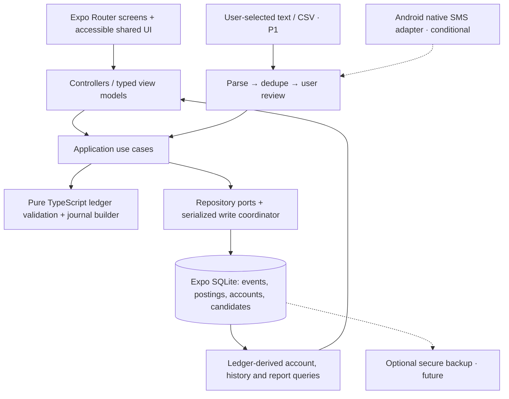
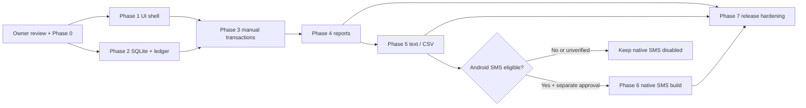
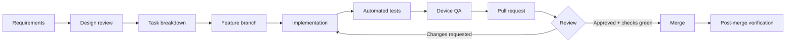

<div align="center">

# 🧪 06 · Implementation & Test Plan

### From a deliberate mobile foundation to a reconciled, offline-first financial release.


[🏠 Project](../README.md) · [📚 Docs Hub](00-INDEX.md) · [🎯 PRD](01-PRD.md) · [🧭 Flows](02-USER-FLOWS.md) · [🎨 Screens](03-SCREEN-SPEC.md) · [🗄 Ledger](04-DATABASE-DESIGN.md) · [🏗 Architecture](05-TECH-ARCHITECTURE.md) · [✍️ Standard](90-DOCS-STYLE-GUIDE.md)

</div>

---

> [!IMPORTANT]
> **Planning artifact · 2026-11-18 · v0.1.** Tio Money is currently documented, **not implemented or tested**. Every task, file path, test and release gate below is a **proposed delivery contract**, not evidence of existing code, installed dependencies, passing tests, SMS access or store approval. The [PRD](01-PRD.md), [flows](02-USER-FLOWS.md), [screen specification](03-SCREEN-SPEC.md), [ledger](04-DATABASE-DESIGN.md) and [architecture](05-TECH-ARCHITECTURE.md) are drafts requiring owner review. Unresolved items are recorded in [`9](#9-owner-decisions-and-specification-gaps); this plan does not silently approve them.

**Release invariant:** **Internal transfer principal is neither income nor expense.** A real transfer fee is **an expense**, recorded once. Home, Accounts, History and Reports must reconcile to the **same balanced SQLite journal**, including credit-card liabilities.

## In this plan

[Delivery map](#1-delivery-map-and-status) · [Engineering contract](#2-implementation-contract) · [Milestones](#3-milestones-and-release-tracks) · [Phase playbooks](#4-phase-by-phase-execution) · [Financial test catalogue](#5-financial-acceptance-test-catalogue) · [QA and CI](#6-test-execution-and-evidence) · [Workflow](#7-development-workflow-and-review-gates) · [Risks](#8-risks-and-dependencies) · [Owner decisions](#9-owner-decisions-and-specification-gaps) · [Publication checklist](#10-document-quality-and-handoff)

## 1. Delivery map and status

### 1.1 What is fixed, proposed and conditional

| Contract | Status here | Implementation consequence |
| :--- | :--- | :--- |
| One primary `+` opens **Income / Expense / Transfer**; no three Home shortcut tiles | **Product rule in draft PRD** | One editor and one entry action; its placement requires sign-off |
| Cash, bank and funded wallet are assets; credit card is a liability | **Proposed ledger contract** | Class-aware postings; no fabricated card “cash balance” |
| Transfer principal excluded from income/expenses; linked fees count once as expenses | **Product rule in draft PRD** | Every release gate asserts it numerically |
| Balanced, append-only journal; integer paise; reversal-based correction | **Architecture / database proposal** | Finalize ADR and validate real-device SQLite behavior before Phase 3 |
| Central `+` in a four-destination bottom shell; light/dark tokens | **Screen proposal, not approved** | Review placement, copy, accessibility and palette before freezing Phase 1 |
| Cross-platform pasted/selected text and CSV statement import | **P1 planned** | Never post a parser suggestion without user confirmation |
| Native Android SMS inbox integration | **Conditional, policy-gated** | Separate custom Expo build; **not available in Expo Go** |
| iPhone automatic SMS inbox access | **Out of scope** | User-initiated text/CSV only |
| App lock, at-rest encryption, encrypted backup/sync, budgets | **Later / separate decision** | No fake settings toggles or security claims |

**Status vocabulary:** `Planned` = design/task only; `Approved` = owner accepted a decision; `Implemented` = code exists; `Tested` = named evidence captured; `Verified` = tests **and** relevant device behavior signed off. No phase below is marked complete. Do not promote a status based on a mock screen, an AI-generated plan, or a checklist alone.

### 1.2 Source-of-truth and change control

The [PRD](01-PRD.md) defines product behavior; [User Flows](02-USER-FLOWS.md) define interaction and error paths; [Screen Design](03-SCREEN-SPEC.md) specifies UI proposals; [Database Design](04-DATABASE-DESIGN.md) defines the journal proposal; [Technical Architecture](05-TECH-ARCHITECTURE.md) defines boundaries. This document **schedules and tests** those contracts. If two drafts differ, create an owner-visible `TM-ADR-###` decision, link both passages, and amend the owning specification in a **separate approved change**; do not retrofit a new business rule in tests.

## 2. Implementation contract

### 2.1 Dependency and data-flow boundaries



**Directional rule:** `src/domain` has no React, navigation, Expo, SQLite or native imports. Screens format typed outcomes and emit commands; they do **not** calculate fees, mutate balances or issue SQL. Repository adapters own bound SQL and atomic writes; read models derive from postings. `Zustand` is a proposed *ephemeral* UI-state option, never a mutable account-balance source. [Architecture `02–08](05-TECH-ARCHITECTURE.md#02--the-system-map).

### 2.2 Engineering standards and constraints

| Area | Mandatory acceptance contract |
| :--- | :--- |
| Type safety | `tsconfig` `strict: true`; discriminated event/account types; no unchecked `any` for amounts, ports or parsing |
| Amounts | Parse decimal **strings** into positive safe-integer **paise**; reject negatives, zero principal, >2 decimal places, unsafe integer overflow and unsupported currency; never use floating-point sums |
| Journal | Every posted event has ≥2 positive postings, one currency, matched account/category types and `Σ debit = Σ credit`, including reversals |
| Event lifecycle | Preview and Save invoke the **same journal builder**. Submission tokens are persisted uniquely after the schema decision; correction uses reversal + replacement atomically |
| SQLite | Migrations versioned and crash-tested; `PRAGMA foreign_keys = ON` verified on the actual write connection; prepared/bound statements for user data |
| Concurrency | **Proposed:** one serialized write coordinator on a controlled connection. Prove that writes cannot interleave; do not assume `withTransactionAsync()` isolates unrelated async queries. If using `withExclusiveTransactionAsync()`, independently enable/check FKs on its connection before the transaction |
| Read consistency | No editable `current_balance` cache; account totals, period reports and History are posting-derived with deterministic reversal/refund treatment |
| Error handling | Typed domain/validation/storage/permission errors; recoverable messages preserve form inputs, prevent duplicate retries and never report success before COMMIT |
| UI quality | Reusable components; large text; 44pt iOS / 48dp Android targets; safe areas, keyboard, light/dark contrast, English/Hindi; labels beyond color alone |
| Platform | P0 manual ledger in Expo Go on Android/iPhone offline; no runtime import of native SMS module in P0 bundle; no unsupported iOS SMS promise |
| Privacy | Least privilege, masked account references, no bank login/OTP/full inbox retention; no database-encryption claim without verified encryption |
| Build discipline | Pin mutually compatible Expo SDK/RN/Router/SQLite versions at kickoff; run typecheck, lint, format, unit, integration and applicable device QA before merge |

**Financial sign convention:** ASSET/EXPENSE increase by **debit**; LIABILITY/INCOME/EQUITY increase by **credit**. `Net worth = sum(assets) − sum(liabilities)`. Opening balances post to EQUITY, **not income**. Only confirmed import candidates become posted events. [Ledger ``02–06](04-DATABASE-DESIGN.md#02--definitions-and-sign-conventions).

### 2.3 Non-negotiable transfer examples (asset → asset)

| ₹5,000 principal | Source asset | Destination asset | Fee expense | Debits = credits |
| :--- | ---: | ---: | ---: | ---: |
| No fee | −₹5,000 | +₹5,000 | ₹0 | ₹5,000 |
| ₹50 fee at **source** | −₹5,050 | +₹5,000 | **₹50** | ₹5,050 |
| ₹50 deducted at **destination** | −₹5,000 | +₹4,950 | **₹50** | ₹5,000 |

For source fee, postings are `Dr Destination 500000`, `Dr Bank Charges & Fees 5000` and `Cr Source 505000` **paise**. For destination fee: `Dr Destination 495000`, `Dr Fee 5000` and `Cr Source 500000`. Fee `0` emits **no zero-amount posting**. The fee is a distinct expense *posting inside the same transfer event*, with linked `transfer_details`; it is not an independent second principal transaction. Credit-card movements require **liability-aware** rules, not the formulas above.

### 2.4 Proposed folder/module ownership (paths do not yet exist)

```text
src/
  app/                          # Expo Router routes; (setup), (tabs), transaction, account, settings
  shared/{ui,theme,i18n,errors,utils}/
  features/{onboarding,dashboard,transactions,accounts,reports,import,settings}/
  domain/{money,ledger,contracts}/
  data/sqlite/{migrations,repositories,queries,initialize.ts}/
  data/projections/
  platform/{file-import,sms,security}/
tests/{domain,application,sqlite,ui,imports,e2e,fixtures}/
modules/                       # Conditional Android native SMS only, not P0
```

This follows the [proposed architecture tree](05-TECH-ARCHITECTURE.md#03--proposed-repository-structure); `tests/ui`, `tests/imports` and `tests/fixtures` are **additional proposed test locations**, not existing code. Prefer feature-local component tests where the runner requires them.

## 3. Milestones and release tracks

### 3.1 Milestone ledger

| Gate | Phase / slice | Primary artifacts | Must be proven before exit |
| :--- | :--- | :--- | :--- |
| **M0** | Phase 0 · Foundation | Toolchain, routing shell, strict TS, decision log | Both platform dev paths build; CI baseline green |
| **M1** | Phase 1 · UI foundation | Setup, Home, History, Reports, Accounts, Settings, unified editor UI | Original accessible shells and one `+`; **mock UI ≠ finance complete** |
| **M2** | Phase 2 · Ledger | SQLite migrations, domain, writer, projections | `TM-DB-001…022` / invariant and rollback evidence |
| **M3** | Phase 3 · Transactions | Real create/edit/reverse/detail/filter workflows | P0 end-to-end manual event scenarios; no duplicate or orphan fee |
| **M4** | Phase 4 · Reports | Local daily/monthly/custom breakdowns and card views | Report vs ledger reconciliation on both OSs |
| **M5** | Phase 5 · User imports | Text/CSV adapter, candidates, matching, review | P1 privacy, duplicate and confirmation fixtures |
| **M6** | Phase 6 · Android SMS | **Conditional** custom-build adapter and policy dossier | Eligibility confirmed **before permission integration/shipping**, device QA; otherwise **skipped/blocked** |
| **M7** | Phase 7 · Security & release | Release checklist, privacy/export, test evidence, store assets | Selected release track passes every applicable gate and owner go/no-go |

These are **sequence labels, not dates or commitments**. Create estimates only after M0 dependency validation and scope approval; track forecast vs actual in issues, not as invented dates here.

### 3.2 Dependency graph and release choices



| Track | Release definition | Required phase gates | Explicitly excluded until separately delivered |
| :--- | :--- | :--- | :--- |
| **A · Core MVP (P0)** | Offline manual money tracker | M0–M4 + **M7 P0** | Native SMS; P1 imports; backup/sync; unverified app lock |
| **B · Import-enabled (P1)** | Core + user-selected text/CSV | Track A + M5 + refreshed M7 | Auto inbox reading |
| **C · Android SMS (conditional)** | Approved Android flavor with optional native SMS | Track B + **policy gate** + M6 + Android M7 | Automatic iPhone SMS; promises of permission approval |

**M7 is a reusable hardening/release gate**, not a requirement to finish M5/M6 before releasing Track A. Phase 6 may remain blocked indefinitely without blocking a privacy-safe manual tracker. A phase may be developed in parallel only when its dependencies and ADRs are stable.

## 4. Phase-by-phase execution

Each phase is a **planned work package**. `TM-Px-yy` identifiers name backlog tasks; acceptance IDs in `TM-FIN-*`, `TM-UX-*` and `TM-DB-*` name tests. Checkboxes remain unchecked until backed by linked evidence.

### Phase 0 — Project foundation · M0

**Objective:** Establish a reproducible, Expo Go-capable React Native + TypeScript workspace before financial UI or storage code.

**Technical tasks**
- [ ] `TM-P0-01` Confirm target Expo SDK, React Native, Expo Router, TypeScript and `expo-sqlite` compatibility; pin versions and record the install matrix / lockfile.
- [ ] `TM-P0-02` Bootstrap `src/app/_layout.tsx` and route groups; confirm editor is a stack action, not a fifth content tab.
- [ ] `TM-P0-03` Create strict TS config, ESLint, Prettier, import-boundary rules, aliases and deterministic scripts.
- [ ] `TM-P0-04` Establish semantic light/dark tokens, typed i18n keys, money/date format utility contracts and common error/result types; leave final palette provisional.
- [ ] `TM-P0-05` Set up unit/component test runner, CI skeleton, emulator/simulator instructions and privacy-safe sample fixtures.

| Required aspect | Implementation-ready gate |
| :--- | :--- |
| **Dependencies** | Owner review of scope; Node/package-manager version; target Android SDK/Xcode/Expo versions verified; choose TS test runner |
| **Files / modules** | `package.json`, lockfile, `tsconfig.json`, `app.json` / config, `src/app/_layout.tsx`, `src/shared/{theme,i18n,errors}`, `tests/fixtures`, `.github/workflows/ci.yml` (proposed) |
| **Deliverables** | Installable P0 shell, documented dependency matrix, environment setup, CI static checks, ADR register |
| **Acceptance** | Clean install reproducible; `tsc --noEmit` / lint / formatting / empty baseline tests pass; Android and iOS load Expo Go shell **without native SMS** |
| **Automated tests** | Route and module-boundary static tests, theme token typing, formatter fixtures, smoke build/compile checks |
| **Manual tests** | Fresh install / cold start on Android and iPhone; keyboard/safe-area probe; run core bundle offline |
| **Risks** | Expo version mismatch, route conflicts, native package mistakenly imported into Expo Go, unapproved theme freeze |
| **Definition of Done** | [ ] `TM-P0-*` tasks reviewed; [ ] pinned environment reproduced; [ ] two-platform shell proof; [ ] CI artifacts and open ADRs linked to M0 |

### Phase 1 — UI foundation · M1

**Objective:** Create accessible original screen shells and shared components; **finance data is still mocked** until Phase 2–3.

**Technical tasks**
- [ ] `TM-P1-01` Implement first-run language/INR/account-type screens and empty/loading/error states.
- [ ] `TM-P1-02` Compose Home, History, Reports, Accounts, Settings and transaction detail shells from shared components.
- [ ] `TM-P1-03` Implement four root destinations plus **one** central `+` Add action (**proposed placement awaiting owner approval**); no Income/Expense/Transfer Home tiles.
- [ ] `TM-P1-04` Build one full-screen editor with exactly **Income | Expense | Transfer** tabs, collapsed fee disclosure, account/category pickers, preview slot, Save / Save & Add Another state UI and dirty-form dialog.
- [ ] `TM-P1-05` Build `MoneyAmount`, `MoneyMovementPreview`, `TransactionRow`, `TypeTabs`, `FormField`, `AccountPicker`, `FeeDisclosure`, semantic loading/error/empty components.
- [ ] `TM-P1-06` Add accessibility labels, Hindi/English strings, scale/contrast tests, keyboard avoidance and landscape policy review.

| Required aspect | Implementation-ready gate |
| :--- | :--- |
| **Dependencies** | M0; [Screen Spec](03-SCREEN-SPEC.md) navigation and design review; approved semantics of Save & Add Another |
| **Files / modules** | `src/app/(setup)/*`, `src/app/(tabs)/*`, `src/app/transaction/*`, `src/app/settings.tsx`, `src/features/{onboarding,dashboard,transactions,accounts,reports,settings}/*`, `src/shared/ui/*` |
| **Deliverables** | Navigable, original UI prototype; reusable design-system components; named screen states |
| **Acceptance** | `TM-UX-001…008,012…015` UI behavior in mock mode; only one root `+`; all form fields reachable at 320–430 logical width |
| **Automated tests** | RN component tests for tabs, fee disclosure, field errors, dirty dialog, labels, large-font wrapping and single Add action |
| **Manual tests** | TalkBack + VoiceOver, Hindi strings, light/dark contrast, physical keyboard/IME, safe-area edges, orientation and small phone |
| **Risks** | Mistaking mock totals for working ledger; duplicate Add entry, copied screenshot style, unapproved nav/palette |
| **Definition of Done** | [ ] Screens reviewable; [ ] mock-only banners/dev fixtures clearly labeled; [ ] accessibility evidence; [ ] no claims of persisted balances or delivered transaction saves |

### Phase 2 — SQLite & financial ledger · M2

**Objective:** Make a balanced, auditable SQLite journal the **single source of financial truth**.

**Technical tasks**
- [ ] `TM-P2-01` Finalize schema ADRs: `ledger_events` / `ledger_postings` / `transfer_details` / accounts / categories / import candidates; add a **persisted unique idempotency key** and explicit refund linkage by approved migration design.
- [ ] `TM-P2-02` Implement versioned migrations, `PRAGMA user_version` or equivalent registry, FK verification, safe error/blocked-write state, and on-disk upgrade fixtures.
- [ ] `TM-P2-03` Build pure INR decimal parser, safe-integer guard, typed asset/liability chart, double-entry journal constructor and reversal builder; prohibit zero-amount posting legs.
- [ ] `TM-P2-04` Implement serialized write coordinator, rollback, atomically linked fee metadata, and cross-table account/category-kind validation.
- [ ] `TM-P2-05` Implement opening equity events, posting-derived balance queries, liability outstanding and net-worth projections.
- [ ] `TM-P2-06` Add fault-injection seams for every write step; prove crash/retry atomicity and identical balance recomputation.

| Required aspect | Implementation-ready gate |
| :--- | :--- |
| **Dependencies** | M0; owner review of [DB design](04-DATABASE-DESIGN.md), correction/date policy and idempotency/migration ADR; Expo SQLite API validation |
| **Files / modules** | `src/domain/{money,ledger,contracts}/*`, `src/data/sqlite/{initialize.ts,migrations/*,repositories/*,queries/*}`, `src/data/projections/*`, `tests/{domain,sqlite}/*` |
| **Deliverables** | Schema v1 migrations, typed ledger/use-case contracts, atomic repository, reusable real-SQLite fixture suite |
| **Acceptance** | Every event balances; ₹0.01 exactness; card liability ≠ asset; fee is one expense posting; FK ON on write connection; bad writes reject and roll back; `TM-DB-001…022` reconciled |
| **Automated tests** | Domain property tests, all `TM-FIN-001…029` applicable invariants, fault injection, FK/kind/unique constraints, upgrade/reopen/corruption safety, serialized concurrency |
| **Manual tests** | Android + iOS persistent DB across force close/restart, killed write path, offline read/write, low-storage recovery without data deletion |
| **Risks** | `withTransactionAsync()` interleaving, exclusive connection FK gap, hidden float arithmetic, half-applied migration, missing idempotency constraint |
| **Definition of Done** | [ ] Fresh and upgrade paths verified; [ ] recorded balanced-event audit; [ ] rollback and duplicate proofs on real SQLite; [ ] no second mutable balance store |

### Phase 3 — Transaction management · M3

**Objective:** Connect the unified editor to real accounts and durable manual **Income, Expense, Transfer** commands.

**Technical tasks**
- [ ] `TM-P3-01` Wire first-run account creation, correct opening balances, archive checks and valid account/category pickers.
- [ ] `TM-P3-02` Connect shared Preview / CreateTransaction use cases to the same domain builder; validate principal, fee, payer, dates, account kinds and currency.
- [ ] `TM-P3-03` Implement Save and Save & Add Another, disable repeated taps and persist request tokens for crash-safe idempotency.
- [ ] `TM-P3-04` Implement one grouped History row for transfer + fee; filters, stable pagination, transaction detail and import provenance label where present.
- [ ] `TM-P3-05` Implement edit as atomic reversal + replacement, delete as reversal, and truthful audit/correction history; no orphan charges.
- [ ] `TM-P3-06` Implement credit-card purchases, repayments and approved cash-advance/fee variants without treating liability as cash.

| Required aspect | Implementation-ready gate |
| :--- | :--- |
| **Dependencies** | M1 + M2; owner choice on edit/report effective date, restoration, credit-card fee treatment and Save & Add Another defaults |
| **Files / modules** | `src/features/transactions/{ui,controllers,use-cases}/*`, `src/features/accounts/*`, `src/app/transaction/*`, `src/data/sqlite/repositories/*`, `tests/{application,ui,e2e}/*` |
| **Deliverables** | Durable create/edit/delete/history, grouped transfer fee details, account and category management |
| **Acceptance** | `TM-UX-001…010` with **real** data; all P0 finance fixtures produce correct posting/category deltas; retry does not double-save |
| **Automated tests** | Use-case validation tables, correction chains, idempotent retry, archived account reject, history filters, fee payer swap, invariant suite |
| **Manual tests** | Airplane-mode full editor → Save → History → edit → delete → restart on both OSs; interrupted Save; back/discard; card screen copy |
| **Risks** | Double-posting fee on edit, stale read models, Save & Add Another defaults, card principal misclassified, negative overdraft ambiguity |
| **Definition of Done** | [ ] Finance/History/Accounts reconcile; [ ] atomic correction evidence; [ ] keyboard/a11y QA; [ ] no transfer principal in income/expense |

### Phase 4 — Reports · M4

**Objective:** Produce transparent local reports without introducing a second accounting engine.

**Technical tasks**
- [ ] `TM-P4-01` Implement date-range filters (Today, Week, Month, Custom), explicit local-calendar boundaries over stored UTC epoch milliseconds and account/category filters.
- [ ] `TM-P4-02` Query posting-derived income/expense by category, including **fee expense exactly once**, and report transfer principal separately.
- [ ] `TM-P4-03` Produce asset, liability, card outstanding and net-worth summaries plus daily/monthly trends; do not equate assets with net worth.
- [ ] `TM-P4-04` Apply refund/correction effective-date policy consistently across period, category and history; preserve transfer labels.
- [ ] `TM-P4-05` Build accessible charts plus numeric/text summaries, empty states, filter consistency and indexed/paginated data access.

| Required aspect | Implementation-ready gate |
| :--- | :--- |
| **Dependencies** | M2–M3; chosen refund/reversal period policy; [Screen Reports](03-SCREEN-SPEC.md#screen-07--reports-tm-s07--p0) |
| **Files / modules** | `src/features/reports/*`, `src/data/sqlite/queries/reports*`, `src/data/projections/*`, `tests/{domain,sqlite,ui,e2e}/reports*` |
| **Deliverables** | Daily/weekly/monthly/custom income, expense, transfer and category reports; card/liability views |
| **Acceptance** | Total category expenses = expense postings; transfer principal excluded; linked fees included once; net worth = assets − liabilities; date and account filters agree with History |
| **Automated tests** | Cross-period and timezone boundaries, partial refund, retroactive edit, mixed card purchases and repayments, zero-activity, fee aggregation and projection reconciliation |
| **Manual tests** | Reproduce `TM-FIN` fixture dashboard/History/Reports on Android + iPhone; local timezone change, VoiceOver/TalkBack chart alternatives |
| **Risks** | Display-time vs event-time ambiguity, double-counted fee, slow unindexed queries, misleading “net savings/cashflow” terminology |
| **Definition of Done** | [ ] Cross-screen reconciliation artifact; [ ] all finance/report release blockers green; [ ] accessible chart alternatives; [ ] original dated events remain auditable |

### Phase 5 — User-selected text & CSV import · M5 / P1

**Objective:** Convert user-authorized statement data into **reviewable candidates**, not silent ledger postings.

**Technical tasks**
- [ ] `TM-P5-01` Build user-selected paste/text/file entry adapters and permission-minimal CSV picker; define supported bank formats and size/encoding limits.
- [ ] `TM-P5-02` Normalize debit/credit direction, timestamp, account hints and masked references; reject OTP, marketing, pending/failed alerts, broken/hostile CSV and formula-injection vectors.
- [ ] `TM-P5-03` Stage `pending/needs_review/duplicate/ignored/confirmed` candidates; never affect balances before confirmation.
- [ ] `TM-P5-04` Match by **scoped** account, amount, direction, timestamp window, optional normalized reference and self-transfer legs; ambiguous matches require user decision.
- [ ] `TM-P5-05` Implement review/edit/ignore/confirm, with one atomic candidate-link + ledger posting and unique confirmation/idempotency guarantees.
- [ ] `TM-P5-06` Minimize sensitive retained source text; sanitize fixtures, previews, exports and logs; test user deletion/privacy controls.

| Required aspect | Implementation-ready gate |
| :--- | :--- |
| **Dependencies** | M2–M4; owner-approved CSV formats and parser limits; schema resolution for `ledger_events.source='text'` provenance |
| **Files / modules** | `src/features/import/*`, `src/platform/file-import/*`, `src/app/import/index.tsx`, `src/data/sqlite/repositories/import*`, `tests/{imports,fixtures,e2e}/*` |
| **Deliverables** | Cross-platform text/CSV import, review queue, matching explanations, posted-event trace |
| **Acceptance** | No unreviewed posting; repeated import/confirmation produces one event; matching self-transfer legs do not produce two principal records; no OTP/raw unrelated SMS stored |
| **Automated tests** | Sanitized parser corpus, encodings/dates/CSV quotes, duplicate/manual/self-transfer fixtures, negative/ambiguous tests, confirmation concurrency, CSV export escaping |
| **Manual tests** | Files chosen on Android/iPhone; large file canceled/retried; offline import, review and ignored-state recovery; inspect local data/log redaction |
| **Risks** | False-positive dedupe, false income for credits, hostile CSV, parser bank drift, sensitive-text retention |
| **Definition of Done** | [ ] Supported formats documented; [ ] candidate/posted count reconciled; [ ] P1 privacy fixtures signed; [ ] ambiguous matches never auto-post |

### Phase 6 — Android SMS integration · M6 / conditional

**Objective:** Evaluate — and implement **only if authorized** — a privacy-preserving Android native adapter while keeping core Expo Go and iPhone builds independent.

**Technical tasks**
- [ ] `TM-P6-01` **Before native permission work:** obtain written product/policy determination on Google Play restricted SMS eligibility, declaration requirements, use case, consent and fallback. No eligibility assumption.
- [ ] `TM-P6-02` Define `SmsImportPort` and a disabled adapter for ordinary Expo Go/iOS builds; ensure no eager native import or SMS permissions in the default flavor.
- [ ] `TM-P6-03` **Only after gate approval:** create a separate Expo development build and Android local/native adapter, configuration/plugin and manifest flavor; minimize accessible message scope and retention.
- [ ] `TM-P6-04` Add just-in-time rationale, permission denial/revocation state, enable/disable, source visibility and privacy disclosures; prohibit OTP/promotional ingestion.
- [ ] `TM-P6-05` Route eligible bank alerts through **the same** candidate dedupe/review/confirmation service as P1, never direct auto-post.
- [ ] `TM-P6-06` Audit Android manifest/binary, native/background lifecycle, OS versions, battery restrictions and store declaration outcome.

| Required aspect | Implementation-ready gate |
| :--- | :--- |
| **Dependencies** | M5, explicit policy eligibility **and separate owner approval**, Android native build capacity, reviewed permission rationale; never a P0 prerequisite |
| **Files / modules** | `src/platform/sms/{port,disabled,native}*`, `modules/*`, build/config flavor and native permission documentation (**only after approval**) |
| **Deliverables** | Either **documented no-go + maintained manual/CSV fallback**, or a separately built/tested eligible SMS candidate adapter |
| **Acceptance** | Expo Go/default manifest lacks `READ_SMS`/`RECEIVE_SMS`; iPhone shows no native SMS route; denied/revoked Android permission leaves core intact; confirmed candidate posts once |
| **Automated tests** | Adapter contract, build-flavor import guards, manifest permission diff, parser/privacy/repeated-message fixtures and consent-state transitions |
| **Manual tests** | Android physical devices with permission deny/revoke, app upgrades, background/foreground and selected OS releases; independently smoke-test Expo Go and iPhone fallback |
| **Risks** | Play policy ineligibility/rejection, OEM behavior, overcollection, permission creep, Expo Go crash if native module linked |
| **Definition of Done** | [ ] **Go:** policy evidence + owner approval + manifest/privacy QA + native tests; **or No-go:** SMS feature disabled/absent with documented fallback. Never label blocked native SMS “implemented” |

[Google Play SMS/Call Log policy](https://support.google.com/googleplay/android-developer/answer/10208820) · [Expo development builds](https://docs.expo.dev/develop/development-builds/introduction/). These external rules can change; recheck **at implementation and submission time**.

### Phase 7 — Security, quality & release · M7

**Objective:** Ship only the selected tested track with documented privacy, failure recovery and device evidence.

**Technical tasks**
- [ ] `TM-P7-01` Threat review for phone loss, local data, diagnostic logs, imported files, account masking, export/deletion and device backup behavior; prohibit raw OTP and bank credentials.
- [ ] `TM-P7-02` Deliver user-visible privacy/data-loss explanation and **P0 user-initiated CSV export** if included in signed-off release scope; test sensitive CSV sharing and deletion controls.
- [ ] `TM-P7-03` Decide **backup design and recovery roadmap** (key custody, encryption, fresh-device restore, failure/no-backup behavior) without presenting unimplemented backup as active. App lock and database at-rest encryption need **separate implementation, threat review and tests** before any claim.
- [ ] `TM-P7-04` Execute domain, real SQLite integration, application, UI, import-if-applicable, Android/iPhone device and offline/regression matrices; preserve pass/fail evidence.
- [ ] `TM-P7-05` Validate production bundle permissions, crash handling, release signing, versioning, privacy policy, store data safety disclosures and accessibility.
- [ ] `TM-P7-06` Run release candidate smoke, fresh-install and **upgrade with existing ledger**, negative rollback and post-build reconciliation; prepare rollback and support/data-loss messaging.

| Required aspect | Implementation-ready gate |
| :--- | :--- |
| **Dependencies** | Track A: M0–M4; Track B: +M5; Track C: +M6 policy approval; completed critical owner decisions and privacy copy |
| **Files / modules** | `src/features/settings/*`, `src/platform/security/*` as approved, `tests/e2e/*`, `docs` release evidence, `.github/workflows/*`, store metadata and release configuration (proposed) |
| **Deliverables** | Release-candidate evidence pack, privacy/export controls, migration test report, store readiness and explicit no-go/approval record |
| **Acceptance** | No P0 financial blocker; both OS device smoke; permission parity correct; offline core works; upgrade preserves books; no unverified “encrypted/backed up/SMS connected” claim |
| **Automated tests** | CI static/unit/integration gates, sanitized log checks, privacy/manifest assertions, migration rehearsal and platform build health |
| **Manual tests** | Android physical phone + iPhone physical phone (and emulator/simulator matrix), assistive tech, force-close/reopen, storage constraints, install/upgrade, airplane mode |
| **Risks** | Local-device loss before backup shipped, policy metadata mismatch, distribution signing failure, inaccessible layout, missed actual-device regression |
| **Definition of Done** | [ ] All selected-track release blockers green; [ ] signed QA report and owner go/no-go; [ ] publicly truthful feature/status copy; [ ] rollback/support and data-loss warnings ready |

## 5. Financial acceptance test catalogue

All amounts below are **fictional INR examples**; persisted amounts are integer paise. Run each case against a **fresh seeded fixture or explicitly stated prior state**, never an accumulated mutable test database. Check **journal postings, account/liability deltas, History grouping, category reports and net worth** together. `TM-DB-001…022` refers to the [ledger specification's acceptance IDs](04-DATABASE-DESIGN.md#10--acceptance-and-reconciliation-test-matrix). The new `TM-FIN-*` IDs are test identifiers proposed by this plan, **not passing tests**.

### 5.1 Deterministic fixture set

| Fixture account / category | Opening event | Starting displayed value |
| :--- | :--- | ---: |
| SBI bank · ASSET | Dr SBI / Cr Opening Equity | ₹10,000 available |
| HDFC bank · ASSET | Dr HDFC / Cr Opening Equity | ₹500 available |
| Cash · ASSET | Dr Cash / Cr Opening Equity | ₹1,000 available |
| Funded Wallet · ASSET | Dr Wallet / Cr Opening Equity | ₹300 available |
| Credit Card · LIABILITY | Dr Opening Equity / Cr Card | ₹2,000 outstanding |
| Expense categories | Grocery, Shopping, Bank Charges & Fees | ₹0 period expense |
| Income categories | Salary, Other | ₹0 period income |

**Baseline:** assets = **₹11,800**; card owed = **₹2,000**; net worth = **₹9,800**. Opening events must contribute **₹0** to current-period Income/Expense. Reset baseline before each isolated case. For a test requiring a preceding purchase/refund, build that prerequisite explicitly.

### 5.2 Exact financial cases · release blockers

| ID / scope | Action and expected ledger effect | Mandatory result and mapping |
| :--- | :--- | :--- |
| `TM-FIN-001` · P0 | Income ₹5,000 salary → SBI: **Dr SBI / Cr Salary** ₹5,000 | SBI ₹15,000; income +₹5,000; expense ₹0; `TM-DB-003` |
| `TM-FIN-002` · P0 | Expense ₹500 grocery ← Cash: **Dr Grocery / Cr Cash** ₹500 | Cash ₹500; expense +₹500; income ₹0; `TM-DB-004` |
| `TM-FIN-003` · P0 | Bank→bank SBI→HDFC ₹2,000: **Dr HDFC / Cr SBI** | SBI ₹8,000; HDFC ₹2,500; total assets unchanged; income/expense ₹0 |
| `TM-FIN-004` · P0 | Bank→Cash SBI→Cash ₹2,000 | SBI ₹8,000; Cash ₹3,000; total assets unchanged; income/expense ₹0; `TM-DB-005` |
| `TM-FIN-005` · P0 | SBI→funded Wallet ₹250 | SBI ₹9,750; Wallet ₹550; no income/expense |
| `TM-FIN-006` · P0 | Funded Wallet→SBI ₹100 | Wallet ₹200; SBI ₹10,100; no income/expense |
| `TM-FIN-007` · P0 | Expense ₹1,000 paid using Card: **Dr Shopping / Cr Card** | Card owed ₹3,000; expense +₹1,000; SBI unchanged; net worth −₹1,000; `TM-DB-008` |
| `TM-FIN-008` · P0 | SBI repays Card ₹1,000: **Dr Card / Cr SBI** | SBI ₹9,000; card owed ₹1,000; expense/income ₹0; net worth **unchanged**; `TM-DB-009` |
| `TM-FIN-009` · P0* | Card cash advance to Cash ₹2,000, fee ₹60 charged to Card: **Dr Cash 2,000; Dr Fees 60; Cr Card 2,060** | Cash ₹3,000; card owed ₹4,060; fee expense +₹60; net worth −₹60; `TM-DB-010` |
| `TM-FIN-010` · P0 | SBI→HDFC ₹5,000, **source** fee ₹50: **Dr HDFC 5,000; Dr Fees 50; Cr SBI 5,050** | SBI ₹4,950; HDFC ₹5,500; expenses +₹50 **once**; assets/net worth −₹50; `TM-DB-006` |
| `TM-FIN-011` · P0 | SBI→HDFC ₹5,000, **destination** fee ₹50: **Dr HDFC 4,950; Dr Fees 50; Cr SBI 5,000** | SBI ₹5,000; HDFC ₹5,450; expenses +₹50 **once**; assets/net worth −₹50; `TM-DB-007` |
| `TM-FIN-012` · P0 | Same transfer, fee collapsed/₹0 | Principal only; **no** fee posting or fee expense; preview/save identical |
| `TM-FIN-013` · P0 | Source/destination fee changes for one unsaved draft | Preview re-computed by domain; no account/posting changes until Save; fee remains one expense |
| `TM-FIN-014` · P0 | Fee negative; destination fee ₹5,001 on ₹5,000; same From/To; zero principal | All rejected with field-specific reason and **zero writes**; `TM-DB-019` |
| `TM-FIN-015` · P0 | Add one ₹50 transfer fee, query daily/monthly and category breakdown | `Bank Charges & Fees` +₹50; **total expenses +₹50**, not ₹5,050; transfer principal shown separately |
| `TM-FIN-016` · P0 | First cash Grocery expense ₹500, then **genuine partial refund ₹200**: **Dr Cash 200; Cr Grocery 200** | Cash net −₹300 vs baseline; Grocery net expense ₹300; income ₹0; refund links to original; `TM-DB-022` |
| `TM-FIN-017` · P0 | Reverse ₹500 cash expense with opposite postings | Baseline Cash/expenses restored; reversal visible in audit; no ordinary “income” row; `TM-DB-013` |
| `TM-FIN-018` · P0 | Edit ₹5,000/₹50 source-fee transfer to ₹5,000/₹50 destination-fee | One exact reversal + one replacement in a single commit; final equals `TM-FIN-011`, not sum of both; `TM-DB-012` |
| `TM-FIN-019` · P0 | Delete a fee-bearing transfer | Full principal **and fee** reverse; opening balances and expenses restored; repeated delete rejected/idempotent |
| `TM-FIN-020` · P0 | Inject DB failure after event insert / after first posting / during fee metadata | **No event, posting or transfer_details** persists; form retains inputs; `TM-DB-011` |
| `TM-FIN-021` · P0 | Rapid double Save, retry with same `clientRequestId`, app restart then retry | Exactly **one** posted event and one linked fee set; result returns existing event ID; `TM-DB-014` |
| `TM-FIN-022` · P0 | ₹0.01 expense ×3 from Cash; parse `0.001`, `1e3`, unsafe max | Exact expense ₹0.03 / Cash −₹0.03; invalid representations rejected without truncation; `TM-DB-017` |
| `TM-FIN-023` · P0 | Create opening card owed ₹2,000 and bank ₹10,000 | Liabilities ₹2,000; assets ₹10,000; income/expense ₹0; `TM-DB-001,002` |
| `TM-FIN-024` · P0 | Try archived/missing account, wrong category kind, invalid asset/card class | Reject before posting; invariant/foreign-key checks on actual SQLite; `TM-DB-018,021` |
| `TM-FIN-025` · P0 | UPI identifier linked to SBI, **not separately funded** | One SBI owned-funds balance; no phantom second Wallet/UPI asset |
| `TM-FIN-026` · P0 | Airplane mode: create/edit/report, force quit, restart | Durable journal; all queries reconcile; no network/login dependency; `TM-DB-020` |
| `TM-FIN-027` · P0 | Upgrade old on-disk fixture then reopen; fail mid-migration, reopen again | No dropped/duplicated posted events; atomic upgrade or safe blocked recovery; `TM-DB` migration discipline |
| `TM-FIN-028` · P0 | Local-day boundary, timezone change, historical edit/refund | Correct calendar buckets under **approved** effective-date policy; cross-screen totals match |
| `TM-FIN-029` · P0 | Mixed bank, card, fee and refund events; rebuild reports from raw postings | Every event balanced; assets − liabilities = net worth; report totals = category ledger totals; no duplicate transfers |

`*` `TM-FIN-009` is included as a **ledger-specification example**; exact card-cash-advance UI/fee support must be explicitly accepted for the targeted release before making it a P0 ship blocker. All other P0 rows reflect existing core invariants or architecture-quality requirements; owner policy decisions remain necessary where noted.

### 5.3 P1 import and conditional native cases

| ID / release | Scenario | Expected behavior |
| :--- | :--- | :--- |
| `TM-IMP-001` · B | Parse debit and credit statement rows | Only **candidates** created; no money change before review |
| `TM-IMP-002` · B | Import same CSV twice, then retry candidate confirmation | One confirmed event; repeat marked duplicate/linked, **not re-posted** |
| `TM-IMP-003` · B | Import already manually recorded SBI expense | Proposed scoped match shown; user can link existing event; no duplicate booking |
| `TM-IMP-004` · B | Two opposite bank alerts for SBI→HDFC transfer | One transfer principal event; source/destination reconcile; not income + expense |
| `TM-IMP-005` · B | Bank credit is refund, own transfer, or ambiguous | Needs Review; never inferred salary/income without review |
| `TM-IMP-006` · B | OTP, promotion, pending/failed charge, available-balance alert | Ignore/no booking; no stored OTP/unrelated raw content |
| `TM-IMP-007` · B | Corrupt CSV, quoted commas, different date locales, huge file, cancel | Bounded parser, clear error, recoverable queue, no partial posted events |
| `TM-IMP-008` · B | Duplicate-looking legitimate same amount/date transaction | Do **not** impose global fingerprint uniqueness; human resolution allowed |
| `TM-IMP-009` · B | Fee-bearing confirmed import, failure before candidate link | Roll back both journal and confirmation; retry once |
| `TM-SMS-001` · C | Expo Go/default manifest; iPhone build | No native SMS adapter loaded, `READ_SMS`/`RECEIVE_SMS` absent in default flavor; no inbox promise |
| `TM-SMS-002` · C | Android eligible custom build: deny/revoke permission | Graceful opt-out, no crash, manual/CSV and local ledger remain usable |
| `TM-SMS-003` · C | Repeated matching bank SMS, low confidence and unrelated SMS | Sanitized candidate review; no automatic duplicates or sensitive retention |
| `TM-SMS-004` · C | Policy eligibility denied/unverified | Native integration **not shipped**; Track A/B remain releasable |

### 5.4 Property, atomicity and recovery assertions

For every seeded event `e`, use a shared test helper to assert **all** of the following:

1. `SUM(debit amount_minor) = SUM(credit amount_minor)`; each leg `> 0` and safe integer; wrong currency/category/account class refused.
2. The SQL write results in **one complete event or none**. Inject failure at every insertion point, including candidate linking and reversing/replacing an earlier event.
3. Grouping does not double count: one transfer principal in History; fee expense **once** in category reports; import candidate remains unposted until confirmed.
4. The total of ledger ASSET balances minus LIABILITY outstanding equals rendered net worth; period INCOME/EXPENSE equals their category posting net effects, **not** asset cash movement.
5. Editing, deleting or restoring only through an approved compensating-event policy; every reversal references a real original and cannot apply twice.
6. Re-running the same request token, including after crash/relaunch, produces at most one booked intent; independent legitimate entries with different tokens remain possible.
7. Rebuild read models from postings after restart and after migration; independently compare against Home, Accounts, History and Reports.
8. Negative/oversized amounts, zero/negative fees, fee > principal for destination deduction, same account, archived account and missing FK are rejected without side effects.

**Failure protocol:** Test on a **real Expo SQLite database** on each platform, not merely a mocked repository. Simulate exceptions after each step and an app kill at controlled boundaries. Expected outcomes are either fully committed data or fully absent data, never an orphan event/fee/import link. If SQLite itself reports corruption, **do not erase or recreate silently**; block writes, preserve the file, present recovery guidance and document any validated export path.

### 5.5 Audit test mapping back to specifications

| Existing ID group | New execution coverage | Owner of correctness |
| :--- | :--- | :--- |
| `TM-DB-001…010` | `TM-FIN-001…012,023` | Ledger sign conventions, openings, card and transfer math |
| `TM-DB-011…014` | `TM-FIN-018…021` | Atomicity, reversal/replace, idempotency |
| `TM-DB-015…016` | `TM-IMP-001…005` | Candidate lifecycle and deduplication |
| `TM-DB-017…022` | `TM-FIN-014,016,022,024,026,029` | Money precision, validation, offline and reconciliation |
| `TM-UX-001…015` | M1 mock checks → M3/M4 real E2E → M5/M6 applicable variants | Screen/navigation/permission states |

**Traceability example:** `TM-TR-004` fee expense → [fee flow](02-USER-FLOWS.md#03--transfer-fees--important-money-rule) → [journal C/D](04-DATABASE-DESIGN.md#05--example-journals-exact-money-math) → `TM-FIN-010/011/015` → `TM-P2-03` / `TM-P3-02` → pull request and device evidence. Tests are references until executable test files exist.

## 6. Test execution and evidence

### 6.1 Pyramid, runners and responsibility

| Layer / proposed tooling | Required suite | Evidence artifact |
| :--- | :--- | :--- |
| **Domain unit** · Vitest **or** Jest (choose at M0) | Money parser, journal builder, sign rules, property cases | Deterministic test report + changed-case coverage |
| **Application** · same runner + fake ports | Save/edit/reverse/confirm idempotency, error state mapping | Command/result and rollback assertions |
| **SQLite integration** · real Expo SQLite | On-disk upgrades, FK, serialized writes, rollback, cancellation, data recovery | Device/emulator logs + query snapshots |
| **React Native UI** · React Native Testing Library (version-checked) | Three tabs, one Add action, fee disclosure, picker errors, accessibility | Component test report |
| **End-to-end** · Maestro or Detox (select based on Expo build and CI compatibility) | First-run → Add → History → Reports → restart → edit/delete | Android/iPhone run video or reproducible execution log |
| **P1 imports** · sanitized fixture corpus | Parser errors, CSV, idempotence, legitimate duplicate ambiguity | Fixture manifest + counts + privacy check |
| **Native / release** · build & policy checks | Conditional SMS manifest, deny/revoke, privacy policy, upgrade | Build manifest diff, physical-device sign-off |

**Tool choices are recommendations, not installed dependencies.** Avoid a green mocked SQLite suite substituting for a real SQLite transaction test. Adopt runtime-compatible tools at M0; pin versions and document why.

### 6.2 Required CI gates (proposed build scripts)

- [ ] `typecheck` — `tsc --noEmit`, strict TS and typed route/domain API checks.
- [ ] `lint` / `format:check` — boundary/import rules and consistent formatting.
- [ ] `test:domain` / `test:application` — numeric invariants, correction, idempotency and fee aggregation.
- [ ] `test:sqlite` — migration + FK + rollback, using real SQLite integration in a supported test environment; device checks required if host runner differs.
- [ ] `test:ui` — navigation/form/accessibility components.
- [ ] `test:imports` — required for Track B/C.
- [ ] `build:android` / `build:ios` — compatibility builds; default Android build has no SMS permissions.
- [ ] `e2e` — selected release candidate on **both** platforms, plus native Android custom flavor **only if M6 approved**.

**Proposed code coverage floor:** 100% of enumerated P0 financial scenarios and error branches, with line/branch coverage thresholds **chosen at M0** instead of invented as an already-approved policy. Coverage percentage never replaces invariant or hardware evidence. Keep financial fixtures small enough for fast PR execution, and run larger concurrency/load/upgrade/device suites on release candidates and after migration changes.

### 6.3 Manual device matrix

| Context | Android | iPhone | Pass criteria |
| :--- | :--- | :--- | :--- |
| Fresh setup + single Add + three tabs | Physical + emulator | Physical + simulator | P0 forms, i18n, safe areas, no duplicate `+` |
| Offline CRUD, edit/delete, persistence | **Physical required** | **Physical required** | Reopen and read exactly same ledger; no online dependency |
| Fee source/destination and credit-card liability | Physical | Physical | Correct preview, journal/report and spoken labels |
| Voice accessibility, text scale, 320–430 logical width, dark/light | TalkBack / large font | VoiceOver / Dynamic Type | All actions visible, accessible and not color-only |
| Migration, low storage, interruption | Physical device | Physical device | Safe completion or blocked recovery; **no silent data loss** |
| Text/CSV picker + privacy | Track B | Track B | Same review/confirmation semantics |
| Native SMS deny/revoke/manifest | Track C custom build only | Not applicable | Consent and fallback; default flavor clean |

Capture OS/version, Expo/build flavor, app commit, DB schema version, test fixture ID, date, actual result, expected result, screenshots only if redacted, and issue link. **A test is “Passed” only when evidence is attached**; “Not run” is not “Passed”.

### 6.4 Release acceptance envelope

**P0 no-go:** any unbalanced journal, mismatch between account/report totals, transfer principal appearing in income/expense, duplicate expense/fee, silent data loss, untested real SQLite migration, false app-security claim or unsupported P0 platform behavior. P1 failures block Track B, **not Track A**; native SMS policy failures block Track C, **not Track A/B**.

Treat non-financial UI defects by documented severity. **Block** on inaccessible Save, clipped critical fee preview, crash, inaccessible core account/amount controls or missing privacy disclosure. Minor visual defects may be triaged with owner sign-off, never by changing the financial acceptance math.

## 7. Development workflow and review gates

### 7.1 One governed path from requirement to verification



**Sequencing:** Reviews happen **before** coding when they can alter business behavior; tests and devices are exercised **before** merge; post-merge verification repeats affected smoke checks on the merged commit. For documentation-only changes, perform link/diagram/claim review instead of pretending an app test ran.

### 7.2 Task and pull-request contract

**Issue ID scheme:** `TM-P{phase}-{sequence}` (example: `TM-P2-04`). Reference the existing specification IDs `TM-UX-005` / `TM-DB-006` and new test `TM-FIN-010`. Each task must contain: scope and non-goals, source-document links, owner/assignee, prerequisites and ADRs, files/modules, example input/output, accessibility/privacy impact, rollback strategy, automated/manual cases, and evidence links. Keep one independently reviewable behavior per PR where practical.

**Suggested branch naming:** `docs/tm-p6-plan` for documentation, `feat/tm-p3-02-transfer-editor` for product work, `fix/tm-p2-04-rollback` for corrections. These are naming examples, not existing branches.

**Pull request review checklist**
- [ ] Product rule, acceptance IDs and owning document linked; proposed choices not presented as approved.
- [ ] Scope isolated; no unrelated files, code secrets, personal bank data, unsupported permissions or dependency drift.
- [ ] Domain math outside screens; account class, category type, currency, safe paise and balanced postings reviewed.
- [ ] Migration, idempotency, rollback and reversal implications documented; real SQLite tests provided where relevant.
- [ ] UI states, translations, keyboard, safe area, screen reader and Android/iPhone differences tested where relevant.
- [ ] Tests cover success, negative path, repeat submission, interruption and offline mode; failures linked to issues.
- [ ] CI green on PR head; reviewers inspect **actual changed lines** and linked test/device evidence.
- [ ] Privacy claims and Play permissions accurate; no default Android SMS permission introduced.
- [ ] Required owner/QA reviewers approved; no self-declared completed milestone without evidence.

### 7.3 Milestone completion gates

| Gate | Evidence required | Gatekeeper / decision |
| :--- | :--- | :--- |
| **M0** | Compatible build matrix, strict TS, static CI and device shell smoke | Tech lead + owner review of unresolved ADRs |
| **M1** | Screen acceptance trace, accessible component evidence, original UX approval | Product/design + accessibility QA |
| **M2** | `TM-DB` fixture reconciliation, on-disk migration and atomic rollback proof | Finance-domain reviewer + SQLite reviewer |
| **M3** | Real editor and account flows; no duplicate/orphan fee; edit/delete audit | Product + QA + ledger reviewer |
| **M4** | Report/history/balance comparison report, period/refund policy evidence | Ledger + QA sign-off |
| **M5** | Supported CSV set, candidate dedupe/privacy corpus and user confirmation proof | Product + privacy reviewer |
| **M6** | **Either** documented policy no-go **or** written eligibility + build/privacy/device evidence | Owner + Android policy/security reviewer |
| **M7** | Selected release track pass list, physical devices, manifests, privacy/store checklist, rollback path | Owner explicit release go/no-go |

**Sign-off record template (per milestone):** `Gate ID | Commit/PR | Scope track | Design/ADR approvals | Test IDs & actual results | Devices/builds | Open defects | Reviewer/date | Decision: Go / No-go`. A document approval is **not** a test pass; a test pass is **not** store approval.

## 8. Risks and dependencies

### 8.1 Risk matrix

| ID | Risk / impact | Likelihood × severity* | Mitigation / release gate | Responsible role |
| :--- | :--- | :---: | :--- | :--- |
| `TM-R-01` | Transfer principal counted as expense/income | M × **Critical** | Balance + report invariant suite; block M2–M7 | Domain/QA |
| `TM-R-02` | Half-written journal or orphan fee after crash | M × **Critical** | Serialized writer, fault injection, on-device rollback | Data/QA |
| `TM-R-03` | Missing unique idempotency persistence | H × High | Resolve `TM-ADR-011` before real transaction saves | Data/architect |
| `TM-R-04` | Lost historical ledger during migration | M × **Critical** | Old on-disk fixtures, interruption/reopen, no destructive reset | Data/release |
| `TM-R-05` | Card treated as asset, net worth misstated | M × **Critical** | Class-aware journal and card-specific reports | Domain/product |
| `TM-R-06` | Refund/edit date changes past reports unexpectedly | H × High | Approve effective-date policy, snapshot/backdated tests | Product/domain |
| `TM-R-07` | False-positive import match or leaked SMS/CSV content | M × High | User confirmation, sanitized corpus, scoped matching, privacy review | Import/privacy |
| `TM-R-08` | Restricted SMS permission denied by store | H × High (C only) | Policy gate before native implementation, fallback Track A/B | Owner/Android |
| `TM-R-09` | Expo Go bundles missing native SMS adapter incorrectly | M × High | Explicit build split, no eager imports, manifest/Expo Go smoke | Mobile |
| `TM-R-10` | Local-only data lost with device/uninstall | H × High | Plain-language warning, export plan, separate tested backup proposal | Product/security |
| `TM-R-11` | Accessibility/keyboard prevents accurate money entry | M × High | Physical large-text/IME/VoiceOver/TalkBack tests | UI/QA |
| `TM-R-12` | SQLite and Expo dependency/runtime mismatch | M × High | Pin versions, two-platform smoke at M0 | Mobile |
 
`*` Likelihood is a **planning estimate** (L/M/H), not measured incident data. Reassess at milestone reviews; critical defects are release blockers regardless of estimated likelihood.

### 8.2 External and owner dependencies

| Dependency | Needed by | Safe fallback if unresolved |
| :--- | :--- | :--- |
| Approved center `+` location, theme and Save & Add Another behavior | M1 polish / M3 completion | Keep UI prototype clearly proposed; do not freeze interaction |
| Final schema, unique token and correction/refund rules | M2–M4 | Block financial production writes; continue isolated domain design/testing |
| Expo SDK and device-compatible package versions | M0 | Spike and record compatible alternatives |
| Supported CSV examples / account mappings | M5 | Restrict to explicitly tested format(s), clearly label unsupported |
| Android Play policy eligibility and owner release choice | M6 | Disable native SMS; manual + CSV/text remain |
| Privacy notice, data export/deletion, store metadata | M7 | Do not publish; manual local builds remain test-only |
| Encryption/backup key management | Future milestone | Disclose local-only loss risk; never claim automated backup |

## 9. Owner decisions and specification gaps

**These are review tasks, not silent implementation choices.** A blocking decision must be written as a dated ADR or approved change to its owning document, with a test consequence. Existing `TM-ADR-001…010` are listed in [Architecture `13](05-TECH-ARCHITECTURE.md#13--open-decisions--architecture-review); IDs below extend that register **as proposals**, not approved records.

| ID / priority | Unresolved question or source mismatch | Required owner/technical disposition |
| :--- | :--- | :--- |
| `TM-ADR-001/002` · M1 | Original palette and central `+` location are screen **proposals**, though single Add entry is a product rule | Sign off final tokens/navigation/contrast; keep single action |
| `TM-ADR-003/004/009` · M0/M2 | Zustand scope, exact Expo versions and serialized `withTransactionAsync`/FK strategy unverified | Pin versions; prove write isolation/FK on device |
| `TM-ADR-005` · M2/M3 | PRD says transfer and linked fee “record”; DB chooses **one transfer event + fee expense posting** | Explicitly ratify canonical event/projection; grouped History and fee report test |
| `TM-ADR-010` · M2/M7 | Local reinstall/data-loss, migration recovery and export/backup behavior | Approve no-silent-reset recovery and warning copy |
| `TM-ADR-011` · **M2 blocker** | `saveBalancedEvent(..., clientRequestId)` exists in architecture contract, but proposed `ledger_events` DDL has **no persisted unique token** | Add approved schema field/index or request table and atomic collision semantics; test repeat after relaunch |
| `TM-ADR-012` · **M5 blocker** | `import_candidates.source` includes `text`, while `ledger_events.source` permits only `manual/sms/csv/system` | Decide exact posted provenance mapping/schema change; preserve user-visible origin |
| `TM-ADR-013` · **M2/M4 blocker** | Refund example requires original-event link; proposed DDL only specifies `reverses_event_id` for a `reversal` | Define separate refund relation, partial-refund limit, multiplicity and query policy |
| `TM-ADR-014` · **M2/M4 blocker** | Historical edit/refund report timing and restore of reversal chain not yet defined | Define event occurrence vs correction effective date and a restore policy; golden reports |
| `TM-ADR-015` · M2/M3 | Card cash-advance and fee payer variants are illustrated but not fully generalized; overdraft/negative balances unspecified | Approve supported account-class combinations, preview math, overdraft validation and scope |
| `TM-ADR-016` · M2 | Safe-integer currency upper limit and boundary policy not fixed; destination-fee equals principal is permitted by `≤` but results in zero receipt | Select product maximum, equality/warning behavior and amount UX; add boundary fixtures |
| `TM-ADR-006/007` · M5/M6 | Supported CSV bank formats and Android SMS Play eligibility undecided | Select fixtures; eligibility determination precedes permissions/build |
| `TM-ADR-008` · future/M7 messaging | Encryption, app lock, backup/sync are **not implemented** | Threat model and independently approve future milestone; accurate data-loss notice |
| `TM-ADR-017` · M3 | Save & Add Another retaining last tab/account/category remains proposed; no auto-draft recovery promised | Specify reset/retention behavior, post-save focus and abandoned-draft policy |

**Potential specification drift:** The [PRD `9](01-PRD.md#9-suggested-data-entities-detailed-schema-comes-next) describes simpler `transactions`/`transaction_links` entities; the later [Database `03–04](04-DATABASE-DESIGN.md#03--data-map) proposes `ledger_events` and `ledger_postings` instead. This is a **draft-to-detailed-design evolution**, not permission to implement both schemas. Record `TM-ADR-005` and update the PRD's conceptual wording upon approval.

**Recommended decision order:** resolve M0/M1 UX and dependency choices, then **M2 finance schema/atomicity/idempotency/refund/date policies before real writes**, then M5 bank format/provenance, and finally conditional M6 Play eligibility. No calendar commitment or security guarantee follows from this recommendation.

## 10. Document quality and handoff

### 10.1 Publication checklist (documentation review, **not app QA**)

- [ ] Source documents and [Tio Money documentation standard](90-DOCS-STYLE-GUIDE.md) checked; this plan does not overwrite their owner decisions.
- [ ] All local links resolve relative to `docs/`; README and [Docs Hub](00-INDEX.md) link this page.
- [ ] Mermaid flowcharts parse in GitHub and have textual explanations; no stale source/project branding copied from Tio Workspace.
- [ ] All rupee math and paise postings reconcile; source vs destination fees are distinct and **transfer principal never enters income/expense**.
- [ ] Every Phase 0–7 includes objective, tasks, dependencies, modules, deliverables, acceptance, automated/manual tests, risks and Definition of Done.
- [ ] Status wording separates **planned, approved, implemented, tested and verified**; no checkbox here is prechecked.
- [ ] Owner decisions have blocker/phase and proposed disposition; M6 cannot imply approved SMS permissions.
- [ ] No unrelated repository file or application code is changed by publishing this plan.

### 10.2 Next actions after this document is reviewed

1. Owner and architect triage `TM-ADR-011…016` alongside [Architecture `13](05-TECH-ARCHITECTURE.md#13--open-decisions--architecture-review).
2. Convert `TM-P0-*` into independently scoped issues; validate Expo versions, database SDK semantics and CI/tool choices.
3. Create and approve real financial fixture tests **before** wiring financial UI. Use the `TM-FIN-*` tables as expected outputs, not assertions that already ran.
4. Open a reviewable branch per milestone; attach finance, device, privacy and migration evidence as the feature actually ships.

---

[← Technical Architecture](05-TECH-ARCHITECTURE.md) · [📚 Documentation Hub](00-INDEX.md) · [🏠 Project Home](../README.md) · [✍️ Documentation Standard](90-DOCS-STYLE-GUIDE.md)

<div align="center">

<sub>**Tio Money · Document 06 · Draft v0.1 · 2026-11-18**</sub>

**Correct books first. Test real devices. Release only what has been verified.**

</div>
