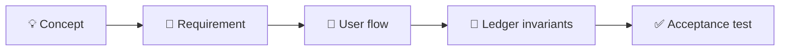

<div align="center">

# ✍️ Tio Money · Documentation Design System

### Premium readability. Visual reasoning. Engineering-grade precision.


[🏠 Project](../README.md) · [📚 Documentation Hub](00-INDEX.md) · [🎯 PRD](01-PRD.md)

</div>

---

## 1 · The documentation identity

**Editorial, calm, structured, precise.** Inspired by professional design systems, not decorative overload.

| Quality | Do this | Avoid |
| :--- | :--- | :--- |
| Hero | One memorable title, one-line promise, truthful status | Huge banners with no purpose |
| Color | Consistent violet/teal/slate in optional badges and diagrams | Rainbow emoji everywhere |
| Readability | Short paragraphs, concise tables, clear hierarchy | Walls of text and 10-column tables |
| Visuals | Mermaid flows for decisions/accounting, diagrams for boundaries | Filler images or fake screenshots |
| Engineering | Invariants, examples, edge cases, acceptance tests | Vague requirements such as “works well” |
| Trust | Draft/approved/implemented explicitly differentiated | Pretending documentation equals shipped code |
| Navigation | Home · Hub · related documents at top and bottom | Orphaned pages and broken links |
| Accessibility | Text equivalents, informative diagram labels | Color-only meanings or tiny screenshot text |

## 2 · Page anatomy

Each major document follows this reusable structure:

```md
<div align="center">

# [Meaningful icon] 0N · Clear document title
### One sentence explaining why the document matters.


[🏠 Home](../README.md) · [📚 Docs Hub](00-INDEX.md)

</div>

---

> [!IMPORTANT]
> Say what is not shipped / not approved when relevant.

## 01 · Executive summary
## 02 · Non-negotiable decisions
## 03 · Product or system diagram
## 04 · Detailed contracts and edge cases
## 05 · Acceptance & verification
## 06 · Open decisions and follow-ups

---

[← Docs Hub](00-INDEX.md)
```

**Do not turn an entire document into decorated Markdown:** put the most useful information within the first screenful.

## 3 · Visual tokens and hierarchy

These are **documentation presentation suggestions**, not approved mobile app theme tokens.

| Token | Example | Role |
| :--- | :--- | :--- |
| `docs.hero` | Bold title, one subtitle | Clear entry point |
| `docs.primary` | `#7357E8` violet | Document stage/visual identity |
| `docs.success` | `#118C84` teal | Positive status or accepted behavior |
| `docs.neutral` | `#596274` slate | Infrastructure/meta state |
| `docs.warning` | GitHub `[!IMPORTANT]` | A genuine constraint or risk |
| `docs.spacing` | `---` between major chapters only | Calm visual separation |
| `docs.diagram` | Mermaid 5–10 nodes if possible | Understand one complete flow |

### Language conventions

- Reader-facing **documentation** summaries can be simple Hindi-English, but domain types, fields, schema names and engineering contracts are in consistent English. This is **not** the mobile app language policy: the initial app UI is English-only ([TM-DEC-001](DECISIONS.md#tm-dec-001--english-only-initial-app)).
- Format Indian currency as `₹5,050.00` when decimal detail matters; use amount in integer paise for storage examples.
- Keep date metadata in `YYYY-MM-DD`; distinguish example date and current date.
- Do not use “automatic” for unimplemented steps, conditional permissions or unverified detection.
- When discussing money, separate **asset balance**, **liability outstanding**, **cashflow**, **expense**, and **net worth**.
- Use one canonical term for a feature within a document; note aliases where screenshots use different labels (`Continue` → proposed `Save & Add Another`).

## 4 · Diagram rules

Use **one diagram per important decision** rather than a screenshot of prose.



For money movement, **always** show where value leaves, where it enters and how expense is recognized.

For security-sensitive flows, mark conditional/native/future steps with a dotted arrow `-.->` and a clear label. Never hide access or policy constraints behind a happy-path diagram.

## 5 · Status and approval truth

**Every significant artifact must have one honest state.**

| Status | Meaning | May be called “implemented”? |
| :--- | :--- | :---: |
| 📝 Draft | Created, needs stakeholder review | No |
| 🟣 In review | Under active review; may change | No |
| ✅ Approved | Requirement/design accepted, not necessarily built | No |
| 🧪 Implemented / unverified | Code exists; validations incomplete | No |
| 🟢 Verified | Code exists, relevant tests and device behavior confirmed | Yes |
| ⚪ Planned | Future scope only | No |
| ⛔ Blocked | Explicit unresolved dependency | No |

**Never copy a status badge from another project.** Tio Workspace is a quality benchmark, not an implementation source or a delivery record for Tio Money.

## 6 · Evidence and document connections

A product rule should connect to:

1. **Requirement ID** (for example, `TM-TR-004` Transfer Fee).
2. **User flow** with path + alternate/error case.
3. **Data rule** explaining account/ledger impact.
4. **Acceptance test** with input, expected output and pass/fail.
5. **Code/PR evidence** only once code exists.

### Example traceability

| ID | Requirement | User flow | Verification |
| :--- | :--- | :--- | :--- |
| `TM-NAV-001` | One `+` entry | [Unified editor](02-USER-FLOWS.md#01--the-navigation-promise) | One action on Home, three form tabs |
| `TM-TR-004` | Fee becomes expense | [Transfer fees](02-USER-FLOWS.md#03--transfer-fees--important-money-rule) | ₹5,000 + ₹50 → ₹50 expense |
| `TM-IMP-002` | No duplicates | [Import review](02-USER-FLOWS.md#05--transaction-review-and-import-flows) | Same alert cannot create duplicate posting |

## 7 · Publishing quality gate

- [ ] Links to README, docs hub and related page all resolve.
- [ ] Every badge and claim truthfully reflects real status.
- [ ] HTML/GitHub Markdown renders in both light and dark theme.
- [ ] Mermaid graphs use readable, meaningful labels (not spaghetti).
- [ ] Key decisions appear early; first screenful conveys purpose.
- [ ] Tables remain readable on mobile.
- [ ] Diagrams have accompanying textual business rules.
- [ ] Figures reconcile with ledger / currency examples.
- [ ] No API keys, banking credentials, PII or fabricated screenshots.
- [ ] Requirements and acceptance cases use consistent terminology.
- [ ] No duplicate source-of-truth conflict between PRD, flows and tests.
- [ ] Screenshots from other apps are documented as references, not embedded as owned designs.
- [ ] New docs appear in the [hub](00-INDEX.md).
- [ ] Changes affecting security or bank imports include relevant platform caveats.

## 8 · What's next

Follow this standard for the **Screen Specification**, **Data Model & Ledger**, **Tech Architecture** and **Test Plan**, adding more technical depth where necessary — **never substituting visual polish for correctness**.

---

[← Docs Hub](00-INDEX.md) · [User Flows →](02-USER-FLOWS.md)
