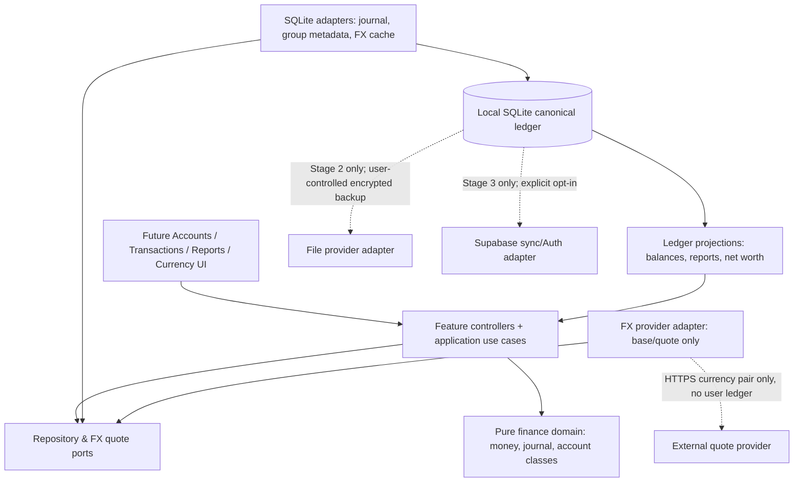
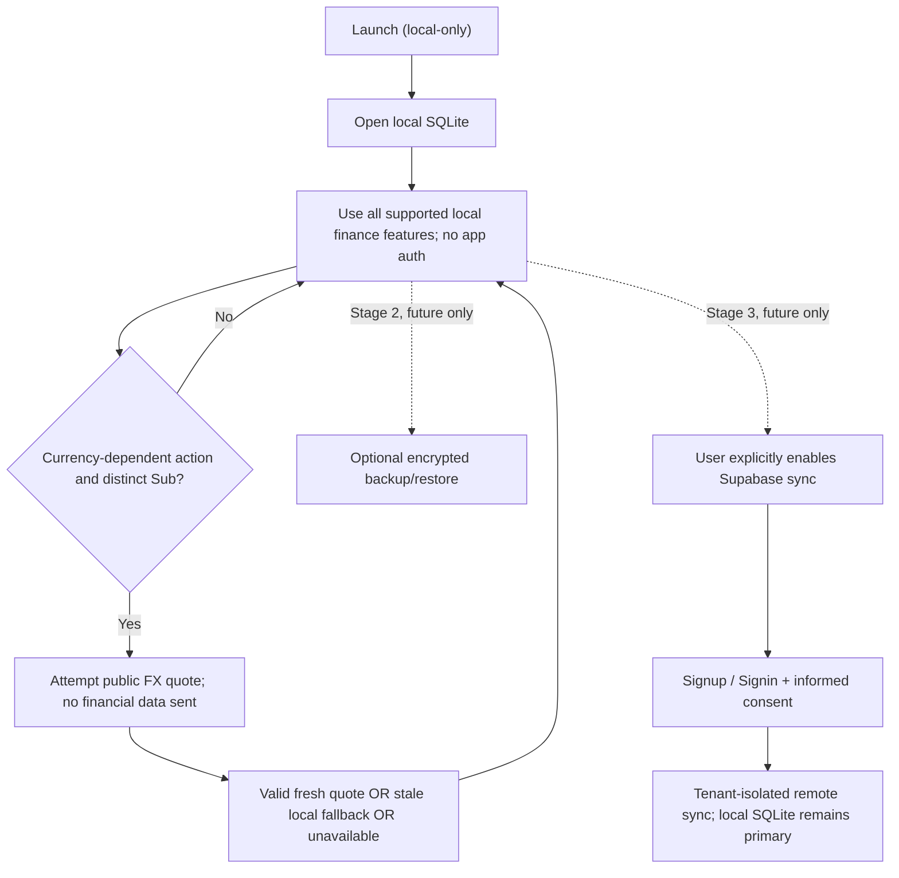
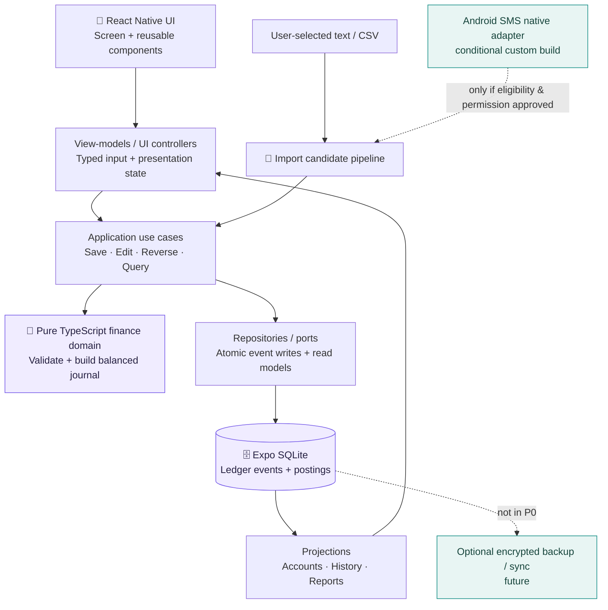
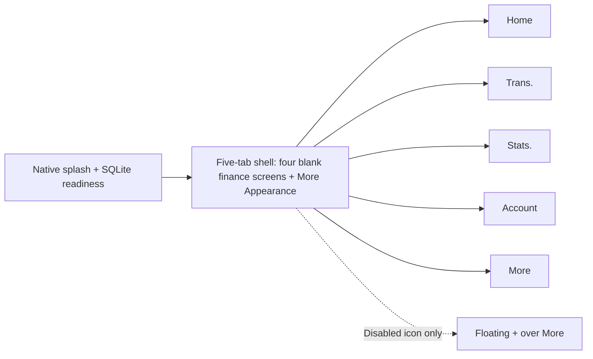
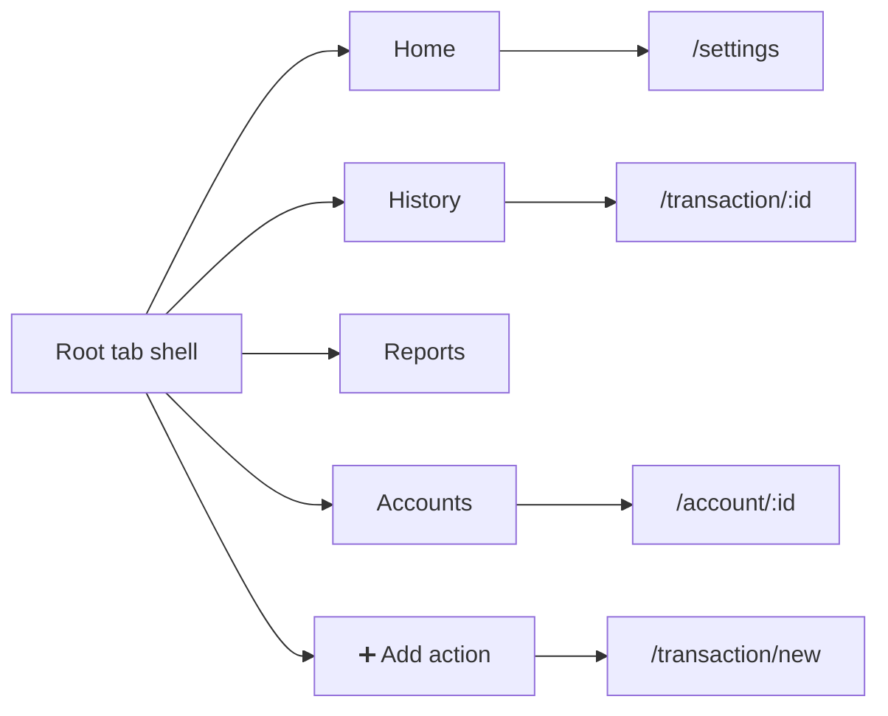
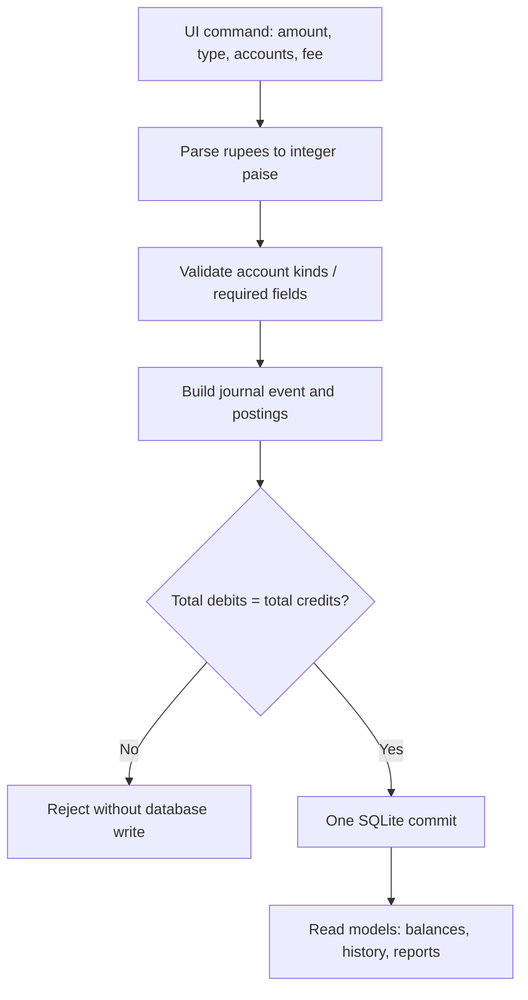
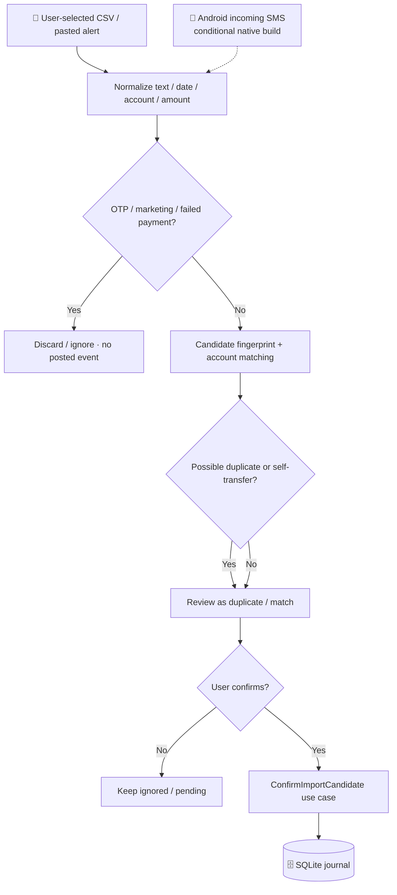
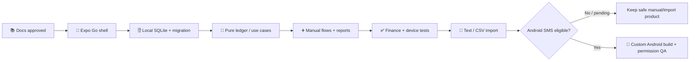

<div align="center">

# 🏗️ 05 · Technical Architecture

### One reliable financial engine. One beautiful mobile experience. Two platforms.


[🏠 Project](../../README.md) · [📚 Docs Hub](../00-INDEX.md) · [🎯 PRD](../product/PRD.md) · [🎨 Screen Design](../design/SCREEN-SPEC.md) · [🗄 Ledger Model](DATABASE-DESIGN.md)

</div>

---

> [!IMPORTANT]
> **Current source status (main 2026-11-21):** PR #1 created the five-tab shell, while later merged UI PRs implemented **More → Appearance** (controller + presentation), selected weight 300/inactive 200 icons with 0dp icon-label gap, and 160ms theme-safe Reduced Motion-aware content crossfade. Home/Trans./Stats./Account remain blank and Add disabled. This is read-only source verification, not full device/SQLite QA or finance feature implementation.


## 00 · Technical architecture alignment — 2026-11-20

> **Owner directive TM-DEC-011 (2026-11-21): EVERY screen is strictly dumb.** A `src/app/` route only composes a container; `features/*/screens` render immutable typed ViewModels and injected callbacks. Screens **must not** use `useState`/`useEffect` for workflow, issue router commands, invoke services, perform I/O, SQL, finance math, FX, policy branching or permissions. Controllers/hooks manage screen state and navigation; application use cases orchestrate commands; domain is pure and balances the journal; adapters own SQLite and network. See [12 — Dumb-Screen Boundaries](DUMB-SCREEN-BOUNDARIES.md) and [finance ADRs](../governance/STAGE-1-FINANCE-ADRS.md). Current root layouts may compose existing providers/navigation hooks without moving their effects into feature screens. No runtime files are changed here.


> [!IMPORTANT]
> **Documentation-only future design.** [RFC #15](https://github.com/im-tnyx/Tio-Money/issues/15) and [TM-DEC-006–009](../governance/DECISIONS.md#tm-dec-006--local-first-delivery-order-and-backup-boundary) set this stage order: **Stage 1 complete local SQLite app with optional FX quote requests only → Stage 2 encrypted user-directed Drive/iCloud backup → Stage 3 optional Supabase sync with signup/signin only after explicit opt-in**. Current Phase 0 source has four blank finance tabs plus implemented More → Appearance, the disabled FAB and settings-only SQLite bootstrap; no financial journal, FX provider, backup, authentication or remote sync is implemented. Original "no P0 cloud/network" paragraphs below mean no **account data** networking; FX quotes are a narrowly scoped future **public pair-metadata exception**, not backend financial storage.

### 00.1 Stage 1 module ownership and data movement



**Module contracts (names proposed; no new folders or packages are created by this PR):**

| Capability | Interface / ownership | Security and failure boundary |
| :--- | :--- | :--- |
| `AccountGroupCatalog` + `AccountSetupUseCase` | Feature/app layer selects typed group descriptor and validates fields; **non-ledger Bank-linked Wallet reference** writes metadata only, while positive ledger-bearing opening positions post one atomic balanced opening-equity event | Group identity is UI metadata; domain chooses asset/liability class; reference has **no separate ledger balance** and zero positions create no postings |
| `LedgerCommandPort` | Domain builds balanced events; adapter enforces idempotent transaction-safe SQLite write | Single source of truth, no UI-computed balances, rollback on failure |
| `AccountLinkRepository` | Links compatible bank/wallet/card/loan/investment records by stable ID | Reject archived/invalid links, do not duplicate bank-linked UPI assets |
| `CardBillingService` | Due/statement schedule and user-confirmed local repayment use cases | **No real bank autopay**, no silent scheduled posting, no card secrets |
| `LoanScheduleService` | Draft installments and user-confirmed principal/interest allocation | Plan != posted event; compounding/interest ADR before implementation |
| `InvestmentValuationPort` | Dated **unposted** market-value inputs and separately labelled portfolio estimate; cost-basis asset remains journal-derived | Quote refresh/market estimate **cannot** change canonical ledger Net Worth, Income or Expense without a future approved **balanced valuation posting** ADR |
| `FxQuotePort` / `FxCachePort` | Trigger refresh on meaningful currency use, check pair/source/timestamps, save last-known quote locally | Network sends currency codes only; cache stale UI; request timeout/rate limit; no hidden account uploads |
| `CurrencyProjection` | Pure exact-decimal display conversion (when a validated quote exists) | No floating-point journal math, no original amount mutation |
| `BackupProvider` (Stage 2 only) | Encrypted archive export/import via user-selected Drive/iCloud/file provider | Explicit user action, key custody, file authentication, restore dry-run and failure recovery |
| `SyncProvider` / `IdentityProvider` (Stage 3 only) | Opt-in remote synchronization + login/signup shown **only after selection** | Explicit consent, tenant-bound authorization/RLS, conflict resolution and local data control; **not added now** |

**Dependency rule:** UI may call only feature APIs; features use application/domain ports; SQLite, FX HTTP and future cloud adapters implement ports. The domain must not import HTTP, platform, Expo or Supabase SDKs. Background refresh is **not** implied. Exchange-rate **provider selection, rates/fee plan, licensing, key handling and retry thresholds require a separate ADR** before implementation.

### 00.2 Local-only privacy and identity state machine



**Identity architecture:** Stage 1 device-local accounts are financial account records, **not identity accounts**. No user email, password, remote UID or forced account registration is needed for local usage. Cloud backup provider's Google/Apple account or OS permissions are distinct from Tio Money identity. **Only Stage 3** introduces app authentication following the user choosing Supabase sync; all local data remains available when sync is declined or signed out (unless explicit data-deletion action). Later sync must define durable local record IDs, user-ownership linking, consent-to-upload boundary, encrypted sensitive fields policy, remote deletion, tenant isolation, token lifecycle, recovery and conflicts in a separately reviewed threat model.

### 00.3 Stage 1 FX request lifecycle

- **Trigger** once per meaningful currency-dependent action (app foreground when active Sub, selected pair change, conversion/relevant transaction/report open or manual Refresh Now). Do not issue HTTP on every React render or keypress.
- **Validate** supported pair and server result format, positive exact decimal rate, effective/published timestamp and provider. Deduplicate simultaneous identical requests. If user changes pair during fetch, old response must not update new pair UI.
- **Store** quote and metadata in SQLite as non-authoritative cache with last successful fetch and accepted provider timestamp. Distinguish provider-published vs locally-fetched freshness.
- **Display** fresh latest-published quote when available; if offline/rate-limited use last valid cached quote with **stale badge/time**; if no quote exists mark estimated conversion **unavailable**. Local original-currency transactions must continue.
- **Privacy:** HTTPS quote requests limited to pair; never send transaction amount, account ID, merchant, ledger rows, device contacts or email for pricing. Avoid embedding a secret API key in a publicly shipped mobile binary; cost/auth strategy requires prior provider ADR.
- **Math:** no currency-specific journal engine is authorized by quote fetching alone. Currency-aware ledger, historic conversion methodology, rounding, holding valuation and FX gains require [04 — Ledger](DATABASE-DESIGN.md#00--finance-data-model-reconciliation--2026-11-20--documentation-only) ADRs.

### 00.4 Stage-gated backup, future authentication and threat model

| Stage | Data movement | User experience | Unresolved security design |
| :--- | :--- | :--- | :--- |
| 1: Local | Finance journal stored only in SQLite; quote pairs may leave device | No app signup; offline financial features; FX optional online | Local physical-device data protection, at-rest encryption claims **not made**, database integrity/recovery and FX provider privacy |
| 2: Backup | User-directed **encrypted, authenticated** backup file to Google Drive/iCloud/file provider | Choose save, verify and restore; OS/provider account may be necessary, **no Tio signup** | Password/key loss, key-derivation/versioning, restore replace/merge, rollback/dry-run, corruption and partial restore, provider permissions/metadata |
| 3: Sync | Optional explicitly consented remote finance-data sync to Supabase | Only opting-in users signup/signin; local default unchanged | Tenant RLS, ownership assertions, publishable vs secret keys, session/token lifecycle, encryption and sync conflicts, rekey/delete/sign-out, user data portability |

**Future Supabase design safety floor:** no mobile client service-role/secret keys; owner-scoped row policies even when `TO authenticated` is specified; user-editable metadata cannot grant access; view/RPC policy review; tenant isolation and staged deletion/conflict simulations. This is **not an implementation recipe or completed security audit**. Confirm current product docs before Stage 3 implementation.

### 00.5 Verification/acceptance trace (future code gates)

| ID | Required outcome |
| :--- | :--- |
| `TM-ARCH-001` | Stage 1 local app never requires app login; FX failure does not block local same-currency entry |
| `TM-ARCH-002` | Data-flow capture shows only currency pair/provider metadata goes to FX endpoint |
| `TM-ARCH-003` | Group/card/loan/investment workflows post via one balanced journal; no UI SQL and no mutable balance caches |
| `TM-ARCH-004` | Card “autopay” tracking cannot trigger remote debit or local payment posting without confirmation |
| `TM-ARCH-005` | Quote latest-published/stale/unavailable states, request coalescing and race rejection are tested |
| `TM-ARCH-006` | No backup or Supabase/Auth dependency in Stage 1 release graph |
| `TM-ARCH-007` | Stage 2 encrypted archive is validated and recoverable before any cloud-sync scope |
| `TM-ARCH-008` | Stage 3 login only on opt-in, RLS isolation and local continuity after logout (future separate auth threat model) |
| `TM-ARCH-009` | Bank-linked Wallet references create only typed link metadata and never duplicate a Bank asset; historical Investment/Loan openings are distinct from new funding/disbursement transactions |
| `TM-ARCH-010` | Investment market quote changes only a **separate unposted portfolio estimate**; canonical journal-derived Net Worth remains unchanged until an approved balanced valuation event is explicitly posted |

**Stage 1 finance ADRs triaged (2026-11-21):** [11 — Finance ADR Register](../governance/STAGE-1-FINANCE-ADRS.md) is now canonical for TM-ADR-011–023: shared finance invariants are accepted **for design**, while cross-currency posting, issuer-card rules, loan interest, investment realization, concrete FX provider and data migration remain explicitly **BLOCKED pending approvals/tests**. [PR #22](https://github.com/im-tnyx/Tio-Money/pull/22) has already merged (not an open separate PR C); its Stage 1/2/3 sequence remains authoritative. Stage 2 backup keys and Stage 3 sync identity/security require separate future ADRs.

## 01 · Executive architecture at a glance

**Recommended approach:** React Native + Expo + TypeScript, feature-oriented Clean Architecture, a **pure TypeScript financial domain**, and **Expo SQLite** as the local source of truth. Android SMS reading is an **optional native integration**, never a dependency of the core money tracker.

| Decision | Proposed solution | Why |
| :--- | :--- | :--- |
| Mobile app | **React Native + Expo** | Shared Android/iPhone feature code |
| Navigation | **Expo Router** | Explicit root/editor routes and predictable deep links |
| Language | **TypeScript (strict)** | Typed financial events and less ambiguous app state |
| Local persistence | **Expo SQLite** | Offline-first ledger with relational constraints |
| Finance engine | **Pure TypeScript journal builder** | Same math for preview, saving and reports |
| State | **Zustand for UI state**; repositories as source of truth | Prevent UI stores from becoming a second database |
| Theme + components | Shared typed tokens and reusable components | Original Tio Money design for both platforms |
| Import | Shared candidate parser + review + de-duplication | Cross-platform consistency and privacy |
| Android SMS | Local native module **only in custom development/release build**, subject to Play policy | Expo Go cannot load custom SMS inbox modules |
| iPhone | Manual entry, user-selected text/CSV | No automatic third-party SMS inbox access |
| Cloud | **None required for current Phase 0 or local-finance-data storage** | Future Stage 1 allows **only optional currency-pair FX requests**, not financial cloud upload, login or remote ledger |

### 1.1 Non-negotiable boundaries

- **Current Phase 0:** Home, Trans., Stats. and Account are blank finance tabs; **More → Appearance** is implemented as controller-driven, dumb-screen UI. The single floating `+` above More is **disabled and has no handler/editor route**. **Future product contract only:** once separately authorized, enable a single unified **Income | Expense | Transfer** editor, never three Home shortcut cards. Do not advertise the future editor as implemented.
- Transfer principal between tracked accounts is not reported as income/expense. **Optional transfer fee is an expense**, including bank/wallet/card-related real charges.
- A credit card is a **liability**, not a cash balance.
- **Legacy INR-only examples** use integer paise; planned Stage 1 monetary amounts require exact **currency-specific native integer minor units with ISO currency/exponent**, never JS floating-point ledger totals. Mixed-currency journal posting remains **BLOCKED** until accepted TM-ADR-018 FX clearing/rounding and migration rules.
- Reports, history and balances are derived from the **same balanced journal**.
- No import candidate affects account balances until confirmed and posted.
- Expo Go must run P0 with **zero SMS native-module dependency**.
- Project implementation must not copy styling from the reference screenshots.

## 02 · The system map



**Dependence direction:** UI knows application APIs; application knows domain contracts; data adapters implement repositories. **Domain must never import React Native, Expo, SMS, SQLite or navigation.**

### 2.1 Layers and responsibilities

| Layer | Owns | Must not own |
| :--- | :--- | :--- |
| **Presentation** | Screen states, display labels, accessible controls | SQL, bank SMS parsing, ledger calculations |
| **Application** | Transaction commands, orchestration, authorization of local changes | Native permission screens, raw SQL |
| **Domain** | Money types, invariants, balanced journal construction, event classification | Device APIs, React hooks, SQLite |
| **Data** | SQLite migrations, repository adapters, queries, journal persistence | UI colors, untyped business heuristics |
| **Platform adapters** | Files, share/paste, permissions, optional Android SMS bridge | Financial accounting decisions |
| **Infrastructure (later)** | Encrypted backup/sync transport | Replacing local ledger as default source of truth |

## 03 · Proposed repository structure

### Current Phase 0 source boundaries (PR #1 foundation plus later merged UI refinements)

```text
src/
├─ app/
│  ├─ _layout.tsx                # Providers + SQLite gate + headerless stack
│  └─ (tabs)/
│     ├─ _layout.tsx             # Four blank finance tabs + More Appearance; separate disabled FAB
│     ├─ index.tsx
│     ├─ transactions.tsx
│     ├─ reports.tsx
│     ├─ accounts.tsx
│     └─ more.tsx
├─ shared/
│  ├─ theme/
│  │  ├─ primitives.ts          # Canonical fixed numeric visual sizes
│  │  ├─ tokens.ts              # Spacing, radius, type, system light/dark palettes
│  │  ├─ component-tokens.ts    # Shared icon roles, nav/FAB/buttons/shadows
│  │  └─ theme-provider.tsx
│  ├─ navigation/               # Router, splash and safe-area controller hooks
│  ├─ bootstrap/                # Database readiness/error recovery
│  └─ ui/                       # Theme-driven presentation components
├─ data/sqlite/                 # Settings-only versioned bootstrap
├─ domain/                      # Financial contracts; no posting engine yet
└─ platform/sms/                # Disabled adapter; no default SMS permission
```

**Current route ownership:** `index`, `transactions`, `reports` and `accounts` export `BlankScreen`; `more.tsx` exports [`MoreRoute`](../../src/features/settings/more-route.tsx), composing a **controller** (`useMoreViewModel`) and dumb **presenter** (`MoreScreen`). [`use-root-tab-navigation.ts`](../../src/shared/navigation/use-root-tab-navigation.ts) owns navigation, root layout delegates crossfade/Reduced Motion to shared hooks and the floating Add remains independent. No SQL or finance logic is in these screens.

**Central token ownership:** [`primitives.ts`](../../src/shared/theme/primitives.ts) holds fixed physical sizes; [`tokens.ts`](../../src/shared/theme/tokens.ts) defines semantic spacing, radii, type and light/dark palettes; [`component-tokens.ts`](../../src/shared/theme/component-tokens.ts) defines one **24dp icon-size** token with aliases for navigation, future top bars, buttons, sheets, cards and text fields, plus current 50dp navigation baseline / 50dp FAB, **0dp icon-label spacing, selected icon weight 300 / inactive 200**, 16dp FAB-to-bar clearance, **160ms Reduced Motion-aware tab crossfade** and shadow contracts. The root theme provider defaults to **system** appearance, with implemented **More → Appearance (System/Light/Dark)** user override and local preference persistence. No unapproved financial features or per-screen hardcoded dimensions. See the [implementation ownership guide](../../src/shared/theme/README.md) and [enforcement tests](../../tests/phase0/design-tokens.test.ts). The future folder tree and proposed APIs below must follow these contracts.

### Future feature-oriented repository proposal (not implemented)

The route files stay thin and presentation-only. Feature modules own workflows; `src/domain/` owns finance contracts/invariants. **The large example tree below represents future planned folders/routes, not the actual Phase 0 tree.** Current Phase 0 deliberately has no `(setup)`, `transaction/new`, standalone `/settings`, old `history` or extra feature routes; implemented Appearance remains inside More, not a new route. Current working structure is summarized first.

```text
Tio-Money/
├─ src/
│  ├─ app/                         # Expo Router route definitions
│  │  ├─ _layout.tsx                # App initialization / providers / stack
│  │  ├─ (setup)/
│  │  │  ├─ welcome.tsx
│  │  │  └─ account.tsx
│  │  ├─ (tabs)/
│  │  │  ├─ _layout.tsx             # Home · History · + · Reports · Accounts
│  │  │  ├─ index.tsx
│  │  │  ├─ history.tsx
│  │  │  ├─ reports.tsx
│  │  │  └─ accounts.tsx
│  │  ├─ transaction/
│  │  │  ├─ new.tsx                 # Unified 3-tab form; modal/stack route
│  │  │  └─ [id].tsx
│  │  ├─ account/
│  │  │  ├─ new.tsx
│  │  │  └─ [id].tsx
│  │  ├─ import/                    # P1 · selected text/CSV + review
│  │  │  └─ index.tsx
│  │  └─ settings.tsx
│  ├─ features/
│  │  ├─ onboarding/
│  │  ├─ dashboard/
│  │  ├─ transactions/
│  │  │  ├─ ui/
│  │  │  ├─ controllers/
│  │  │  └─ use-cases/
│  │  ├─ accounts/
│  │  ├─ reports/
│  │  ├─ import/                    # Parser + review UI (P1)
│  │  └─ settings/
│  ├─ domain/
│  │  ├─ money/                     # Parse INR → integer paise
│  │  ├─ ledger/                    # Balance, postings, reversals
│  │  └─ contracts/                 # Domain + repository interfaces
│  ├─ data/
│  │  ├─ sqlite/
│  │  │  ├─ migrations/
│  │  │  ├─ repositories/
│  │  │  ├─ queries/
│  │  │  └─ initialize.ts
│  │  └─ projections/
│  ├─ platform/
│  │  ├─ file-import/
│  │  ├─ sms/                       # No-op or conditional native adapter
│  │  └─ security/
│  └─ shared/
│     ├─ ui/
│     ├─ theme/
│     ├─ i18n/
│     ├─ errors/
│     └─ utils/
├─ modules/                         # Future only: Android SMS local Expo module
├─ tests/
│  ├─ domain/
│  ├─ application/
│  ├─ sqlite/
│  └─ e2e/
├─ assets/
├─ docs/
├─ app.json
├─ package.json
└─ tsconfig.json
```

**Naming principle:** Screen = **presentation-only composition**; Controller/hook = routing, view state and user intent; Use case = business workflow; Repository = persistence port; SQL adapter = concrete storage. No SQL, ledger/domain calculations, platform permissions, splash lifecycle or router commands in feature screen components. Avoid giant `utils.ts`, `financeStore.ts` or a screen with inline SQL. **The directory tree above is an original future design, not the current source tree.**

## 04 · Navigation contract

**Current Phase 0 navigation contract (owner-approved, source implemented):** five selectable routes `/` (Home), `/transactions` (Trans.), `/reports` (Stats.), `/accounts` (Account), `/more` (More). **Four finance tabs are blank; More implements the Settings → Appearance bottom sheet (System/Light/Dark) through `MoreRoute`/`useMoreViewModel` and dumb presentation.** The source-defined nav tokens use selected weight **300**, inactive **200**, **0dp** icon-label gap and **160ms Reduced Motion-aware** tab-content crossfade. A **separate disabled floating `+`** is centered above More, has no press handler and no editor route; there is **no root header**, welcome, standalone Settings route, History route or financial feature screen. Normal startup keeps splash visible for SQLite initialization and reveals the shell directly. One exceptional bootstrap error may show safe recovery. Owner reports a current physical-device UI smoke PASS and no recurring `ExpoSQLite` crash; the full Android+iPhone device matrix and SQLite PRAGMA/migration/restart QA remain NOT_VERIFIED.



**Historical future-state proposal only (superseded for current Phase 0):** The original [screen design proposal](../design/SCREEN-SPEC.md#21-proposal-five-positions-one-action) described **four destinations + one active central Add**. The diagram and behavior below are preserved as future design exploration; they are **not present routes** and require a new owner-scoped decision before implementation:



- **Future flow only:** `+` would be an action, not a fifth content screen. **In current Phase 0 it is disabled and has no handler**, and five selectable content destinations exist.
- `/transaction/new` and `/transaction/:id` open as full-screen stack/editor routes and hide the bottom bar.
- Existing filled fields survive temporary account/category selection overlays; back with dirty fields shows an explicit discard prompt.
- `Save` returns to origin; `Save & Add Another` saves once, then resets for a new entry with a visible success acknowledgement.
- Do not create second `+` controls or three shortcuts on Home.
- Older four-root/center-Add plans are **historical**; the current five destinations, More Appearance, 300/200 icons, 0dp gap and theme-safe 160ms content crossfade reflect separate owner-approved work. The Add editor and all finance screens remain separately gated.

**Route state is not money state.** Avoid passing entire transaction objects through route parameters; pass stable IDs and re-read local repository data.

## 05 · Financial domain model

### 5.1 Canonical ledger contract

The [Database & Financial Ledger](DATABASE-DESIGN.md) specifies:
`financial_accounts`, `categories`, `ledger_accounts`, `ledger_events`, `ledger_postings`, `transfer_details`, `import_candidates` and `app_settings`.

An **event** is one user-visible financial action. It contains multiple postings that **must balance**. Transfer fees are an **expense posting in the same transfer event**, not a separately saved free-floating expense. Edits/deletes use reversals and, where needed, replacements, rather than mutating historical postings.



### 5.2 Transfer example · debit SBI, credit HDFC, charge ₹50

A ₹5,000 SBI → HDFC transfer with ₹50 fee charged to **SBI** yields these *bookkeeping* postings:

| Account | Debit | Credit |
| :--- | ---: | ---: |
| HDFC (asset) | ₹5,000 | — |
| Bank Charges & Fees (expense) | ₹50 | — |
| SBI (asset) | — | ₹5,050 |
| **Total** | **₹5,050** | **₹5,050** |

**UI result:** SBI −₹5,050; HDFC +₹5,000; **Expense +₹50**. Income +₹0. Do not model ₹5,050 as an expense.

**Destination-deducted alternative:** SBI −₹5,000; HDFC +₹4,950; Fee expense ₹50. Full formulas apply to **asset-to-asset** only; card liability transactions need class-aware posting rules.

### 5.3 Pure TypeScript contracts (illustrative, not shipped)

```ts
type Id = string;
type MoneyMinor = number; // INR-only sample: safe integer paise; Stage 1 needs native ISO units
type TransactionType = "income" | "expense" | "transfer";

type TransferFee = {
  amountMinor: MoneyMinor;   // 0 allowed
  payer: "source" | "destination";
  expenseCategoryId: Id | null;
};

type CreateTransferCommand = {
  clientRequestId: Id;       // retry-safe idempotency key
  amountMinor: MoneyMinor;
  currency: "INR";
  fromAccountId: Id;
  toAccountId: Id;
  occurredAtMs: number;
  fee: TransferFee;
  note?: string;
};

type JournalPosting = {
  accountId: Id;             // ledger_accounts.id
  side: "debit" | "credit";
  amountMinor: MoneyMinor;   // > 0
};

type JournalDraft = {
  eventType: TransactionType | "opening" | "refund" | "reversal";
  postings: readonly JournalPosting[];
  metadata: Record<string, unknown>;
};

// Domain: builds a validated journal; application: persists atomically.
// Actual implementation must handle IDs, account classifications,
// safe-integer overflow, reversal rules and strong input validation.
```

**Legacy INR-only illustrative code above, NOT an approved Stage 1 multi-currency domain interface.** Production must use a branded/runtime-validated native minor-unit type **coupled to immutable ISO currency and exponent**, with versioned currency metadata. JavaScript `number` is acceptable only for **safe integers**; reject non-integers/overflow and currency-incompatible decimals. Parse `"5000.50"` by decimal-string decomposition, not floating-point multiplication. The old example's `currency: "INR"` cannot book mixed-currency transfers; see [TM-ADR-018](../governance/STAGE-1-FINANCE-ADRS.md#tm-adr-018--native-currency-accounting-and-fx). Current Phase 0 has **no posting engine**.

### 5.4 Core use cases

| Command / query | Input | Output / guarantee |
| :--- | :--- | :--- |
| `CreateAccount` | Name, type, opening amount | Account + balanced opening entry |
| `CreateTransaction` | Type, amount, accounts, category, fee | **One atomic balanced event** |
| `PreviewTransaction` | Same draft as Save | Asset/liability delta, fee expense, validation |
| `CorrectTransaction` | Original event ID + corrected draft | Reversal + replacement in one atomic operation |
| `ReverseTransaction` | Event ID + reason | Compensating postings, no orphan fee |
| `GetAccounts` | Optional archived flag | Asset balances and card outstanding |
| `GetHistory` | Date/type/category/account filters | Stable ordered event projections |
| `GetReports` | Period + account filters | Expense includes fees once; transfers separate |
| `ConfirmImportCandidate` | Candidate ID + reviewed values | Idempotent posting once |

**Preview and Save cannot maintain two different fee calculators.** Both call the same domain validation/journal function. Display projections have no authority to change event math.

## 06 · SQLite lifecycle and transaction safety

### 6.1 Initialization

1. Open a named SQLite database; confirm compatible Expo SDK on both OSs.
2. On the **active write connection**, enable `PRAGMA foreign_keys = ON` and verify it reads as enabled.
3. Enable/check WAL mode if supported and appropriate; test under low storage and device restart.
4. Read `PRAGMA user_version`; apply **versioned migrations** in order with backup/failure policy.
5. Verify required schema/indexes, then expose repositories to the UI.
6. Keep splash/setup in a **database initializing/error** state until the DB contract is ready.
7. Local seed data should be limited to stable built-in categories/settings; **never** generate fabricated money transactions in real user storage.

### 6.2 Transaction nuance — important

Expo SQLite documents that:
- `withTransactionAsync()` may allow other asynchronous DB queries to interleave if they bypass the intended write scope.
- `withExclusiveTransactionAsync()` isolates operations on its `txn` connection, **but uses a new connection**; settings like `PRAGMA foreign_keys = ON` set on the original connection do **not** automatically carry over. Foreign keys cannot be enabled once a transaction has already begun.

**P0 decision proposal:** use **one serialized write coordinator**, a **single controlled SQLite connection**, enforced `foreign_keys=ON`, and `withTransactionAsync()` for all event+postings writes. **Every database operation capable of affecting ledger writes must go through the coordinator**; bypassed/out-of-band writes are forbidden. Verify rollback, foreign-key constraints and concurrency on Android and iPhone before accepting this design as implemented.

Do **not** switch to exclusive transactions casually or claim FK enforcement without an integration test. If a later design uses an exclusive connection, independently establish and test its FK configuration and constraints.

### 6.3 Query safety

- Use bound parameters with `runAsync()` / `getAllAsync()`, or prepared statements with `prepareAsync()`, then `finalizeAsync()` in `finally`.
- Do **not** interpolate user-entered values into `execAsync()`; reserve it for trusted static migrations/PRAGMAs.
- Ensure every financial write is atomic: journal event + all postings + transfer metadata + import confirmation link, if applicable.
- Construct balanced drafts first, then persist; guard with request idempotency and event status/projection rules.
- P0 queries should paginate History rather than loading all transactions in memory.
- Editing an event creates reversible audit events rather than changing debit/credit rows in place.
- Read models are **derived from postings**; cached dashboard aggregates, if ever added, are disposable projections.

### 6.4 Data access contracts (conceptual)

```ts
interface LedgerRepository {
  saveBalancedEvent(draft: JournalDraft, clientRequestId: string): Promise<Id>;
  reverseAndReplace(originalEventId: Id, replacement: JournalDraft): Promise<Id>;
  listHistory(query: HistoryQuery): Promise<HistoryPage>;
  getAccountSummary(accountId: Id): Promise<AccountSummary>;
  getReport(query: ReportQuery): Promise<ReportSummary>;
}

interface ImportCandidateRepository {
  listPending(): Promise<ImportCandidate[]>;
  markIgnored(candidateId: Id): Promise<void>;
  confirmOnce(candidateId: Id, event: JournalDraft): Promise<Id>;
}
```

**Important:** Above interfaces are design sketches; concrete typing of `HistoryQuery`, `HistoryPage`, `ImportCandidate` and `ReportSummary` comes during implementation. Never paste them into a TypeScript compilation unit without defining dependent types.

## 07 · Application state, React performance and consistency

**Three separate kinds of state:**

| State class | Examples | Owner |
| :--- | :--- | :--- |
| **Ephemeral UI** | Selected Income/Expense/Transfer tab, unsaved form input, sheet visible | Local component/controller / small Zustand store |
| **Durable domain data** | Accounts, ledger postings, import candidates, settings | **SQLite repositories only** |
| **Derived read models** | Home totals, category charts, History rows | Memoized query/selectors over SQLite |

Use **Zustand selectively** for editor drafts or cross-screen presentation state; do **not** mirror a writable account balance in a global store. After successful database writes, invalidate/re-read affected queries via a single event/update notification mechanism.

- Controllers return typed view models; screens render and forward actions.
- Use explicit `idle → validating → saving → success/error` state machine for Save.
- Disable repeated submission while saving; still require idempotency at repository boundary for crash/retry.
- Keep input responsive while large reports run; index/filter SQL rather than formatting every record on every render.
- Include error/empty/loading/offline states from [Screen Design](../design/SCREEN-SPEC.md).

## 08 · Import pipeline and platform adapters

### 8.1 One pipeline regardless of source



- The **parser** produces untrusted suggestions, not balanced journal events.
- **User review** is required initially, even when a parser reports high confidence.
- Existing manual entries, both sides of self-transfers, reversals and repeated bank messages must be matched before posting.
- Do not store unrelated SMS, OTPs or sensitive full account numbers.
- If amount/account is ambiguous, present it as **Needs Review**, not auto-income or an invented category.

### 8.2 Expo Go versus custom development builds

| Capability | Expo Go P0 | Android custom build (conditional) | iPhone |
| :--- | :---: | :---: | :---: |
| Manual ledger, account, reports | ✅ | ✅ | ✅ |
| SQLite persistence | ✅ | ✅ | ✅ |
| User-initiated text/CSV import | P1 | P1 | P1 |
| Custom native SMS inbox access | **No** | **Only if native feature + policy approval** | **No normal inbox access** |
| SMS receiver parsing and permission screen | **No** | **Conditional** | Not applicable |

**Build integration boundary:** the P0 Expo Go bundle must never eagerly import/call an unavailable native SMS module. Provide a `SmsImportPort` with a disabled implementation; the native implementation is only linked into an explicitly configured Android custom-build flavor after the permission-policy gate. A JavaScript runtime flag alone does not guarantee native module availability. Use build/config separation and validate an actual Expo Go install.

**Permissions:** Never ship `READ_SMS`/`RECEIVE_SMS` in the ordinary Expo Go-oriented default manifest. A distinct reviewed Android build may require sensitive permissions, disclosure and Google Play Console declaration. The case-by-case approval is **not guaranteed**. No accessibility or notification workaround should be used to bypass platform restrictions.

**iOS:** Manual entries and user-selected/pasted financial alert text, plus file-selected CSV statements. No continuous, universal automatic SMS inbox-reading claim.

### 8.3 Domain-level import interfaces

```ts
type ImportSource = "sms" | "csv" | "text";

interface ParsedCandidate {
  source: ImportSource;
  amountMinor: number | null; // untrusted until validated
  direction: "debit" | "credit" | null;
  occurredAtMs: number | null;
  matchedAccountId?: string;
  maskedReference?: string;
  confidence: number;
}

interface ImportSourceAdapter {
  kind: ImportSource;
  collectUserAuthorizedInput(): Promise<unknown>;
}
```

Keep the candidate type separate from the `JournalDraft`. Parsers can fail, date formats vary, and bank credit messages do not always mean earned income.

## 09 · Privacy, security and backups

**Threat model:** personal finance metadata, account identifiers, bank references, device loss, malicious import files, accidental deletion and secret leakage.

| Protection | P0 design | Must be verified |
| :--- | :--- | :--- |
| Least data collection | Account name, masked identifier, event metadata only | No OTP/full unrelated SMS stored |
| Offline-first | No login/backend needed to enter data | Airplane-mode manual entry |
| Local storage privacy | SQLite local sandbox; sensitive data minimization | Device backup behavior and data accessibility reviewed |
| Input validation | Strict amount/date/account/category types | Fuzz and malformed input tests |
| SQL injection | Bound queries and safe migrations | Audit every repository query |
| Permissions | No SMS permission in P0 | Manifest checks, policy review later |
| App lock | Planned milestone, **not core database encryption** | Lock and cold-start tests once delivered |
| Encryption | Require a separately designed/tested at-rest solution before claiming encrypted DB | Threat review, key ownership, cross-platform testing |
| Backup and restore | Future opt-in, clearly distinguished from sync | Encrypt/authenticate, integrity, restore trials |
| Telemetry | No raw SMS, notes, full identifiers or ledger payloads | Log redaction tests and explicit consent decisions |

**No false security claims:** being local-only or having a PIN screen does not, by itself, prove the SQLite file is encrypted. No bank credentials, OTP collection, covert upload or ad analytics in the P0 design.

**Data loss:** Until a real recovery feature ships, uninstalling/loss/resetting a device can delete local data. State this in onboarding/settings rather than suggesting automatic backup exists.

## 10 · Localization, appearance and accessibility

- **MVP language decision:** English-only user-facing text, validation and accessibility labels; **no language selector**. Keep typed semantic string resources future-localization-ready; Hindi and other translations are later features ([TM-DEC-001](../governance/DECISIONS.md#tm-dec-001--english-only-initial-app)).
- **Numbers:** INR display examples use Indian grouping and rupee symbol, but future per-currency display must honor the immutable ISO currency/exponent and locale while journal amounts stay **native safe-integer minor units**. ViewModel mappers format values; **screens never compute currency/ledger math**.
- **Dates:** Store timestamps consistently (UTC epoch milliseconds), render using chosen device locale/timezone; reports group by the user-selected local calendar period.
- **Theme:** The current shared System/Light/Dark token resolver and More → Appearance preference are implemented. Any **future proposed** theme tokens or feature palettes beyond the approved current source still require owner approval and accessibility/contrast testing; existing device-wide accessibility QA is not claimed. See [Screen Design](../design/SCREEN-SPEC.md) and [current theme tokens](../../src/shared/theme/component-tokens.ts).
- **Fonts:** prefer system fonts for MVP unless the owner specifically approves an alternative; keep number/date formatting separate from message translation.
- **Tap targets:** minimum suggested 48dp Android and 44pt iOS, and test large-font layouts.
- **Screen readers:** announce full amount, type and source/destination; don't convey debit/credit status with color alone.
- **Keyboard & safe areas:** fixed Save footer stays above IME/home indicator; form scroll stays reachable.
- **Motion:** respect reduced-motion preference; no essential information inside animation.

## 11 · Testing and engineering quality gates

### 11.1 Test pyramid

| Test layer | Important cases | Tooling proposal |
| :--- | :--- | :--- |
| **Pure domain tests** | Debit=Credit; cents/paise parsing; card liability; fee source/destination | TypeScript unit test runner (choose later) |
| **Application tests** | Create/edit/reverse; rollback; idempotency; no duplicated fee | Use-case tests with fake repository |
| **SQLite integration** | Foreign keys ON, migrations, atomic writes, concurrency, indexes | Real SQLite and device/emulator tests |
| **UI component tests** | Tab transitions, errors, accessibility labels, Fee disclosure | React Native component tests |
| **Device E2E** | Onboarding → `+` → Save → History/Reports; no double tap | Android and iPhone builds |
| **Import fixtures (P1)** | Failed/OTP messages, debit/credit, duplicates, self-transfer, privacy | Versioned sanitized samples |
| **Native permission gates** | Expo Go no-SMS; Android opt-out; restricted permissions | Manifest review + conditional build tests |

### 11.2 Release-blocking financial assertions

- [ ] ₹500 cash expense → Cash −₹500 and Expense +₹500.
- [ ] ₹5,000 salary credit → SBI +₹5,000 and Income +₹5,000.
- [ ] ₹2,000 bank → cash transfer → combined assets unchanged, no reported income/expense.
- [ ] ₹5,000 SBI → HDFC with ₹50 **source** fee → SBI −₹5,050; HDFC +₹5,000; Expense +₹50 **once**.
- [ ] Same amount with **destination** fee → SBI −₹5,000; HDFC +₹4,950; Expense +₹50 once.
- [ ] Credit-card purchase → Expense rises and Outstanding rises; no false bank deduction.
- [ ] Card bill repayment → bank and liability decrease together; no new expense.
- [ ] Mid-save injected exception rolls back **all** journal/posting/fee writes.
- [ ] Edit/delete yields valid reversal/replace history with no orphaned fee.
- [ ] 1,000 repeated read/write operations do not break FK/transaction consistency (test corpus to be sized during implementation).
- [ ] No duplicate posted event from the same confirmed import candidate or repeated Save tap.
- [ ] Expo Go P0 can open, enter and read transactions **offline** with no custom SMS module.

### 11.3 Code quality gates

- `tsc --noEmit`, lint, formatting and tests must pass.
- Enforce module boundaries (domain imports no React Native/Expo).
- Every PR updates requirement links and acceptance evidence.
- Never label mocks, planned packages or static UIs as implemented features.
- Store migration tests use real on-disk upgrade paths, not only a fresh empty database.
- Manual device checks: Android physical device and iPhone physical device/simulator for typography, safe area, behavior and persistence.

## 12 · Delivery sequence and go/no-go



| Milestone | Deliverable | Exit gate |
| :--- | :--- | :--- |
| **M0 — Review** | PRD, flows, screens, ledger & architecture | Core design decisions acknowledged |
| **M1 — Shell** | Original theme, setup, bottom nav, one `+` editor | Expo Go opens on Android + iPhone |
| **M2 — Ledger** | Local DB, migrations, account and journal services | All finance assertions + FK/rollback tests pass |
| **M3 — Core features** | Create/edit/reverse, History, Accounts, Reports | Offline E2E; no double count |
| **M4 — Import** | User-selected text + CSV, review workflow | Deduplication and privacy fixtures pass |
| **M5 — Android native (conditional)** | SMS source adapter, policy/permission lifecycle | Approved eligibility + custom build + safety QA |
| **M6 — Hardening/release** | Privacy policy, optional protections, EAS store builds | Real device sign-off and explicit owner approval |

## 13 · Open decisions / architecture review

| ID | Decision still open | Proposal / next validation |
| :--- | :--- | :--- |
| `TM-ADR-001` | Exact branding and palette | Follow original Screen Design; contrast QA before freeze |
| `TM-ADR-002` | Exact `+` button location — **SUPERSEDED / RESOLVED for Phase 0** | Owner TM-DEC-004/005/010 confirms five bottom destinations and **separate disabled Add above More**; never implement old four destinations + center slot |
| `TM-ADR-003` | UI state library | Zustand only for ephemeral state; keep SQL canonical |
| `TM-ADR-004` | SQLite transaction strategy | Verify serialized writes + FK enforcement on both devices |
| `TM-ADR-005` | Ledger correction model | Reversal + replacement, grouped to original event |
| `TM-ADR-006` | Import sources / bank CSV formats | Confirm sample formats; validate sanitization |
| `TM-ADR-007` | Android SMS restricted permission eligibility | Review current Play policy and request approval before enabling |
| `TM-ADR-008` | Encryption and optional backup | Separate threat-model and native platform research |
| `TM-ADR-009` | Exact package versions | Pin compatible Expo SDK / RN packages at implementation kickoff |
| `TM-ADR-010` | Handling app data reinstall/migration | Document recoverability and test upgrade paths |

## 14 · Authoritative references and next steps

**Internal product sources**

- [🎯 01 — Product Requirements](../product/PRD.md): goals, field contracts, fees, privacy.
- [🧭 02 — User Flows](../product/USER-FLOWS.md): editor, fee preview, import deduplication.
- [🎨 03 — Screen Design](../design/SCREEN-SPEC.md): navigation, UI tokens, screen states.
- [🗄 04 — Database & Ledger](DATABASE-DESIGN.md): canonical journal schema and financial examples.
- [✍️ Documentation Style](../governance/DOCS-STYLE-GUIDE.md): visual consistency and honest status labels.

**External documentation — checked 2026-11-18; recheck at build time**

- [Expo Router, core concepts](https://docs.expo.dev/router/basics/core-concepts/) — routing/layout boundaries.
- [Expo SQLite API](https://docs.expo.dev/versions/latest/sdk/sqlite/) — parameters, migrations, transaction semantics and FK nuance.
- [Expo custom native code](https://docs.expo.dev/workflow/customizing/) — Expo Go limits and development builds.
- [Expo development builds](https://docs.expo.dev/develop/development-builds/introduction/) — platform-native extension workflow.
- [Google Play SMS / Call Log restricted permissions](https://support.google.com/googleplay/android-developer/answer/10208820) — case-by-case eligible exceptions and declaration.

**Next document:** `06 — Implementation & Test Plan` to convert this architecture into ordered, testable milestones with verifiable deliverables.

---

[← Documentation Hub](../00-INDEX.md) · [Review Ledger Model](DATABASE-DESIGN.md) · **Next: Implementation & Test Plan**
