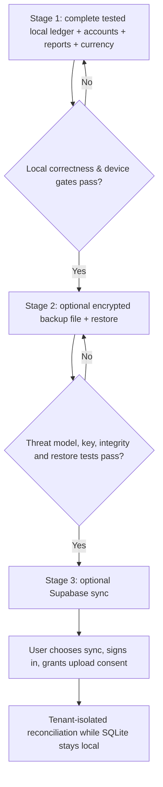

# 🔐 09 · Optional Backup, Restore & Future Sync

### Keep local financial data private and recoverable—without making the cloud mandatory.

[🏠 Project](../../README.md) · [📚 Docs Hub](../00-INDEX.md) · [🎯 PRD](PRD.md) · [🏗 Architecture](../architecture/TECH-ARCHITECTURE.md) · [📌 Decisions](../governance/DECISIONS.md)

---

> [!IMPORTANT]
> **This document designs future stages only. No backup, restore, encryption, Supabase project, cloud data transfer or app login currently exists.** Owner requires Stage 1 = complete local app (network **only for optional exchange-rate quotes**), Stage 2 = **optional encrypted backup/restore** through Google Drive/iCloud-compatible file providers, Stage 3 = **optional Supabase sync + conditional app login**. Local SQLite remains the primary on-device store. Source: [TM-DEC-006](../governance/DECISIONS.md#tm-dec-006--local-first-delivery-order-and-backup-boundary), [TM-DEC-009](../governance/DECISIONS.md#tm-dec-009--conditional-identity-only-for-opt-in-supabase) and [RFC #20](https://github.com/im-tnyx/Tio-Money/issues/20). No code or live provider setup is authorized by this specification.

## 01 · Stage separation and trust boundaries

| Dimension | Stage 1 — current development priority | Stage 2 — optional backup | Stage 3 — optional sync |
| :--- | :--- | :--- | :--- |
| Source of truth | Local SQLite journal | Same local SQLite journal; encrypted **snapshot/file** | Local SQLite remains operating database; remote replica/sync protocol requires ADR |
| App signup | **Not required** | **Not required** | Required **only if user enables** Supabase sync |
| Internet | Optional FX pair quotes only | Only when user initiates provider backup/restore | Only when user opts into sync |
| Financial-data upload | **None** | User-selected **encrypted backup artifact only** | Informed opt-in upload through authorized user session |
| Provider account | None for app usage | A Google/Apple/file-provider account or OS permissions may be needed | Supabase identity for opted-in users |
| Disconnect | Fully local | Stop provider operations, leave local records intact | Logout/disable sync, preserve local records without silent wipe |

**Threat boundary:** Exchange-rate services may receive ISO currency-pair codes only, **never balances, transaction IDs or notes**. Backup files can contain private financial details even when filenames/metadata are not encrypted; minimize metadata leakage. Supabase receives financial records **only** after later explicit opt-in and vetted authorization. Never store passwords, UPI PINs, CVV, full PAN or OTPs in backup or sync databases.

### Stage dependency

## 02 · Stage 2: encrypted backup/restore user flows

**Entry:** Settings → Data → **Backup & Restore** only after implementation. No forced registration; if the user has a compatible Google Drive/iCloud Drive file-provider account, the OS/provider may prompt for its own authorization. **Do not promise a uniform API on Android/iOS**; platform feasibility and app store/privacy permissions require research in a separate scoped task. A local file export may be available as a provider-agnostic fallback. Google Drive and iCloud **backup** are not continuous cloud synchronization.

**Backup flow:** user selects target/provider → app builds a consistent SQLite snapshot through a tested read coordination strategy → validates schema and journal consistency → creates an authenticated-encrypted, versioned archive with minimal plaintext metadata → provider/OS picker handles save → app independently verifies completion/availability to the degree provider APIs support → shows truthful destination, completed time and caveats. An abandoned picker, upload failure or unknown provider result **must not display "Backed up"**.

**Restore flow:** user selects an archive → authenticate/decrypt in private staging → check manifest/version/schema/minimum app compatibility, records, checksums/AEAD tags, IDs, ledger balancing and references → present recoverable summary, **existing data impact (replace vs merge) and irreversible risks** → require explicit confirmation → perform staged local SQLite restore/migration under transactional/atomic cutover strategy → cold-restart and verify postings/accounts/reports → only then show success. Preserve the original database on wrong key, tampering, insufficient disk, cancel, invalid payload or unsuccessful cutover. Avoid running imports into a live writable journal without isolation.

**Data scope:** must include ledger events/postings, accounts and group-specific metadata, categories, settings/preferences including Main/Sub Currency, FX cache as optional non-authoritative snapshot metadata, attachments only if explicitly supported/approved, import provenance and schema version. Do not serialize plaintext provider credentials/auth sessions, secret API keys, transient OTPs or raw unrelated SMS content.

**Key custody and encryption contract (proposed):**
- Use a reviewed, standards-based **authenticated encryption** construction plus cryptographically strong random nonces/salts and a well-reviewed key derivation mechanism where passphrases apply; define algorithms, parameters, version negotiation and mobile runtime implementation **in a security ADR** before coding.
- **Encryption of backup file ≠ encryption of local SQLite at rest.** Never claim either without measured platform proof.
- Decide between user-held recovery passphrase, secure OS key custody and cross-device restoration. If key is lost, a strong encrypted backup may be unrecoverable; disclose this **before first backup**. Never silently upload unencrypted recovery keys to a cloud provider.
- Authenticate metadata that affects decryption/restore; reject corruption/tampering and unsupported versions **before any writes**. Minimize filenames and unencrypted manifest fields.
- Do not log passphrases, raw content, account identifiers, decrypted files, provider OAuth tokens or failed plaintext.

### 02.1 Stage 2 failure/recovery matrix

| Scenario | Required safe behavior |
| :--- | :--- |
| Offline/provider unavailable | No backup claim; local use continues; retry is explicit |
| Wrong passphrase or lost key | Refuse restore without modifying current DB; give accurate recovery explanation |
| Truncated/corrupt/tampered archive | Authentication/schema check fails closed; current records untouched |
| Incompatible future schema | Refuse or offer a tested versioned migration; never silently down-convert financial events |
| App crash mid-backup | Existing valid backup remains valid; partial artifact not marked complete |
| App crash/low disk mid-restore | No half-restored journal; recover existing SQLite from staging/backup with verified integrity |
| Repeat restore | Warn/resolve duplicates; no double postings or phantom income |
| Existing local records present | Do **not** silently replace or merge; show explicit choice only after reviewed policy |
| New phone | User must be able to obtain key and encrypted backup independently of the old phone, or understand recovery limitation |

**Unresolved Stage 2 ADRs:** provider adapter choice and platform availability, filename/metadata privacy, key/passphrase and KDF, archive version/format, staged restore/replace-vs-merge, attachment policies, automation/retention limits, permission lifecycle, user consent and delete/export support. These are **BLOCKED before Stage 2 implementation**.

## 03 · Stage 3: opt-in Supabase sync and conditional identity

**Start state is always local.** When Stage 3 exists, Settings may offer **Enable Cloud Sync (optional)** only after user makes an affirmative selection. **Then and only then** show Tio Money signup/signin (distinct from Google/Apple file-provider login), explain precisely which data will upload and request informed consent **before first upload**. Declining or signing out leaves the local app and local SQLite data usable. No forced signup on app startup and no remote-primary ledger.

**Future sync design:** agree on a canonical identity mapping from stable local record IDs to tenant/user-owned remote rows; minimize uploaded data, sanitize any attachments/import snippets, version event schemas, replay immutable balanced journals with persistent idempotency keys, use per-record ownership and constrained mutation policies. Reconciliation of offline edits and multi-device merges requires conflict semantics (e.g., append-only event identities, tombstones, version clocks, concurrent category/account rename policy), deterministic ledger tie-out, retry/resume, and explicit UI disclosure on conflicts. **“Last write wins” must not silently delete or modify posted financial events.**

**Future Supabase security floor (not implemented):**
- Mobile client receives only an approved public/publishable client key; **never** an admin/service-role/secret key. Secrets must not appear in public Expo config or mobile bundles.
- Exposed finance tables need **row-level security** with **owner/tenant predicates**, not mere authenticated-role access. Constrain insert, select, update and delete; if updates are allowed, check both old and new owner. Never make authorization decisions from user-editable metadata. Test RLS from two distinct identities and an unauthenticated context.
- Security invoker/restricted views/RPC privilege, session expiry/revocation, account takeover defenses, signed-in device lifecycle, reset/deletion/export and app configuration need separate security/identity review and current Supabase docs verification **before Stage 3**.
- Explicit opt-out disables future uploads. Document deletion request handling separately from app logout and avoid silently deleting local finance data. Cloud deletion cannot be promised as instant while retention/backups remain undefined.
- Provider availability or outage must never corrupt or block already-local same-device data; a failed sync stays queued with honest status.

### 03.1 Identity / conflict state model (future)

| State | Display / action | Local data impact |
| :--- | :--- | :--- |
| Local-only default | No login prompts, no remote data upload | Full local finance functionality |
| Sync selected, not signed in | Explain need and optional cancel | Local remains intact, no upload |
| Signed in, consent pending | Show scope of data to be uploaded and privacy policy | **Do not upload before consent** |
| Sync enabled | Show last completed reconciliation and pending/error/conflict count | Local SQLite operational; do not assume always online |
| Network error / token expiry | Pending queue and re-auth action only for sync | Local transactions continue |
| Logout / disable sync | Stop remote actions, revoke app session as applicable; cloud retention choice explained | **No silent local wipe** |
| Account deletion request | Clear separate user intent and compliance retention notice | Only explicitly selected data deletion, never hidden in logout |

**Unresolved Stage 3 ADRs:** remote schema/version strategy, sync engine, local-to-cloud ownership, auth provider/MFA/session policy, tenant isolation, RLS and admin tooling, encryption-in-transit/at-rest vs end-to-end encryption claims, conflict/reversal rules, attachments, delete/backup retention and per-device key strategy. Do not treat this document as approved Supabase implementation scope.

## 04 · Test and acceptance catalogue

| Test ID | Required evidence |
| :--- | :--- |
| `TM-BACKUP-001` | Encrypted archive roundtrip reproduces all ledgers, account metadata, currency settings and reports on Android and iPhone |
| `TM-BACKUP-002` | Wrong passphrase/AEAD tag tamper/truncation does not modify existing DB; no key plaintext logs |
| `TM-BACKUP-003` | Incomplete save/upload/cancel is not marked backed up; prior usable snapshot preserved |
| `TM-BACKUP-004` | Restore under different schema version goes through tested compatibility or fails closed |
| `TM-BACKUP-005` | Low storage/cold restart/corruption fault injection leaves no half-posted journal; repeat restore no duplicates |
| `TM-BACKUP-006` | No app signup required for file-provider backup; provider authentication distinguished from app login |
| `TM-SYNC-001` | Stage 1/2 app can launch offline and track money with no Supabase SDK/session and no remote finance upload |
| `TM-SYNC-002` | Only opt-in sync path prompts signup/signin and consents before initial upload |
| `TM-SYNC-003` | Two different users cannot read or mutate each other's finance records under RLS/ownership policies |
| `TM-SYNC-004` | Duplicate retries, offline edits, concurrent devices and tombstone replays reconcile without double expense/income |
| `TM-SYNC-005` | Logging out/stopping sync does not silently remove local accounts, balances or transactions |
| `TM-SYNC-006` | Mobile bundle contains no privileged server secrets, no unapproved analytics/credential export |
| `TM-SYNC-007` | Deletion/export, key rotation and lost-device/session revocation pass reviewed privacy/security test plan |

**Release gate:** Stage 2 and Stage 3 remain blocked until the prior stage passes its acceptance, financial and device QA, a dedicated threat model/ADR is approved and current external provider/platform behavior is verified. Independent review is strongly recommended for encryption, finance-data restore, authentication and RLS. Real-world provider approvals/permissions and privacy terms are not guaranteed. No task or PR may merge without owner-specific [merge authorization](../governance/DECISIONS.md#tm-dec-003--owner-authorized-agent-merge).

## 05 · Platform and architecture boundaries

- Keep the existing **React Native + Expo + TypeScript + SQLite** implementation and **unmodified five-tab bottom-navigation UI**. Do not introduce cloud dependencies into Stage 1 or move financial calculations into screens.
- Stage 2 candidate ports: `BackupArchiveService`, `BackupFileProvider`, `BackupKeyProvider`, `RestoreValidator`. Stage 3 candidate ports: `SyncProvider`, `IdentityProvider`, `RemoteConflictResolver`. **These are conceptual interfaces; no files/modules/SDK dependencies have been added.**
- The local ledger's stable IDs, reversals, idempotency, account classifications and schema versions should remain durable enough for later backup and optional sync. This is future compatibility planning, **not cloud code now**.
- FX quote adapter and its network calls are **not backup/sync providers**. FX cache timestamps are estimates and must not be treated as transfer rates without a reviewed finance ADR.
- Trace to [06 — Implementation & Test Plan](../engineering/IMPLEMENTATION-TEST-PLAN.md), [05 — Architecture](../architecture/TECH-ARCHITECTURE.md), [08 — Account Groups](ACCOUNT-GROUPS-SPEC.md), and [10 — Currency](CURRENCY-SPEC.md).

## 06 · Open decisions / signoff

**Required before building Stage 2:** supported provider file picker flows, crypto/KDF key strategy, key recovery, metadata/manifest signing, file retention and backup scheduling, restore collision/replace choice, privacy disclosure and user consent.

**Required before building Stage 3:** Supabase Auth choices, tenant model/RLS, sync journal protocol, remote schema/migration rules, key/custody and secrets, conflict/deletion, session lifecycle, user export and revocation, practical costs/limits and telemetry exposure.

**No release or data security claim follows from this draft.** Identity, encryption, provider integration and financial-data transfer require scoped future RFC/ADR + owner-approved authority. The earlier implementation/user-flow specifications continue to govern Stage 1 finances independently.

---

[← Documentation Hub](../00-INDEX.md) · [Implementation & Test Plan →](../engineering/IMPLEMENTATION-TEST-PLAN.md)
