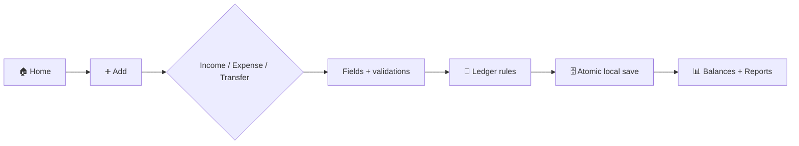

# 🎯 01 · Product Requirements Document

### The product contract behind every rupee, every account and every transaction.

[🏠 Project](../../README.md) · [📚 Docs Hub](../00-INDEX.md) · [🧭 User Flows](USER-FLOWS.md) · [✍️ Docs Standard](../governance/DOCS-STYLE-GUIDE.md)

---

> [!IMPORTANT]
> **Product planning, not delivered code.** Version 0.1 is a working requirements draft dated 2026-11-18. Final app name, visual assets, screen design and mobile store approvals remain to be determined. Screenshots provided by the owner are **functional references only**, not UI assets to clone.

## 0. Owner product-direction update · 2026-11-20

> [!IMPORTANT]
> **Future requirements only; none of the features below is shipped in Phase 0.** The current app is the five blank tabs and disabled Add described in [TM-DEC-005](../governance/DECISIONS.md#tm-dec-005--phase-0-empty-navigation-shell-and-disabled-fab). This section records newer owner instructions that **supersede conflicting older P0/P1 scope wording below**; existing INR-only SQL remains a draft and must not be implemented unchanged for mixed currencies.

| Ordered stage | Scope | Identity / remote data |
| :--- | :--- | :--- |
| **Stage 1 — Complete local app** | Cash, Bank, Wallet, Credit Card, Investment and Loan account groups; dynamic forms; core ledger/transactions/reports; Main + optional Sub Currency | SQLite primary, **no app signup**, offline tracking; **FX-rate requests only** need internet |
| **Stage 2 — Backup/restore** | Optional encrypted user-directed backup to Google Drive/iCloud Drive/file provider; integrity and restore testing | No Tio Money login; file-provider accounts/permissions may apply; **not live sync** |
| **Stage 3 — Optional Supabase** | User-selected cloud sync, migration, conflicts, multiple devices | Signup/signin only after opt-in; on-device SQLite remains working store |

**Account-group contract:** [08 — Account Groups](ACCOUNT-GROUPS-SPEC.md) defines fields, classification and testable flows. **Currency contract:** [10 — Currency](CURRENCY-SPEC.md) defines conditional Sub Currency, exchange-rate refresh at **every relevant use**, cached offline fallback and blocked finance decisions. **Identity:** [TM-DEC-009](../governance/DECISIONS.md#tm-dec-009--conditional-identity-only-for-opt-in-supabase). **Governance RFC:** [Issue #13](https://github.com/im-tnyx/Tio-Money/issues/13).

**Existing planning labels:** P0/P1/P2 and Releases A–D below represent older feature-work packages, not permission to implement Stage 2 or 3 early. Detailed implementation milestone, SQL, user flows and screen-spec synchronization will follow in separately reviewed documentation PRs.

## ✨ Executive snapshot

| Product | Experience | Delivery |
| :--- | :--- | :--- |
| **Tio Money** (working name) | **Single `+` entry** → Income / Expense / Transfer | React Native + Expo + TypeScript (planned) |
| Offline-first personal finance | Optional transfer fees **count as expense** | Expo Go core MVP; Android native SMS only via conditional custom build |
| Bank / Cash / Wallet / Credit card | One consistent asset/liability ledger | iPhone supports user-initiated imports, not automatic full inbox reading |

**The non-negotiable math:** moving ₹5,000 between your own banks does **not** create ₹5,000 expense or income. If that transfer costs ₹50, **₹50 is the expense** — not ₹5,050.

### Main interaction

**Where to go next:** [Full interaction & fee flows](USER-FLOWS.md) · [Documentation navigation](../00-INDEX.md).

---

## 1. Product vision

An offline-first, easy-to-use personal money tracker that lets people record income, expenses, transfers across their own accounts, and optional transfer charges; review daily/monthly spending; and import supported transaction alerts without double counting.

### 1.1 Goals

- Fast manual transaction entry, with clear account-level balances.
- Reliable reporting of **income**, **expenses**, and **transfer fees**.
- One consistent UI across Android and iPhone, with graceful platform-specific import options.
- Ability to run core functionality without account signup, network, or banking credentials.
- Explain and protect personal financial information.
- Keep the data model correct for both asset accounts (cash/bank/wallet) and liability accounts (credit cards).

### 1.2 Non-goals for first release

- Executing real money transfers or connecting to a bank to initiate payments.
- Reading a user's iPhone SMS inbox automatically.
- Promising Android SMS access in Expo Go or guaranteeing Play Store SMS permission approval.
- Automatic bank balance verification / direct banking credentials collection.
- Brokerage order execution, automatic investment/loan-provider connections, tax filing, loan marketplaces and multi-user business bookkeeping. **Manual Investment and Loan tracking are included in the future complete local app**, subject to ledger ADRs.
- Pixel-perfect cloning of the reference screenshots.

## 2. Users and use cases

Primary users: people who manage cash, multiple bank accounts, wallets/UPI-linked accounts, and optionally credit cards.

Example needs:

- “Aaj kitna kharch hua?”
- “SBI se HDFC mein paisa bheja; expense nahi dikhna chahiye.”
- “₹5,000 transfer mein ₹50 fee lagi; sirf ₹50 expense report mein jaye.”
- “Bank SMS aaya; app suggestion dikhaye, duplicate transaction na banaye.”
- “Credit card payment se card outstanding kam aur bank balance bhi kam ho.”
- “Internet na ho tab bhi transactions save hon.”

## 3. UX principles and fixed decisions

1. **The Home dashboard must not show three Income / Expense / Transfer shortcut cards.**
2. One prominent **+ (Add)** icon/button opens **one Add Transaction form**.
3. The single editor presents exactly three transaction-type tabs: **Income | Expense | Transfer**.
4. Screenshots **only references** for possible field structure and flow. Tio Money's layout, typography, colors, icons and components will be original.
5. Suggested color semantics: Income = positive/blue-green, Expense = red, Transfer = neutral. Final visual theme will be decided in the screen specification.
6. **Save** validates, stores and returns to previous screen; **Save & Add Another** (reference screenshot said “Continue”) stores and clears the form for another entry. Button labels may be optimized for clarity.
7. Every save/edit/delete must keep balances, history and reports in agreement.
8. All initial app text, validation errors and accessibility labels are **English only**; use centralized localization-ready strings, with INR formatting handled separately. [Owner decision TM-DEC-001](../governance/DECISIONS.md#tm-dec-001--english-only-initial-app).
9. Mandatory data is clearly distinguished from optional note, description, merchant or attachment.

## 4. Main navigation and screen requirements

### 4.1 First-run setup (P0)

- Initial onboarding has **no language selector**; use English UI copy and default INR currency.
- Create a first **ledger-bearing financial account** using the applicable [Account Group](ACCOUNT-GROUPS-SPEC.md): Cash, Bank, independently funded Wallet, Credit Card, Investment or Loan. After an eligible Bank account exists, the user may additionally create a **bank-linked Wallet reference** via the Wallet group (`wallet_kind=bank_linked_reference`, required `linked_bank_account_id`). This is **reference metadata, not another owned-funds account**: it inherits Bank currency, uses the existing Bank balance and creates **no independent opening amount, ledger account, journal event or second Net Worth asset**. **Do not imply any of this is implemented in the current blank Phase 0 shell.**
- Enter a **group-specific opening position**, never one mandatory universal amount: Cash/Bank/funded Wallet have an opening asset balance; Credit Card has opening outstanding **liability**; historical Investment uses cost basis plus optional separately dated valuation; historical Loan uses Given/Borrowed outstanding principal. A bank-linked Wallet reference has **no independent opening or funded balance**. Positive historical openings balance against opening equity, not Income/Expense; zero/reference openings do not write zero-value journal postings. See [group-specific opening contract](ACCOUNT-GROUPS-SPEC.md#21--group-specific-opening-contracts).
- App can be used without signup.
- Request permissions only when a feature needs them, with clear privacy explanations.

### 4.2 Home dashboard (P0)

- Total asset balance and (if present) liabilities/net worth shown with unambiguous labels.
- Today/month income and expense; transfer principal excluded from both.
- Recent transactions; pending imports badge when available.
- Single prominent `+` action to create a transaction. **No separate Income/Expense/Transfer shortcuts.**
- Account summaries and access to reports/history.

### 4.3 Add transaction (P0)

Common fields:
- Type tab: Income | Expense | Transfer.
- Date and time (default current local time; user may change).
- Amount: positive INR amount; validate max precision of two decimal places; store as paise.
- Optional Note and Description.

Income tab:
- Amount, Income Category, **To Account**, Date/Time; optional note/description.
- Incoming money can be flagged as transfer/reimbursement/refund when appropriate; an arbitrary account credit is not automatically income.

Expense tab:
- Amount, Expense Category, **From Account**, Date/Time; optional note/description.
- Credit card expense raises credit card outstanding, rather than subtracting an asset balance.

Transfer tab:
- Amount, **From Account**, **To Account**, Date/Time, optional note/description.
- From and To cannot be same account.
- Only movement **between accounts that the user owns/tracks** is treated as an internal transfer.
- **Fees optional**; fee input is hidden or collapsed by default. A “Fees” action reveals amount and fee-bearing account.
- Valid fee amount: zero or positive; default zero. A fee > 0 is separately categorized as **Bank Charges & Fees** (editable expense category, if relevant).
- Fee may be charged to source or destination account in V1, with explicit preview before saving.
- The transfer and associated fee expense are linked and saved atomically.
- Editing/deleting a transfer must update/delete its linked fee record consistently and preserve an audit-safe recovery strategy.
- For credit-card ↔ bank/wallet movements, update card liabilities correctly; do not count repayment/cash advance principal as income or expense, but account for actual charges.

### 4.4 Transaction history/detail (P0)

- Chronological list; filters for date range, type, account, category, and amount.
- Transaction detail shows source (manual/SMS/import), linked fee if any, reference ID where known.
- Edit, soft-delete / restore (or equivalent safe delete) and prevent accidental duplicate recording.
- Group a transfer + fee in the UI with separate accounting effects.

### 4.5 Accounts (P0)

- Add/edit/archive Cash, Bank, **funded Wallet and bank-linked Wallet references**, Credit Card, Investment and Loan in the complete local app. The Wallet group's `funded` path owns a distinct asset; its `bank_linked_reference` path creates/edits/archives **non-ledger metadata** linked to an eligible Bank, without duplicating balances. Deleting or archiving a reference must not delete, archive or change postings on the linked Bank. Use group-specific dynamic setup fields per [08 — Account Groups](ACCOUNT-GROUPS-SPEC.md); group names are **not** interchangeable with ledger account classes.
- Display current balance or credit card outstanding, with correct sign conventions.
- One UPI ID linked to a bank account must not create a second owned-funds balance unless it represents an actual separately funded wallet.
- Transactions tied to archived accounts remain in history.

### 4.6 Reports (P0)

- Daily, weekly, monthly, custom date ranges.
- Sum of income, sum of expenses, transfer fees (inside expense totals), net savings/cashflow.
- Category breakdown; transfers shown separately as movements, not included in income/expense.
- Refunds/reversals reduce the original expense category where applicable; do not inflate salary or other income.
- Separate asset, liability and net worth views when credit cards exist.

### 4.7 SMS / import review (P1; platform dependent)

- Shared import candidates pipeline: detected/imported entry → parsed → de-duplication → user review → saved/ignored.
- Pending, Confirmed, Ignored states.
- Show amount, date, direction, merchant, account match, source and confidence.
- Never silently add low-confidence or ambiguous bank alerts as income.
- Ignore OTP, promotions, available-balance-only alerts, failed/pending payment notices.
- Match user-initiated/manual entries and both sides of self-transfers before saving to avoid doubles.

**Android:** Automatic inbound SMS parsing requires a native SMS-reading/receiving integration and a **custom Expo development build**. It **does not work in Expo Go**. SMS permissions are restricted by Google Play; eligibility, declaration, disclosures and approval must be validated before shipping this feature. Build an alternative user-initiated import flow regardless.

**iOS:** A normal third-party money tracker cannot read the full iPhone SMS inbox automatically. Offer manual transaction entry, paste/share user-selected alert text where available, and user-initiated CSV/statement imports instead. Do not promise parity for automatic SMS detection.

Privacy:
- Prefer on-device parsing.
- Do not store unrelated raw SMS or OTPs; minimize retention of sensitive snippets.
- Never ask for bank passwords or OTPs.
- Make import/permission switches easy to turn off.

### 4.8 Settings (P0/P1)

- Account Groups, Main Currency, optional distinct Sub Currency, theme, default account, data export, app lock and import settings; **no language control in the initial MVP** (future localization is separately scoped). The app remains locally usable without signup; currency-rate fetching is the Stage 1 network exception.
- Export CSV; optional PDF later.
- Clear description of backup/restore and data loss risks.
- Biometric/PIN protection as a security milestone; do not imply app-lock equals database encryption.
- Encrypted Google Drive/iCloud-compatible **backup/restore belongs exclusively to Stage 2**, after the complete local app. **Supabase live sync belongs exclusively to opt-in Stage 3**, with conditional signup/signin; neither is present in Stage 1.

### 4.9 Budget and recurring entries (P2)

- Per-category/month budget, notifications and recurring transactions.
- Reference screenshot's “Rep/Inst.” repeat/instalment control is **not confirmed V1 scope**; reconsider in future requirements.

## 5. Accounting rules and examples

### 5.1 Terms

- **Asset account:** Cash, bank, funded wallet; positive balances are money owned.
- **Liability account:** Credit card; outstanding amount is money owed.
- **Net worth:** assets − liabilities.
- **Expense:** cost incurred (including fees); not necessarily an immediate asset debit if funded by credit card.
- **Transfer principal:** movement between tracked accounts/liabilities, not a new income or expense.
- **Refund / reversal:** adjusts the relevant prior cost, not generic income.

### 5.2 Plain bank-to-bank transfer without fee

SBI ₹10,000 → transfer ₹2,000 to HDFC ₹500:

- SBI = ₹8,000
- HDFC = ₹2,500
- Combined assets before and after = ₹10,500
- Income = ₹0; expense = ₹0.

### 5.3 Transfer with fee deducted from source

SBI ₹10,000 → HDFC ₹5,000 with ₹50 transfer fee charged to SBI:

- Source asset change = −₹5,050
- Destination asset change = +₹5,000
- **Expense** under Bank Charges & Fees = ₹50
- Combined asset/net worth change = −₹50
- Linked records: transfer ₹5,000 + fee expense ₹50, saved in one SQLite database transaction.

### 5.4 Fee deducted from destination

From account sends ₹5,000; destination receives ₹4,950 after ₹50 fee:

- Source asset change = −₹5,000
- Destination asset change = +₹4,950
- Expense = ₹50
- App displays clearly **sent**, **received**, and **fee** totals.

### 5.5 Credit card examples

- Card purchase ₹1,000: expenses +₹1,000; card outstanding +₹1,000; net worth −₹1,000.
- Bank repayment ₹1,000 to tracked credit card: bank assets −₹1,000; card outstanding −₹1,000; net worth unchanged; no new expense.
- Card cash advance to bank: bank assets rise, card liability rises, net worth unchanged before actual fees; any cash-advance charges are expenses.
- Avoid describing these as ordinary bank-to-bank asset transfers internally; the ledger must understand account classes.

### 5.6 Data correctness invariants

- Store INR amounts as integer **paise**, never floats.
- No negative or zero principal amount in normal add forms.
- Exclude soft-deleted records from balances/reports.
- Treat save/edit/delete as atomic writes.
- Reports derived from the same underlying ledger as account balances.
- All transaction IDs are stable; preserve original date, created/updated timestamps and import provenance.
- Deduplication uses normalized account, amount, direction, time window and reference ID when present; do not assume reference IDs are globally unique.
- Handle opening balances, refunds, chargebacks, pending/failed bank notices and SMS duplicates explicitly.

## 6. MVP phases

**Owner-stage precedence (2026-11-20):** Stage 1 = fully local functional finance app including groups and currency; Stage 2 = optional encrypted backup/restore; Stage 3 = optional Supabase + conditional identity. The historical "Release A–D" items below are **sub-milestone proposals** and must be reconciled in Document 06 before a new implementation task. **No hidden cloud dependency** is allowed in Stage 1.

### Release A — Expo Go compatible core (P0)

- Original Tio Money UI and bottom navigation.
- First-run setup and account management.
- Single + Add Transaction screen with three type tabs.
- Manual Income, Expense, Transfer and optional Fees.
- Offline Expo SQLite persistence.
- History, filters and basic reports.
- Validation, transaction editing and accounting tests.

### Release B — user-initiated imports (P1)

- Paste/selected-text import and CSV statement upload.
- Common parser/review/deduplication workflow on Android and iOS.
- Account matching and import audit states.

### Release C — Android SMS detection (conditional)

- Dedicated native Android SMS integration in **Expo development build**, not Expo Go.
- Play Store policy and permission eligibility review first.
- Bank-specific parsing fixtures, security review, user controls and test devices.
- If permission eligibility is denied, retain manual/CSV import without weakening user privacy.

### Release D — polish / later scope

- Budgets, reminders, receipts/photos, recurring and instalment entries.
- App lock, stronger local encryption strategy (may require custom build), PDF reports. **Backup is Stage 2; Supabase sync is Stage 3**, not an interchangeable polish feature.

## 7. Non-functional requirements

- Core tracking functional without network.
- No duplicate expense creation during import.
- Smooth transaction UI on both mobile screen sizes.
- Accessible tap targets, consistent date formatting and rupee formatting.
- Reliable schema migrations and documented restore behavior.
- Validation for malformed amounts, same-account transfers, missing categories/accounts and abnormal fee values.
- No upload of raw SMS without explicit consent.
- Privacy policy, permission rationale, user data deletion/export procedure before public release.
- Versioned tests for debit/credit keyword parsing; locale-specific date/time cases.

## 8. Acceptance criteria for first coding milestone

1. User can create **Cash** and **SBI Bank** accounts with opening balances.
2. Dashboard has **one + button**, and **no three action shortcuts**.
3. Tapping + opens a form with Income / Expense / Transfer tabs.
4. A ₹500 expense decreases Cash by ₹500 and increases reported expense by ₹500.
5. A ₹5,000 salary entry increases SBI by ₹5,000 and income by ₹5,000.
6. A ₹2,000 SBI → Cash transfer changes account balances but not total owned assets or income/expense.
7. A ₹5,000 SBI → HDFC transfer with ₹50 fee charged to SBI reduces SBI ₹5,050, increases HDFC ₹5,000 and reports **exactly ₹50 expense**.
8. Saving a transfer with linked fees is atomic; a database failure leaves neither half saved.
9. Editing/deleting that transfer leaves no orphaned fee or incorrect report.
10. Amount parsing supports ₹0.01 accuracy without floating-point drift.
11. Core features work in Expo Go without internet.
12. No Android automatic SMS capability is claimed or requested in Expo Go.
13. iPhone flow does not ask for or promise full SMS inbox access.

## 9. Suggested data entities (detailed schema comes next)

- `accounts` — stable identity, group/subtype, ledger classification, **conditional opening-equity event only for nonzero ledger-bearing positions**, currency and metadata; bank-linked reference types never create a second asset or opening journal, and investment valuations are separate non-posting estimates. Dynamic group-specific details never become mutable authoritative balance caches.
- `categories` — income, expense, bank charges and custom category labels.
- `transactions` — principal, type, from/to accounts, category, timestamps, source and status.
- `transaction_links` or `transfer_group_id` — transfer/fee/refund relationships.
- `import_candidates` — parsed SMS/CSV suggestions with confirmation, duplicate and ignore statuses.
- `budgets` — later release.
- `app_settings` — theme, privacy/import preferences, default/Main/Sub Currency selections; future locale preference is not a P0 UI requirement.
- `account_group_definitions` / typed account detail records — conceptual owner of dynamic setup metadata, payment capability flags, credit card billing data, investment holdings/valuations and loan terms. **Not approved SQL.**
- `exchange_rate_cache` — pair, quoted rate, provider, publication/fetch time, quality and stale status; used only in currency projections, not to mutate source transaction amounts.
- Future Stage 2 backup manifests and Stage 3 sync identity/conflict records are **out of current schema scope**.

**Open technical design task:** Choose a canonical signed ledger/journal representation before implementing balance calculations for assets, liabilities and linked fee postings. The initial two-account shortcut schema is not sufficient for all credit-card cases without explicit ledger rules.

## 10. Open decisions (to be resolved in later documents, not blockers)

- Final marketing name and brand palette (Tio Money is the working name).
- Future interactive behavior of the **single More-aligned floating +** after the present disabled Phase 0 (its existing placement is already owner-decided).
- Whether Save & Add Another should preserve last-used account, category and transaction type.
- Full receipt/attachment scope and cost.
- CSV formats/banks supported at launch.
- Which Android SMS permissions, if any, qualify under Play policy for the final distributed app.
- Stage 2 backup encryption/key custody, restore replace/merge policy and provider adapter feasibility; Stage 3 sync conflict rules/tenant isolation.
- Multi-currency signed journal, FX precision, exchange-rate provider, conversion time basis, original vs display amount, cross-currency movements and Main Currency switching; **block implementation until ADR**.

## 11. Documentation and build sequence

1. **This file:** `docs/product/PRD.md` — product scope and acceptance criteria.
2. `docs/product/USER-FLOWS.md` — navigation, validations, transfer fee, imports, errors.
3. [`docs/design/SCREEN-SPEC.md`](../design/SCREEN-SPEC.md) — unique design system and detailed screen specifications.
4. `docs/architecture/DATABASE-DESIGN.md` — SQLite ledger schema, relationships, migration plan.
5. `docs/architecture/TECH-ARCHITECTURE.md` — React Native / Expo Go boundary, modules and service layer.
6. `docs/engineering/IMPLEMENTATION-TEST-PLAN.md` — milestones, test suites, performance and store release.
7. [`docs/product/ACCOUNT-GROUPS-SPEC.md`](ACCOUNT-GROUPS-SPEC.md) — product-level account setup and group rules.
8. [`docs/product/CURRENCY-SPEC.md`](CURRENCY-SPEC.md) — currency UX, FX refresh and unresolved accounting decisions.
9. **Planned, not yet created:** Stage 2/3 backup-and-sync technical spec in a subsequent documentation PR.

**Status:** Initial planning draft. UX specifics and implementation details can evolve, but money math and platform constraints should remain explicit and testable.

---

## 📎 Navigation and document relationships

| Document | Purpose | State |
| :--- | :--- | :--- |
| [📚 00 — Documentation Hub](../00-INDEX.md) | Navigation and current state | Draft |
| **01 — Product Requirements** | Scope and acceptance contract | Draft |
| [🧭 02 — User Flows](USER-FLOWS.md) | Precise interactions and alternate cases | Draft |
| [✍️ 90 — Documentation Style Guide](../governance/DOCS-STYLE-GUIDE.md) | Visual style and truthfulness standard | Draft |

**Next documentation:** review the [original screen specification](../design/SCREEN-SPEC.md), then define the canonical asset/liability ledger, architecture, and implementation/test strategy.

[← Documentation Hub](../00-INDEX.md) · [User Flows →](USER-FLOWS.md)
